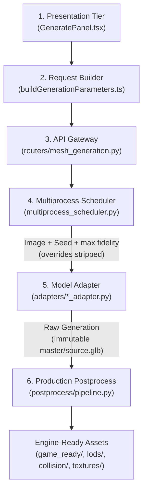
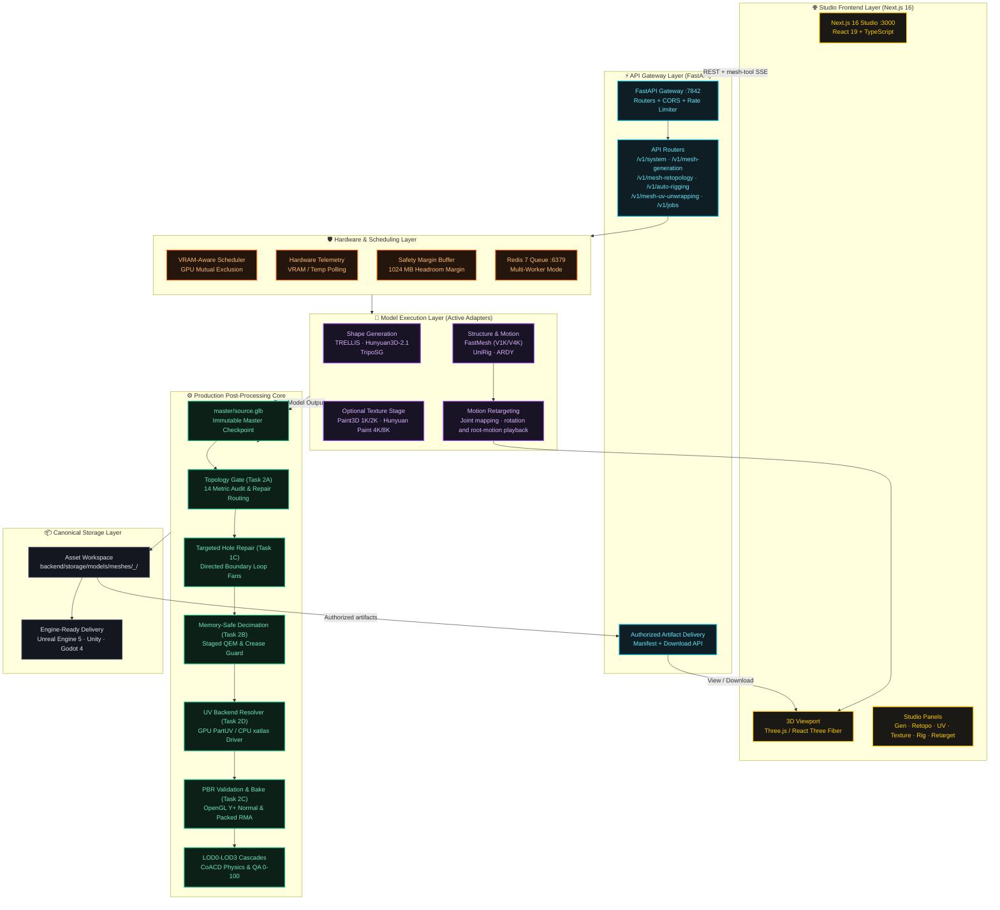
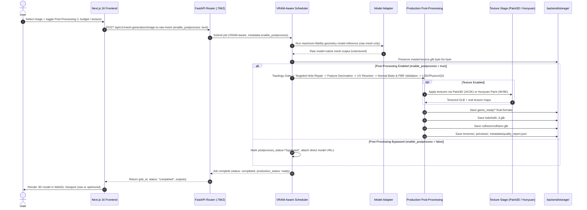

# Architecture — ForMash 3D

> **Architecture Version**: 0.1.0 (FastAPI + Next.js 16)
> **Last Verified**: October 22, 2026
> **Target Environments**: Linux (Ubuntu 20.04/22.04/24.04), Cloud GPU / Local Workstations

---

> Route and mount inventory: see `Docs/ROUTE-MOUNT-AUDIT.md` for current Next.js page aliases, workspace route validation and FastAPI router parity.

## 1. Architectural Mission & Overview

ForMash 3D is an end-to-end generative 3D asset pipeline. The system is architected around a clean separation of concerns:

- **Presentation Layer**: Next.js 16 frontend with interactive Three.js 3D viewport, studio workspace tooling, persistent asset thumbnailing/previews, real-time hardware telemetry HUD, viewport background job capsule, and model management.
- **API Gateway**: FastAPI backend (Python 3.10, Conda env `3daigc-api`) with VRAM-aware multiprocess scheduler, request validation, rate limiting, dual-store job synchronization (Redis + SQLite), and authorized artifact delivery.
- **Model Adapters**: Python adapters for each AI model (TRELLIS, TRELLIS.2, Hunyuan3D-Shape-v2-1, Hunyuan3D-Paint-v2-1, Hunyuan3D-DiT-v2-mini-Turbo, Paint3D, PartUV, UniRig, TripoSG, ARDY, FastMesh, Unique3D, Pixal3D, TaoFlowForge). Normal image-to-3D requests produce raw geometry; the scheduler runs an optional centralized texture stage after the raw master checkpoint is secured. Paint3D is used for 1K/2K, and Hunyuan3D-Paint for 4K/8K with its internal RealESRGAN step enabled automatically.
- **Scheduler & CPU Concurrency**: VRAM-aware scheduler with GPU monitoring, model-input sanitization, dual-store job synchronization (Redis + SQLite), and multi-core CPU concurrency allocating all available cores (`nproc=8`, `OMP_NUM_THREADS=8`) across scheduler workers, marching cubes, and postprocessing.

## Repository Owner Map & Safe Change Paths

Use this map to find the owner of a behavior before editing it. The generation UI contract is detailed in [GENERATION-UI-CONTRACT.md](./GENERATION-UI-CONTRACT.md); the current control-to-consumer inventory is in [GENERATION-CONTROL-AUDIT.md](./GENERATION-CONTROL-AUDIT.md).

| Concern | Source owner | Change here when… | Authoritative inputs |
|---|---|---|---|
| Workspace navigation and page mounts | `app/`, `features/workspace/`, `Docs/ROUTE-MOUNT-AUDIT.md` | A page, workspace tool, or route alias is added/removed | Next.js route files and workspace route allow-list |
| Generation UI state and serialization | `features/workspace/Panels/GeneratePanel.tsx`, `features/workspace/utils/buildGenerationParameters.ts` | A visible generation control or request field changes | UI state is serialized by the builder; no inference schedule belongs here |
| HTTP validation and job construction | `backend/api/routers/mesh_generation.py` | Request shape, intent resolution, file intake, or job metadata changes | Pydantic request model, `backend/config/smart_presets.yaml`, `backend/config/planner_rules.yaml` |
| Model choice and worker lifecycle | `backend/core/planner.py`, `backend/core/scheduler/` | Auto-selection, resource feasibility, model loading, fallback, or queue behavior changes | `backend/config/planner_rules.yaml`, `backend/config/models.yaml`, runtime probe |
| Model inference contract | `backend/adapters/` and adapter-owned model schemas | A model's native call, supported runtime input, or fixed inference profile changes | Adapter profile and model facts in `backend/config/models.yaml`; GPU behavior still requires runtime validation |
| Asset production and derivatives | `backend/postprocess/pipeline.py`, `backend/postprocess/services/` | Master promotion, repair, retopology, UV, baking, LOD, collision, QA, or export changes | `backend/config/quality.yaml`; preset recipes in `backend/config/smart_presets.yaml` |
| Quality limits and production algorithms | `backend/config/quality.yaml`, `backend/core/config.py` | A threshold, sampling policy, physics default/bound, or production recipe changes | Required config keys are validated at load; extend `backend/tests/test_config_ssot.py` |
| Cross-cutting contracts and verification | `backend/tests/`, frontend `*.test.mjs`, `.github/workflows/` | A request, artifact, route, or runtime contract changes | Focused contract tests and the CI commands documented in [CONTRIBUTING.md](../CONTRIBUTING.md) |

### Generation runtime ownership

The normal image-to-asset path is UI upload/request serialization → FastAPI validation and `JobRequest` → scheduler/resource planner → one adapter's inference → raw master persistence → optional `postprocess.pipeline.run_postprocess_job` → derivative artifacts and QA report. The scheduler owns worker/resource selection and job state; it does not implement mesh repair, retopology, baking, LOD, or collision algorithms. A request with post-processing disabled returns the raw result and bypasses those production stages.

For a behavior change, update the owning implementation and its contract test first, then update the linked contract/API docs and verify the targeted CI command. Do not copy thresholds, model profiles, or intent recipes into a second owner.

### Model-Native Source Fidelity Contract
- Fixed model-specific inference profiles belong to adapters; the scheduler removes request overrides for migrated adapters instead of holding duplicate numeric profiles. Seed and image identity remain caller-controlled.
- Hunyuan3D-Shape-v2.1 locks the effective dev scheduler values in its adapter: octree resolution 1300, 150 steps, guidance 5.0, 80,000 chunks, and the native dense decoder with marching cubes. These are preserved runtime values, not a claim of GPU or quality validation; the resolution carries OOM risk.
- TripoSG locks the effective dev scheduler values in its adapter: 100 steps, guidance 9.0, dense depth 10, hierarchical depth 11, and no Flash decoder. Its current depth resolver does not automatically downgrade from supplied VRAM estimates. GPU quality/VRAM benchmarking has not been performed for these settings.
- Hunyuan3D-DiT-v2-mini-Turbo is adapter-owned like the other migrated profiles: its adapter locks octree resolution 768, 20 steps, guidance 7.5 and 80,000 chunks. These runtime values must not be retuned as a side effect.
- TRELLIS locks 100 sparse/slat sampling steps, guidance 7.5 and `simplify=0.0` in its adapter; TRELLIS.2 locks the `1536_cascade` pipeline with a 524,288 max-token budget.
- Pixal3D locks the `1536_cascade` pipeline at resolution 2048; Unique3D locks `input_processing=true`, `do_refine=true` and `expansion_weight=0.1`; TaoFlowForge locks `fill_holes=true` and `offload="auto"` for progressive native mesh generation.
- The scheduler strips downstream-only target/decimation/remesh controls before adapter inference.
- Raw extraction ceilings remain model-specific; only explicit hardware safety guards may lower them.
- Normal image-to-3D routes return raw geometry; optional texture presets are handled after master promotion (Paint3D 1K/2K, Hunyuan3D-Paint 4K/8K). Legacy textured model IDs resolve to raw-generation aliases.
- master/source.glb is immutable; retopology, UV, LOD, collision, and bake operations act on derived artifacts.

### Intent Preset Production Budgets

Intent presets live in `backend/config/smart_presets.yaml` (version 1) and define the default production budget of a request:

| Intent | Target polycount | Atlas | LOD | Collision | Auto-rig | Printability | Auto-repair |
|---|---:|---:|---|---|---|---|---|
| `mobile` | 20,000 | 1024 | on (`mobile` preset, 4 levels) | off | off | off | off |
| `game_ready` | 50,000 | 1024 | on (`high` preset, 4 levels) | on | off | off | off |
| `cinematic` | 200,000 | 2048 | on (`high` preset, 4 levels) | off | off | off | off |
| `animation` | 30,000 | 1024 | on (`high` preset, 4 levels) | off | on | off | off |
| `3d_print` | 0 (native passthrough) | 0 (none) | off | off | off | on | on |
| `native` | -1 (backend-only sentinel) | 0 | off | off | off | off | off |

- `native` is a backend sentinel (`backend/core/smart_presets.py`), not a YAML preset entry. The workspace's Native card reaches the same Native/Raw outcome by setting `enable_postprocess=false`.
- Production-option precedence is explicit request value > intent preset > backend default (`_resolve_preset_option`).
- `texture_resolution`, `enable_printability_check`, `enable_auto_repair`, `enable_auto_rig`, `physics_enabled`, `generate_lod`, `lod_preset` and `lod_count` are tri-state request fields: omitting them lets the intent preset supply the value.
- `target_polycount` follows its own rule: an explicit value > 0 or the `-1` native sentinel wins, `0` means "no explicit budget" and falls back to the intent preset. Native/Raw output is requested with `intent=native` or `enable_postprocess=false`.
- The request builder sends only `seed` inside `model_parameters`; legacy `generateLOD` / `lodPreset` / `lodCount` keys are ignored and never reach job inputs.

### End-to-End Pipeline Contract & Responsibility Boundaries

The generative asset pipeline enforces strict separation of concerns across six architectural tiers. No stage may blur or bypass boundary contracts:



| Tier | Component | Primary Responsibilities | Data Handled & Stripped |
| :--- | :--- | :--- | :--- |
| **1. UI** | `GeneratePanel.tsx`<br>`GenerationPresetDrawer.tsx` | Clean generation studio. Image intake, model selector with live hardware readiness, single Target Polycount / intent-preset card (`mobile`, `game_ready`, `cinematic`, `animation`, `3d_print`, `native`), and an uncluttered Advanced drawer with real production controls (candidates 1–4, quad/tri, normal baking, LOD levels, repair, physics colliders). Presets configure parameters non-destructively; clicking a preset **never** auto-submits. | Emits user settings state. Exposes no fake inference sliders (steps, guidance, octree resolution, sampler overrides). |
| **2. Request Builder** | `buildGenerationParameters.ts` | Pure client serialization function. Maps intent presets and explicit polycount budgets into clean API payloads for `POST /api/v1/mesh-generation/image-to-raw-mesh`. Isolates target budgets and postprocessing flags; `model_parameters` carries only `seed`. | Emits `endpoint`, `body`, `modelParameters`. Does not construct or duplicate adapter-owned numeric inference schedules. |
| **3. API Gateway** | `mesh_generation.py`<br>`smart_generation.py` | Pydantic request validation and job queuing. Accepts production settings (`intent`, `target_polycount`, `candidate_count`, `generate_lod`, `lod_preset`, `lod_count`, `physics_enabled`, `bake_normal_maps`, `enable_postprocess`, etc.) and resolves each production option as explicit request value > intent preset (`backend/config/smart_presets.yaml`) > backend default. Routes to deterministic planner when active. | Enqueues job with request inputs. Legacy inference-style fields (`requested_quality`, `mesh_style`, `object_type`, `symmetry`) are accepted for planner routing only and never reach adapter inference; legacy `model_parameters` keys (`generateLOD`, `lodPreset`, `lodCount`) are popped and ignored. |
| **4. Scheduler** | `multiprocess_scheduler.py` | VRAM allocation, GPU dispatch locks, Best-of-N multi-seed scheduling (`candidate_count` 1..4), and composite quality scoring (`_score_and_select`). Strips all post-process only fields (`_POSTPROCESS_ONLY_INPUTS`) and adapter-owned inference keys (`_ADAPTER_OWNED_INFERENCE_INPUTS`). | Passes `image_path`, `seed`, `source_quality="max"` plus adapter-owned inputs to the adapter. Retains production budgets (`target_polycount`, `generateLOD`, `lodPreset`, `lodCount`, `physics_enabled`, texture options) for post-processing. |
| **5. Model Adapter** | `adapters/*_adapter.py` | Model execution in dedicated worker processes. Owns locked native inference profile (`_LOCKED_INFERENCE_PROFILE`). Produces high-fidelity raw extraction without decimation or quality reduction. | Overwrites request-side inference parameters with locked schedule. Saves immutable raw mesh to `master/source.glb` with SHA-256 hash. |
| **6. Production Pipeline** | `postprocess/pipeline.py` | Post-generation finishing engine. Reads immutable `master/source.glb` and executes production recipe stages based on the selected intent preset and advanced flags: Topology Gate $\to$ Hole Repair $\to$ Quad/Tri retopology $\to$ Decimation $\to$ UV unwrapping $\to$ Normal bake $\to$ Texture stage $\to$ Game-ready export $\to$ LODs $\to$ Collision hull $\to$ Preview/QA. | Produces production derivatives (`game_ready/`, `lods/`, `collision/`, `textures/`, `quality_report.json`). Never mutates `master/source.glb`. |


### Hunyuan Runtime Loading & Shared Dependencies

### UniRig attention selection and FastMesh resource admission

- UniRig chooses SDPA only when the active Transformers causal-LM class advertises `_supports_sdpa`; unsupported architectures such as OPT use eager attention. A GPU-wide fallback alone does not prove every model architecture supports SDPA.
- UniRig Pointcept `SerializedAttention` checks the current CUDA device before enabling FlashAttention: compute capability 8.0+ may use FlashAttention; pre-Ampere, unknown-capability, or no-FlashAttention environments use its eager implementation. Attention dropout remains an `nn.Dropout` module so the eager path can run both directly and after a FlashAttention runtime failure.
- The shared TorchCluster FPS fallback imports PyTorch lazily before defining the typed function, preventing missing-name failures when the optional `torch_cluster` package is absent.
- FastMesh V1K/V4K can use Accelerate `infer_auto_device_map` + `dispatch_model` when one GPU cannot meet the reservation. Loading fails explicitly unless the generated device map places layers on at least two reserved GPUs. The 16,384 MB / 24,500 MB budgets remain conservative project reservations, not upstream-published minimums.
- Hunyuan3D-Paint bounds raster interpolation and UV attribute extraction in 128-row chunks to avoid giant full-frame gather temporaries. Its mesh renderer/super-resolution stage stays on the first selected device; multiview diffusion can run on the second selected device.
- The scheduler's VRAM estimate is capped by live `torch.cuda.mem_get_info()` data so memory consumed outside the scheduler's own reservations is not treated as free. Aggregate VRAM is considered only for declared, supported dispatch strategies, and incomplete multi-GPU dispatch fails closed.
- Paint3D does not advertise multi-GPU placement: its isolated child-stage processes currently run on one selected GPU, so adding their VRAM together would be a false capacity guarantee.
- Rigged assets invalidate stale thumbnails so the viewer generates a preview from the new GLB. The viewport resolves canonical `artifact_format` query values before falling back to asset metadata; the browser-facing rigged artifact is GLB and native FBX remains separately downloadable.


### Multi-GPU placement and rigged artifact contracts
- Model manifests may advertise multi-GPU only when an adapter applies a real layer or component placement strategy. The scheduler passes per-device memory budgets to Accelerate; device-map/component placement must use at least two reserved GPUs or raise a runtime error rather than silently running on one card.
- FastMesh layer sharding uses the scheduler's selected GPU IDs and memory limits. Hunyuan3D-Paint uses explicit component placement, with the renderer pinned to the first selected GPU and multiview diffusion on a second when available.
- Live free VRAM is measured alongside tracked allocations to account for CUDA processes and work that did not originate in the current scheduler.
- The rigging adapter stores both native `rigged.fbx` and a converted `rigged.glb`; the viewport must load the GLB by default and only use FBX when the canonical artifact URL asks for FBX. A changed geometry clears the old preview thumbnail.

### Runtime failure and readiness contracts
- Hunyuan3D-Paint's adapter-level Numba/cache and safe-background-remover helpers also use the canonical backend compatibility loader. This avoids a cached generic `utils.torchvision_fix` silently selecting the Shape or Paint vendored helper for adapter-owned fallback logic.
- Backend CI runs Python source compilation plus CPU-only compatibility, source-contract, and resource-planner tests; frontend CI runs dependency installation, TypeScript checking, and production build. These lanes do not run GPU/checkpoint-backed inference or measure actual peak VRAM.

- ModelFactory and UniRig load the main backend TorchVision/Transformers compatibility helper by a canonical file path under a private module name; they do not rely on whichever third-party `utils.torchvision_fix` Python resolves first.
- The generic `utils` package can still resolve model-specific Shape utilities by design, so third-party code must continue to use an adapter-scoped path or its own package-qualified import. Runtime helper lookup must not depend on this package search order.

- The CPU contract suite imports the main-repo TorchVision helper by file path to avoid accidentally resolving the identically named Hunyuan Shape utility module, which correctly depends on the full model runtime.
- Lightweight source-contract tests now cover BaseModel error-state/cause-chain behavior, Paint3D child-stage preflight and UV validation, and the UniRig/ARDY/ModelFactory exception-chain contracts.

- The shared `backend.utils` package retains the pre-existing Hunyuan Shape utility path for shape-generation compatibility but no longer globally registers the Hunyuan Paint utility path; Paint imports are scoped to its initialization.
- The dependency-contract test now validates the current shared baseline declared in `backend/requirements.txt` and verifies that TripoSG does not duplicate those centrally managed dependencies. This changes test expectations only; requirement files remain unchanged.

- Hunyuan3D-Paint preserves processing-stage exception causes with `raise ... from e` and traceback logging, not only loader-stage causes.
- A local DINOv2 checkpoint is selected only when both `config.json` and at least one recognized model-weight file exist; incomplete local caches trigger an explicit warning before the remote fallback.
- Backend Runtime Contract CI checks out recursive submodules because the existing dependency-contract suite reads reference metadata from a vendored submodule. This lane runs source compilation and CPU-only contracts, not GPU inference.

- Hunyuan3D-Paint temporarily adds its vendored utility path only during model initialization and restores both `sys.path` and the shared `utils.__path__` in `finally`; the shared utils package no longer globally adds third-party paths.
- Hunyuan3D-Paint retries no longer purge shared `sys.modules` entries. Missing local texture or DINO checkpoints are logged before selecting a remote repository fallback.
- ARDY reads its vendored `pyproject.toml` dependency declarations and warns about installed-version mismatches before inference; the check is diagnostic only and does not modify the shared environment or block loading.
- ARDY is manifest-declared CPU-only: the resource planner returns a CPU plan with no GPU IDs/VRAM reservations, and its dedicated worker hides CUDA before worker initialization. The adapter explicitly loads the motion model and local LLM2Vec text encoder on CPU.
- ARDY forces TEXT_ENCODER_DEVICE=cpu and local float32 text encoding to prevent a text-encoder API/CUDA fallback. CPU inference is slower and requires sufficient host RAM and access to the gated text-encoder checkpoint.
- `BaseModel.load()` preserves the original exception as the chained cause. A lightweight CPU backend CI lane compiles backend Python and runs dependency-contract tests; it does not replace GPU/checkpoint-backed smoke tests.

- The Transformers HybridCache import fallback aliases the available real DynamicCache/Cache implementation and logs that HybridCache-specific behavior is not reproduced; it no longer creates an empty compatibility subclass.
- TorchVision native/operator import errors are captured during helper import so diagnostics remain importable, and compatibility setup failures are reported at warning level with the traceback rather than silently skipped.
- ModelFactory and model adapters retain the original exception chain during import/construction failures. Diagnostic logs identify the adapter/model without dumping the full configuration.
- UniRig's default source and checkpoint roots are resolved from the adapter file, not the process working directory.
- Hunyuan3D-Paint returns a background_removal mode/degraded marker and fallback reason when it uses a safe or identity fallback.

- BaseModel.process preserves ERROR after a failed request; only a successful request returns the model state to LOADED.
- UniRig import failures report the actual exception type/message and missing module when available. Blender bpy is described as the cause only when the original exception supports that diagnosis.
- Paint3D initialization imports both child-stage entry-point graphs in a fresh subprocess using the production interpreter, working directory, PYTHONPATH, and GPU visibility before marking the runtime ready.
- Paint3D validates finite per-vertex UV coordinates after the unwrap attempt. If automatic unwrap fails and UVs are invalid, the request stops at mesh preparation with the original cause rather than failing later in texturing.
- Hunyuan3D-Paint reports BackgroundRemover import-time ImportError and native-library OSError with their chained cause; model-load failures retain traceback context.

- The Python 3.10 / PyTorch 2.6 + CUDA 12.4 environment pins `transformers==4.48.3` to satisfy Mini Turbo's upstream minimum and PEFT's `HybridCache` import; `diffusers==0.30.3` remains unchanged.
- Shape imports `hy3dshape.pipelines` and `hy3dshape.rembg` from the vendored package root. Mini resolves its vendored `hy3dgen` root before importing and validates both source files and the checkpoint subfolder.
- Model adapters log chained initialization exceptions; the multiprocess worker stores the full traceback in backend logs and returns a concise initialization summary to the client.

### Pipeline Planner v0 and Runtime Probe contracts (Task 1E)
- `backend/core/runtime_probe.py`: Returns a uniform runtime capability payload (`probe_runtime()`) including live VRAM (`torch.cuda.mem_get_info`), peak allocated memory, host RAM (`psutil`), installed adapter classes (`_ADAPTER_MAP`), enabled models from `models.yaml`, and license opt-in state.
- `backend/core/planner.py`: Pure function `plan_generation(request, runtime, rules)` dynamically routes requests based on quality tier, mesh style, object type, VRAM budgets, and license opt-in. When a preferred candidate fails runtime checks, it recomputes the entire plan (adapter, preset, seeds, retopo permission, UV backend) rather than patching individual fields.
- `BaseModel`: Initialized with `native_topology: bool = False` flag to differentiate dense marching cubes / implicit field adapters from native topology generators.

### Quality Metrics Library and Master Immutability Audit (Task 1A)
- `backend/core/quality/metrics.py`: Pure trimesh/NumPy calculation function `compute_mesh_metrics(mesh, reference_master=None)` evaluating 14 topological and geometric metrics:
  - `triangle_count`, `vertex_count`, `is_watertight`, `non_manifold_edges`, `non_manifold_vertices`
  - `hole_count` (boundary loop count) and `boundary_loop_sizes`
  - `connected_components` and `floater_ratio` (share of vertices in components < 0.5% total)
  - `degenerate_faces` (zero-area or collinear faces)
  - `aspect_ratio_p1` and `aspect_ratio_p5` (1st and 5th percentile triangle radius-edge aspect ratios)
  - `uv_island_count` (face-adjacency chart components when visual UVs are present)
  - `feature_edge_retention` (share of master edges with dihedral angle > 30.0° retained within angle/distance tolerance; 1.0 if no sharp edges or master is None)
  - Master immutability audit logic: `sha256_file` and `audit_master_immutability` guaranteeing working copies preserve exact SHA-256 master lineage.
- `backend/core/quality/parity_scorecard.py`: Competitive benchmarking scorecard generator producing `parity_scorecard.json` across rows (`sharpness`, `topology_cleanliness`, `uv_quality`, `texture_quality`, `speed`, `failure_rate`) and columns (`ForMash3D`, `Tripo`, `Meshy`, `Hyper3D`).

### Input Image Prep Module (Task 1B)
- `backend/core/preprocess/image_enhancement.py`: Pillow/RealESRGAN preprocessing for 3D generation intake without mutating the source image; it writes an approved preprocessing artifact instead.
  - `preprocess_image(source_path, *, profile="default", remove_background=True, auto_crop=True, upscale=True, sharpen=False)`: removes the background, crops to the subject, optionally upscales low-resolution inputs, and returns the preview/approved paths plus metadata (mask occupancy, crop bounds, border coverage, connected components, resize survival, approval status).
  - `load_preprocessed_artifact(artifact_id, variant="approved", *, allow_review=False)`: resolves an approved artifact by ID; a non-approved artifact is rejected unless an explicit review override is supplied.

### Intent Presets, Targeted Hole Repair & Best-of-N Seed Scorer (Tasks 1C & 1D)
- `backend/config/smart_presets.yaml`: Configures the production intent presets (`mobile`, `game_ready`, `cinematic`, `animation`, `3d_print`; `native` is a backend-only sentinel) with their target polycounts, atlas sizes and LOD/collision/rig/printability/repair flags. Model inference schedules (octree resolution, steps, guidance, VRAM budgets) are no longer configured here; they belong to each adapter's `_LOCKED_INFERENCE_PROFILE`.
- `backend/config/quality.yaml`: Owns the targeted hole repair limits (`holes.max_hole_vertices: 50`, `holes.max_hole_perimeter: 0.5`).
- `backend/postprocess/services/hole_repair.py`: `repair_holes_targeted` inspects boundary loops using directed edge traversal and fills loops `<= max_hole_vertices` with boundary fans, preserving non-hole geometry completely untouched.
- `backend/core/scheduler/seed_scorer.py`: `score_seed_candidate` and `select_best_candidate` compute weighted composite quality scores using the fixed reference ranges from `quality.yaml` (`seeds.*`), supporting early termination (`score >= 0.85`) and tie-breaking by feature edge retention.

### Topology Gate & Repair Routing (Task 2A)
- `backend/config/quality.yaml`: Declares the topology gate thresholds for non-manifold edges (0), non-manifold vertices (0), holes (0), floater ratio (0.005), degenerate faces (0), and aspect ratios (p1 >= 0.05, p5 >= 0.10).
- `backend/postprocess/services/gate.py`: `evaluate_topology_gate(mesh, plan=None, strict=False)` inspects geometry without mutating inputs; returns repair decision (`skip_repair`, `minimal_repair`, `full_repair`) and `skip_retopo` flag adhering to `plan.skip_retopo_allowed`.

### Memory-Safe Staged Decimation & Feature Retention (Task 2B)
- `backend/config/quality.yaml`: Sets `decimation.memory_safe_threshold_triangles: 2000000`, `decimation.max_deviation_deg: 45.0`, `decimation.max_ram_fraction: 0.80`, with the 35.0° crease angle inherited from `shared.feature_edge_angle_deg`.
- `backend/postprocess/services/memory_safe_decimate.py`: `memory_safe_decimate(mesh, target_faces, ...)` operates strictly on copies. Under 2M triangles, uses QEM feature-preserving decimation protecting crease planes and boundaries. Over 2M triangles, engages staged 50% reduction chunks with psutil RAM monitoring and aggressive garbage collection.

### Tangent Normal Detail Bake & PBR Asset Validation (Task 2C)
- `backend/config/quality.yaml`: Configures tangent-space OpenGL (Y+) normal baking (`bake.*`), cage/ray distances, atlas resolution, and minimum UV utilization (60%).
- `backend/postprocess/services/pbr_validator.py`: `validate_pbr_asset` validates game-ready GLB assets across non-degenerate textures, packed roughness (G) / metallic (B) channels, OpenGL Y+ normal convention, strictly in-bounds [0, 1] UVs, and atlas space utilization.

### UV Backend Resolver & Unwrap Driver (Task 2D)
- `backend/config/quality.yaml`: Configures the PartUV triangle threshold (500k), VRAM requirements (7.0 GB), default backend (`auto`), and fallback backend (`xatlas`).
- `backend/postprocess/services/uv_backend_resolver.py`: Single source of truth resolving between GPU PartUV (for meshes >= 500k tris when CUDA/VRAM permit) and CPU/GPU xatlas; `execute_uv_unwrap` produces unwrapped non-overlapping UVs without mutating source geometry.

### Postprocess Pipeline Orchestrator Integration (Task 2E)
- `backend/postprocess/pipeline.py`: Connects Topology Gate, targeted hole repair, memory-safe decimation, UV unwrapping, and PBR validation into `run_postprocess_job` while strictly enforcing master immutability (`master/source.glb` SHA-256 verified identical before and after postprocessing).

### Headless Preview Render Contract
- `backend/postprocess/tools/thumbnail_worker.py` renders the asset preview in an isolated Blender subprocess (Cycles on the CPU, 512px, transparent film). The denoiser is **optional**: the bpy wheel and some distribution builds ship without OpenImageDenoise, and Cycles then aborts the render with "Error: Build without OpenImageDenoiser". The worker reads the build flag and the Cycles denoiser enum before rendering, falls back to no denoising with a higher sample count, and retries without denoising if the render still fails. A missing preview is a warning, never a failed job.

### Deterministic Planner v1 & Model Capability Contracts (Task 3B)
- `backend/config/planner_rules.yaml` & `backend/core/planner.py`: Configures benchmark-driven rules per object type (`mechanical`, `organic`, `character`, `general`) and quality tier (`fast`, `balanced`, `high`). Dynamically selects adapter, preset, seed count, feature-aware retopology mode, and UV backend. Full plan recomputed on any fallback.

### Seed Plan and Runtime Telemetry Contract
- The planner's `num_seeds` is a **plan value**, not an execution count. It is only executed when `planner_rules.yaml` sets `apply.auto_seeds: true`; the user's `candidate_count` always wins, and the candidate count is capped by `quality.yaml` `seeds.max_candidates`. `backend/core/planner.py::resolve_seed_plan` is the single place that resolves this into the candidate count and the exact seed schedule (`base_seed + index * seed_step`, with the requested seed as the base).
- The worker reports what actually runs: `[RUNTIME PARAMETERS]` carries `candidate_count`, `planned_candidate_count`, `auto_seeds_enabled` and `seed_schedule`, `[SEED PLAN]` repeats the decision in one line, and the start box shows the candidate count and the seed schedule instead of the base seed alone. Adapter-owned inference values (steps, guidance) are reported after inference as `[EFFECTIVE PARAMETERS]` from the adapter's own `generation_info`, because the adapter profile is clamped inside the adapter (for example TRELLIS caps its stage steps at 50).

### Final Parity Benchmark & Competitive Scorecard (Task 3D)
- `scripts/run_final_parity_benchmark.py`: Evaluates canonical test shapes (cube, sphere, cylinder, mechanical prop) comparing raw baseline vs postprocessed meshes across triangle count, hole count, non-manifold edges, feature-edge retention, UV utilization, and PBR validation.
- Output artifacts: `Docs/baseline_vs_now_benchmark.json` and `parity_scorecard.json` containing authoritative competitive comparisons across ForMash3D, Tripo, Meshy, and Hyper3D.



---

## 2. Component Layers

### 2.1 Presentation Layer (Next.js 16)

| Component | Path | Description |
|---|---|---|
| **App Router** | `app/` | Next.js 16 App Router with server components, layouts, and API proxy routes |
| **Workspace Shell** | `features/workspace/WorkspaceShell.tsx` | Main workspace UI with tabbed panels, persistent asset store, and model viewport |
| **API Client** | `services/apiClient.ts` | Unified axios client for all FastAPI backend REST/SSE communication |
| **3D Canvas** | `features/workspace/Viewport/MeshViewer.tsx` | High-performance Three.js WebGL viewport with zero-allocation shading switcher, event-driven reflection capture, TransformControls 3D manipulator, axial camera presets, physics smoke test, and HUD background job capsule |
| **Mesh Diff Viewer** | `features/workspace/Viewport/MeshDiffViewer.tsx` | Side-by-side comparative WebGL mesh inspection with uncoupled requestAnimationFrame loop and synchronized dual-scene orbit controls |
| **Telemetry HUD** | `components/Header.tsx` | Real-time vertical-pipe hardware gauges (VRAM/RAM/CPU) with saturated load colors and outside-click auto-dismissal |
| **Asset Persistence** | `stores/useAppStore.ts` | Durable image & mesh reference tracking backed by `/api/v1/file-upload/` persistent storage endpoints |
| **State Stores** | `stores/` | Zustand stores for global client state (`useAppStore`, `useViewerStore`, `useAnimationStore`, `useRiggingStore`, `useUIStore`) |
| **Data Fetching** | hooks + TanStack Query | Server-state caching and synchronization for job status |
| **Icon System** | `@hugeicons/react` + `@hugeicons/core-free-icons` | Primary icon library; replaces `lucide-react`. Mapping documented in `components/icons/hugeicons-mapping.ts` |
| **Admin Database Tab** | `features/admin/tabs/DatabaseTab.tsx` | Database administration surface (`/admin?tab=database`): cross-store stats cards, paginated jobs table with per-row cancel/delete, checkbox multi-select bulk delete by ids/status/feature, read-only Redis key inspector, and typed-confirmation danger-zone clear actions for jobs and file metadata |

### ADR-009: Hugeicons as Frontend Icon Library
**Decision**: Migrate frontend icon system from `lucide-react` to Hugeicons.
**Reason**: Consistent icon weight, broader free icon set, no external font dependency, and first-class React tree-shaking.
**Scope**: 75+ files migrated including all `components/ui/*`, `features/workspace/**`, `features/admin/**`, and `features/settings/**`.

### 2.2 API Gateway Layer (FastAPI)

Located at `backend/api/`:
- **Entry Points**: `main_singleworker.py` (embedded scheduler) and `main_multiworker.py` (Redis queue). Python 3.10 via Conda env `3daigc-api`.
- **API Routers**: REST controllers for system info, file upload, mesh generation/editing, auto-rigging, segmentation, retopology, UV unwrapping, user management, and database administration (`backend/api/routers/database.py`: stats, Redis key inspector, guarded bulk job/file cleanup).
- **Configuration** (`backend/core/config.py`): Pydantic V2 settings loaded from `.env` and YAML config files (`system.yaml`, `models.yaml`).
- **Static File Server**: Optimized binary streaming for 3D formats (`.glb`, `.gltf`, `.fbx`, `.obj`, `.stl`) with cache headers.
- **Auth Service** (`backend/core/auth/`): Optional Redis-based authentication controlled by `P3D_USER_AUTH_ENABLED`.

### Admin master.log streaming contract

The Admin Logs tab treats `logs/master.log` as the canonical source and streams the complete file plus appended writes through SSE. Data is transported as UTF-8 chunks with file-identity and byte-offset event IDs, so blank lines, whitespace, CR/CRLF control characters, partial lines, and Unicode are not line-parsed or filtered. The proxy forwards `Last-Event-ID` for gap-free reconnects; pause/resume continues from the last consumed offset. Truncation or rotation emits a reset event. UI batches only DOM updates, not log retention.

### 2.3 Model Execution Layer

| Component | Path | Description |
|---|---|---|
| **Scheduler Factory** | `backend/core/scheduler/scheduler_factory.py` | Creates dev/prod scheduler instances |
| **Multiprocess Scheduler** | `backend/core/scheduler/multiprocess_scheduler.py` | VRAM-aware scheduler with GPU mutual exclusion, coarse mesh integration, and batch queueing |
| **GPU Monitor** | `backend/core/scheduler/gpu_monitor.py` | Real-time VRAM and temperature polling |
| **Job Queue** | `backend/core/scheduler/job_queue.py` | Job request models and types |
| **Redis Job Queue** | `backend/core/scheduler/redis_job_queue.py` | Redis-backed distributed job queue with dual Redis/SQLite atomic deletion synchronization |
| **Model Adapters** | `backend/adapters/` | Python inference adapters (TRELLIS, TRELLIS.2, Hunyuan3D-Shape-v2-1, Hunyuan3D-Paint-v2-1, Hunyuan3D-DiT-v2-mini-Turbo, PartUV, UniRig, TripoSG, ARDY, FastMesh, **Unique3D**, **Paint3D**, Pixal3D, TaoFlowForge). Normal image-to-3D geometry models output untextured raw geometry only, routed through `OutputPathGenerator` into canonical storage (`backend/storage/models/meshes/`). TripoSG uses its upstream Y-up extraction orientation without an extra rotation. |
| **Raw Geometry Fidelity Contracts** | `backend/adapters/hunyuan3d_decoder_profile.py` | Enforces native dense extraction for Hunyuan3D models: `VanillaVolumeDecoder` + `MCSurfaceExtractor` with `mc_algo="mc"`. Fails fast if VAE doesn't switch from FlashVDM. Mini Turbo locks `octree_resolution=768`. TripoSG locks `dense_octree_depth=10` and `hierarchical_octree_depth=11`; its depth resolver does not downgrade from supplied VRAM estimates. |
| **Texture Synthesis Pipeline** | `backend/adapters/hunyuan3d_paint_v21.py` & `backend/adapters/paint3d_adapter.py` | Centralized texture adapters (Paint3D for 1K/2K, Hunyuan3D-Paint for 4K/8K) operating downstream on post-processed raw mesh geometry. RealESRGAN x4+ super-resolution and DifferentiableRenderer for PBR validation. |

### 2.4 Storage Layer

Located at `backend/storage/`:
- **Uploads** (`uploads/`): User-uploaded reference images, image manifests, and matching mesh thumbnails.
- **Uploaded Mesh Workspaces** (`models/meshes/upload_<file-id>/`): Immutable original source at `master/source.<ext>` and its durable `metadata/asset.json` manifest. The manifest records source identity, original name/format, byte size, SHA-256, and upload time; Redis or the single-worker in-memory store is an index/cache.
- **Models** (`models/meshes/<asset_name>_<job_id>/`): Canonical per-generation mesh asset workspaces.
- **Asset workspace**: `master/` (`source.glb` immutable master), `game_ready/` (engine-optimized final output), `lods/` (LOD0..3), `collision/` (CoACD convex decomposition derived from final `game_ready.glb`), `textures/`, `previews/`, and `metadata/` (`quality_report.json`, `asset.json`, `physics.json`). Directory creation is deferred until writing begins.
- **ZIP delivery**: Generated on demand from the canonical workspace; no persistent `exports/` tree is required.

Upload manifests restore file-ID resolution, listing, and counts after restart. Mesh uploads are limited to 200 MiB, 210,000 vertices, and 210,000 faces; geometry parsing runs in at most two AnyIO worker threads. `.gltf` uploads must contain buffers and images as data URIs; external dependencies are not fetched. Upload deletion owns only its source, manifest, and matching thumbnail, not generated job workspaces.

Image-to-3D preprocessing tests for real transparency rather than alpha-channel presence, preserves the foreground alpha through RealESRGAN or Pillow resizing, and records mask occupancy, crop bounds, border coverage, connected components, and resize survival. Only a validated foreground receives an approved artifact. Failed removal is blocked; suspicious or unvalidated previews require an explicit review override at the generation API, and the override is retained in job provenance. The original image remains unchanged.

### 2.5 Local Wheelhouse

Prebuilt wheels are cached at `backend/thirdparty/wheels/` (inside the main ForMash3D repository). The `download_and_install_release_wheels()` function in `scripts/setup.sh` fetches all `.whl` files from the `ForMash3D/releases/tag/Wheels` GitHub Release and installs them. The install script (`backend/scripts/install.sh`) uses `--find-links="$WHEEL_DIR"` to prefer local prebuilt wheels when installing dependencies, falling back to PyPI/index/Git when no compatible wheel exists. Wheels are automatically downloaded from the ForMash3D GitHub Release at runtime into `backend/thirdparty/wheels/`.

---

## 3. Performance Optimizations

| Optimization | Target Layer | Mechanism | Impact |
|---|---|---|---|
| **GPU Mutual Exclusion** | Scheduler | Strict process locking | Prevents GPU OOM during concurrent inference |
| **GPU Monitoring** | Scheduler | Real-time VRAM/temperature polling | Dynamic scheduling decisions |
| **VRAM Safety Buffer** | Scheduler | `VRAM_SAFETY_MARGIN_MB=1024` | Ensures 1GB free margin after each job |
| **Auto Unload** | Scheduler | `AUTO_UNLOAD_AFTER_JOB=true` | Frees VRAM between jobs |
| **Connection Reuse** | Frontend | Axios singleton (`services/apiClient.ts`) | Eliminates per-request overhead |
| **SSE Streaming** | API Gateway | Server-Sent Events for progress | Real-time feedback without polling |
| **Tensor Core Acceleration** | Backend | `torch.backends.cuda.matmul.allow_tf32 = True` | 3x-8x matmul speedup on Ampere/Ada/Hopper |
| **Inference Mode** | Backend | `torch.inference_mode()` | Eliminates autograd graph tracking overhead |
| **Pydantic Serialization** | Backend | FastAPI native Pydantic response model serialization | 10x-20x faster JSON serialization |
| **GZip Compression** | Backend | `GZipMiddleware(minimum_size=1000)` | 75-85% response size reduction |
| **Browser Caching** | Backend | `Cache-Control` headers | Reduces repeated asset downloads |
| **Code-Splitting** | Frontend | `next/dynamic` with skeleton fallbacks | Reduced initial bundle size |
| **Font Optimization** | Frontend | `next/font/google` with `display: 'swap'` | Eliminates CLS and render blocking |
| **Native Dense Decoder Enforcement** | Backend | `configure_native_dense_decoder()` forces `VanillaVolumeDecoder + MCSurfaceExtractor` with `mc_algo="mc"`, disables FlashVDM | Eliminates detail smoothing/loss in Hunyuan3D raw geometry |
| **Official Mini Turbo Resolution** | Backend | `octree_resolution=768` (adapter-locked `_LOCKED_INFERENCE_PROFILE`) | Locks Mini Turbo geometry sampling to the adapter-owned profile |
| **TripoSG Max Hierarchical Depth** | Backend | `dense_octree_depth=10`, `hierarchical_octree_depth=11` (adapter-locked; no automatic VRAM downgrade) | Preserves fine details in TripoSG raw extraction |

---

## 4. End-to-End Generation Request Flow



---

## 5. Storage Directory Organization

```mermaid
flowchart LR
    classDef dir fill:#1e293b,stroke:#3b82f6,stroke-width:2px,color:#fff
    classDef file fill:#0f172a,stroke:#64748b,stroke-width:1px,color:#cbd5e1

    ROOT["backend/storage/"]:::dir --> UPLOADS["uploads/<br/>Reference Images"]:::dir
    ROOT --> MODELS["models/meshes/<asset_name>_<job_id>/<br/>Canonical Asset Workspace"]:::dir
    ROOT --> THUMBS["thumbnails/<br/>Preview PNGs"]:::dir
    ROOT --> DELIVERY["On-demand ZIP delivery"]:::dir

    MODELS --> SRC["source.glb<br/>Untouched Master"]:::file
    MODELS --> GAME["game_ready.glb<br/>Engine-Optimized"]:::file
    MODELS --> TEX["textures/<br/>Textured GLB & Maps"]:::dir
    MODELS --> LODS["lods/<br/>lod0–lod3.glb"]:::dir
    MODELS --> COL["collision.glb<br/>Convex Hull"]:::file
    MODELS --> QA["quality_report.json<br/>QA 0-100 Score"]:::file

    UPLOADS --> IMG["*.png *.jpg *.webp"]:::file
    DELIVERY --> ZIP["Project_Export_[job_id].zip"]:::file

    style ROOT fill:#0f172a
```



---

## 6. Service Lifecycle Management

### 6.1 Installation (`backend/scripts/install.sh`)

The install script creates the Conda env `3daigc-api` (Python 3.10) and installs:
- PyTorch 2.6.0 + CUDA 12.4 (from `https://download.pytorch.org/whl/cu124`)
- All retained third-party model dependencies (TRELLIS.2, Hunyuan3D-Shape-v2-1, Hunyuan3D-Paint-v2-1, Hunyuan3D-DiT-v2-mini-Turbo, UniRig, PartUV, FastMesh, **Unique3D**)
- Main project dependencies (from `backend/requirements.txt`)
- System packages (`libsm6`, `libegl1`, `libgl1-mesa-dev`)
- RealESRGAN_x4plus.pth for Hunyuan3D-Paint-v2-1 super-resolution

Model weights are downloaded separately with `backend/scripts/download_models.sh`; the root `manager.sh` exposes the active model download options.
- DifferentiableRenderer native modules for Hunyuan3D-Paint-v2-1 PBR validation

Build isolation is disabled globally (`PIP_NO_BUILD_ISOLATION=1`, `UV_NO_BUILD_ISOLATION=1`) — required for building flash-attn, nvdiffrast, nvdiffrec, CuMesh, FlexGEMM, o-voxel, cubvh, and bpy-renderer.

### 6.2 Startup (`scripts/start.sh` / `manager.sh`)

```mermaid
flowchart LR
    classDef step fill:#1e293b,stroke:#8b5cf6,stroke-width:2px,color:#fff
    classDef service fill:#0f172a,stroke:#10b981,stroke-width:2px,color:#fff

    A["scripts/start.sh<br/>Launcher"]:::step --> B{"Single or<br/>Multi-Worker?"}:::step
    B -->|Single| C["Uvicorn<br/>main_singleworker:app<br/>:7842"]:::service
    B -->|Multi| D["Redis Server<br/>:6379"]:::service
    D --> E["Scheduler Service<br/>python scheduler_service.py"]:::service
    E --> F["Uvicorn Workers x4<br/>main_multiworker:app<br/>:7842"]:::service
    C --> G["Next.js Dev Server<br/>:3000"]:::service
    F --> G

    style A fill:#1e293b,stroke:#8b5cf6
    style B fill:#1e293b,stroke:#f59e0b
```



**Single-Worker Mode** (default):
```bash
cd backend && conda activate 3daigc-api
uvicorn api.main_singleworker:app --workers 1 --port 7842
```

**Multi-Worker Mode** (Redis Queue):
```bash
redis-server
conda activate 3daigc-api
python backend/scripts/scheduler_service.py
cd backend && conda activate 3daigc-api
uvicorn api.main_multiworker:app --workers 4 --port 7842
```

### 6.3 Centralized Runtime Logging

The only retained project runtime log is the repository-root `logs/master.log`. `core.config.setup_logging()` resolves it to an absolute path, independent of the process working directory. Python API loggers, the scheduler and worker processes use one non-rotating file handler; service stdout/stderr append to the same file. This avoids per-service files and rotating `master.log.1` siblings.

- Local startup routes Next.js build/runtime, launcher output, API/Uvicorn, scheduler, job/model-worker output, and project-managed Redis logs to the master file.
- Docker Compose and `manager.sh docker-run` mount root `logs/` into `/app/logs`; Supervisor forwards Redis, scheduler, API and frontend output to the same append target.
- The Admin Logs API and UI read only `master.log`. Clearing logs truncates the active file in place rather than unlinking it.
- A remote Redis instance cannot write into the application host's local file; its server-side logs remain on the Redis host.
- The /api/v1/system/logs/stream endpoint streams the complete master.log from byte 0 and then follows every appended write, emitting file-identity plus byte-offset event IDs. Chunks are forwarded without line parsing, so partial lines, CR/CRLF control characters and Unicode survive intact, and there is no line-count replay bound.
- The Next.js SSE proxy sets X-Accel-Buffering: no and forwards upstream chunks directly. The Admin Logs tab batches live entries per animation frame, bounds pending/display history, and follows the latest line without repeated smooth-scroll animations.

### 6.4 Shutdown (`scripts/stop.sh`)
- Gracefully terminates Next.js, Uvicorn, and Redis processes.
- Releases TCP ports 3000, 7842, and 6379.
- Cleans up stale PID files.

---

## 7. API Endpoints

### System & Health
- `GET /health`: Health check with timestamp and status.
- `GET /api/v1/system/health`: Extended system health.
- `GET /api/v1/system/info`: Host hardware specs, OS, RAM, GPU telemetry.
- `GET /api/v1/system/models`: Model registry with VRAM budgets and weights status.
- `GET /api/v1/system/jobs/history`: Job history with search and status filtering. Reads the SQLite page and falls back to the Redis job listing when SQLite is empty; completed jobs always carry canonical production URLs (game-ready GLB, `master/source.glb`, thumbnail) so assets remain resolvable after refresh/restart.

### Database Administration (`/api/v1/system/database`)
- `GET /api/v1/system/database/stats`: Combined statistics — SQLite status counts + db file size, Redis key count + `used_memory`, queue counts, file-metadata count, and meshes/uploads disk sizes.
- `GET /api/v1/system/database/keys?pattern=3daigc:*&limit=500`: Read-only SCAN-based Redis key inspector (key, type, size, TTL; `limit` capped 1..1000); `503` when Redis is unavailable.
- `DELETE /api/v1/system/database/jobs`: Bulk delete by `job_ids`, `status`, or `feature`. Requires `{"confirm": true}`; running/queued jobs are skipped unless `force: true`. Each job is removed from Redis hot keys and the SQLite jobs table (ADR-062) and its canonical asset workspace is removed only after the durable delete succeeds.
- `POST /api/v1/system/database/jobs/clear`: Clear every job. Requires `{"confirm": "CLEAR_ALL_JOBS"}`; sweeps only job-owned Redis key patterns (never user/token auth keys), deletes all SQLite rows, removes every job workspace under `storage/models/meshes`, then VACUUMs SQLite. Uploads and file metadata are preserved.
- `DELETE /api/v1/system/database/files/clear`: Clear all file metadata and the referenced upload files. Requires `{"confirm": "CLEAR_ALL_FILES"}`. Job records and assets are preserved.
- `GET /api/v1/system/storage-breakdown`: Storage breakdown by category (`master`, `game_ready`, `textures`, `lods`, `rigging`, `temp`) returning accurate byte sizes and percentages from canonical filesystem.
- `POST /api/v1/system/storage-cleanup`: Safe removal of obsolete scratch/temp assets older than N days while strictly preserving `master/source.glb` lineage.
- `POST /api/v1/system/jobs/queue/reorder`: Reorder queued jobs by priority list without interrupting active worker tasks or single-GPU lock.
- `POST /api/v1/system/jobs/{job_id}/cancel`: Cancel a pending or running job directly via scheduler state machine.

### File Upload & Storage
- `POST /api/v1/file-upload/image`: Upload reference image.
- `POST /api/v1/file-upload/mesh`: Upload base mesh for post-processing.
- `GET /api/v1/file-upload/download/{file_id}`: Stream stored file.

### Mesh Generation & Processing
- `POST /api/v1/mesh-generation/image-to-raw-mesh`: Primary image-to-3D route. It secures raw `master/source.glb` before optional post-processing texturing.
- `POST /api/v1/mesh-generation/image-to-textured-mesh`: Backward-compatible endpoint; legacy textured geometry IDs map to their raw aliases, with optional centralized texturing controlled by the request.
- Central texture routing: 1K/2K → Paint3D; 4K/8K → Hunyuan3D-Paint v2.1. Texture output is stored separately from the raw master; its exported atlas is validated against the requested square dimension.
- `POST /api/v1/mesh-generation/image-mesh-painting`: Paint an existing mesh directly (Texture Studio/manual workflow).
- `GET /api/v1/system/jobs/{job_id}`: Real-time generation job status.
- `GET /api/v1/system/jobs/{job_id}/download?artifact_format=<format>`: Deliver canonical master, game-ready, LOD, collision, texture, preview, QA, or ZIP artifacts.
- `GET /api/v1/system/jobs/{job_id}/candidates/{candidate_id}/download`: Download candidate mesh variation.
- `GET /api/v1/system/jobs/{job_id}/candidates/{candidate_id}/thumbnail`: Download candidate variation thumbnail.
- `POST /api/v1/system/jobs/{job_id}/candidates/{candidate_id}/select`: Promote chosen candidate to `master/source.glb` and garbage-collect unselected candidate files.

### Mesh Editing, Rigging, Segmentation, Retopology, UV
- `POST /api/v1/mesh-editing/text-mesh-editing`: Edit mesh with text prompt.
- `POST /api/v1/mesh-editing/image-mesh-editing`: Edit mesh with image reference.
- `POST /api/v1/auto-rigging/generate-rig`: Generate skeletal rig with UniRig.
- `POST /api/v1/mesh-segmentation/segment-mesh`: Decompose mesh into parts.
- `POST /api/v1/mesh-retopology/retopologize-mesh`: Retopologize dense mesh.
- `POST /api/v1/mesh-uv-unwrapping/unwrap-mesh`: Generate UV atlas.

### Motion Generation
- `POST /api/v1/motion-generation/generate-motion`: Synthesize 3D human motion from text.
- `GET /api/v1/motion-generation/checkpoints`: Query installed ARDY checkpoints.
- `model_preference` must use the registered ID `ardy_motion_generation`; Core and G1 are checkpoint variants (`ARDY-Core-RP-20FPS-Horizon40`, `ARDY-Core-RP-20FPS-Horizon8`, `ARDY-G1-RP-25FPS-Horizon52`, `ARDY-G1-RP-25FPS-Horizon8`), not separate scheduler model IDs.

---

## 8. Model Catalog

The active catalog is sourced from `backend/config/models.yaml`. Text-conditioned **mesh painting** and mesh editing remain supported; Text → 3D mesh generation is not registered.

| Model Family | Registered IDs | Category / Tasks | VRAM Budget |
|---|---|---|---:|
| Hunyuan3D-Shape-v2.1 | `hunyuan3d_shape_v21_image_to_raw_mesh` | Image → Raw Mesh | ~10 GB |
| Hunyuan3D-Paint-v2.1 | `hunyuan3d_paint_v21_image_mesh_painting` | Image/mesh → PBR Paint | ~21 GB |
| Hunyuan3D-DiT-v2-mini-Turbo | `hunyuan3d_dit_v2_mini_turbo_image_to_raw_mesh` | Image → Raw Mesh | ~6 GB |
| TRELLIS | `trellis_image_to_3d`; `trellis_image_to_raw_mesh`; legacy `trellis_image_to_textured_mesh` alias; legacy standalone paint IDs remain API-compatible | Raw Geometry; legacy textured ID resolves to raw output | ~11.5 GB |
| TRELLIS.2 | `trellis2_image_to_3d`; `trellis2_image_to_raw_mesh`; legacy `trellis2_image_to_textured_mesh` alias; standalone paint ID remains API-compatible | Raw Geometry; legacy textured ID resolves to raw output | ~23.5 GB |
| TripoSG | `triposg_image_to_raw_mesh` | Image → Raw Mesh | ~8 GB |
| UniRig | `unirig_auto_rig` | Auto-Rigging | ~9 GB |
| FastMesh | `fastmesh_v1k_retopology`; `fastmesh_v4k_retopology` | Mesh Retopology | ~16–24.5 GB |
| PartUV | `partuv_uv_unwrapping` | UV Unwrapping | ~7 GB |
| ARDY | `ardy_motion_generation` | Text → Motion | CPU-only; no GPU VRAM reservation |
| Unique3D | `unique3d_image_to_raw_mesh` | Image → Raw Mesh | ~10 GB |
| Pixal3D | `pixal3d_image_to_raw_mesh`; `pixal3d_image_to_3d` | Image → Raw Mesh (O-Voxel) | ~18 GB |
| TaoFlowForge | `taoflowforge_image_to_raw_mesh` | Image → Raw Mesh (progressive native mesh) | ~20 GB; registered but disabled by default |

## 8.1 Raw Generation Fidelity / Official Parity Contract


Raw generation is model-specific. ForMash3D does not apply one global inference-step contract because released models are tuned/distilled for different schedules.

```
model-specific inference settings
        ↓
scheduler removes post-process-only controls
        ↓
adapter preprocessing
        ↓
official/vendored model pipeline
        ↓
high-fidelity supported extraction
        ↓
immutable master/source.glb
```

Quality-critical extraction settings are aligned to the current upstream implementation wherever possible. Hardware safety guards may downshift a request only when the configured density would be unsafe on the available GPU.

TRELLIS uses a vendored extraction helper that performs hole filling, UV parametrization, texture baking, and orientation conversion. The immutable source path intentionally keeps model geometry unsimplified even though the upstream downloadable GLB performs additional extraction work.

---

## 9. Third-Party Source Repositories

Each model integration has its own third-party source directory under `backend/thirdparty/`:

```
backend/thirdparty/
├── hunyuan3d-shape-v2-1/    # Hunyuan3D-Shape-v2-1 (3.3B shape)
├── hunyuan3d-paint-v2-1/    # Hunyuan3D-Paint-v2-1 (2B PBR texture, RealESRGAN, DifferentiableRenderer)
├── hunyuan3d-dit-v2-mini-turbo/  # Hunyuan3D-DiT-v2-mini-Turbo (0.6B)
├── TRELLIS/
├── TRELLIS.2/
├── Paint3D/
├── PartUV/
├── Pixal3D/
├── FastMesh/
├── UniRig/
├── TripoSG/
├── Taobao3D/        # TaoFlowForge (Alibaba Taobao3D) - progressive native mesh generation
├── ardy/
├── Unique3D/          # Unique3D (AiuniAI/Unique3D) - single-image to 3D
└── wheels/
```

---

## 10. Configuration Files & Single Source of Truth Map

### Configuration Map (SSOT)
Every tunable parameter has exactly one canonical definition:

| Value Family | Owning File | Canonical Key | Description |
| :--- | :--- | :--- | :--- |
| **Shared Crease Angles** | `backend/config/quality.yaml` | `quality.shared.feature_edge_angle_deg` | Crease angle cutoff (35.0°) for sharp edge retention across decimation, baking, and metrics. |
| **Hole Repair Limits** | `backend/config/quality.yaml` | `quality.holes.*` | `max_hole_vertices` (50) and `max_hole_perimeter` (0.5) for targeted boundary loop filling. |
| **Topology Gate** | `backend/config/quality.yaml` | `quality.gate.*` | Clean-mesh criteria: non-manifold edges/vertices (0), holes (0), floater ratio (0.005), degenerate faces (0), aspect ratio p1/p5 (0.05 / 0.10). |
| **Memory-Safe Decimation**| `backend/config/quality.yaml` | `quality.decimation.*` | `memory_safe_threshold_triangles` (2M), `max_deviation_deg` (45.0), `max_ram_fraction` (0.80). |
| **UV Auto-Routing** | `backend/config/quality.yaml` | `quality.uv.*` | `partuv_triangle_threshold` (500k), `partuv_vram_requirement_gb` (7.0 GB), default backend (`auto`), fallback (`xatlas`), `max_chart_size` (4096). |
| **Normal Detail Bake** | `backend/config/quality.yaml` | `quality.bake.*` | `normal_space` ("TANGENT"), `convention` ("OPENGL"), `cage_extrusion` (0.02), `max_ray_distance` (0.05), `gutter_dilation_pixels` (4), `min_uv_utilization` (0.60). |
| **Candidate Seed Scoring**| `backend/config/quality.yaml` | `quality.seeds.*` | `base_seed` (42891), `seed_step` (1337), `max_candidates` (4), `early_stop_score` (0.85), weights, ranges. |
| **Quality Tiers** | `backend/config/quality.yaml` | `quality.tiers`, `quality.default_tier` | Tiers (`fast`, `balanced`, `high`), default tier (`balanced`). |
| **Quality Badge** | `backend/config/quality.yaml` | `quality.badge.*` | `sharp_min_score` (0.85), `clean_min_score` (0.0). |
| **Production Limits** | `backend/config/quality.yaml` | `quality.limits.*` | `max_production_faces` (2M), `memory_safe_dispatch_triangles` (2M), `uv_scan_max_faces` (60k). |
| **Model Facts & VRAM** | `backend/config/models.yaml` | `models.yaml: <feature>.<id>.*` | Upstream repo, revision, checkpoint license, VRAM requirement (MB), `capabilities.native_topology`, `preferred_resolution`. |
| **Intent Presets** | `backend/config/smart_presets.yaml` | `smart_presets.yaml: intents.*` | Production budgets per intent (`mobile`, `game_ready`, `cinematic`, `animation`, `3d_print`) and the backend-only `native` sentinel; each intent supplies the default for the tri-state production options. |
| **Planner Routing Policy**| `backend/config/planner_rules.yaml`| `planner_rules.yaml: routes.*, apply.*` | Routing decisions per object type and tier; execution toggles (`apply.model_choice`, `apply.auto_seeds`, `apply.input_prep`). |

### system.yaml (`backend/config/system.yaml`)
```yaml
logging:
  level: "INFO"
  format: "%(asctime)s - %(name)s - %(levelname)s - %(message)s"
  file: null

security:
  rate_limit_enabled: false
  rate_limit_per_minute: 0
  cors_origins: ["*"]
  api_key_required: false

environment: "production"
debug: false

user_auth_enabled: false
```

### models.yaml (`backend/config/models.yaml`)
Each feature maps model IDs to configurations with `vram_requirement`, `supported_inputs`, `supported_outputs`, `model_path`, `enabled`, and `max_workers`.

### Model Path Resolution
`model_path` values are written relative to the repository root (for example `backend/pretrained/TRELLIS`). They are resolved by exactly one helper, `core/utils/artifact_utils.py::resolve_manifest_path`, which tries `<repo-root>/<path>`, `<repo-root>/backend/<path>`, and the current working directory, and returns the first existing location. The lookup is therefore independent of the process working directory — the API and scheduler run from `backend/` in Docker supervisord and in `backend/scripts/run_server.sh`. Both the model readiness check (`core/smart_presets.py::_model_ready`) and the model listing endpoint (`api/routers/system.py::_resolve_manifest_path`) use it, so the readiness badge in the UI and the intent resolver can no longer disagree about whether a model is installed.

---

## 11. Verification & Self-Checks

```bash
# Health check
curl -s http://localhost:7842/health | jq .

# TypeScript type check
npx tsc --noEmit

# Frontend build test
bun run build

# Python syntax check
python3 -m compileall backend/api backend/core backend/adapters

# Shell script syntax check
bash -n manager.sh backend/scripts/*.sh scripts/*.sh
```

---

## 12. Design Decisions

### ADR-001: Lazy Adapter Loading
**Decision**: All model adapters use lazy imports inside `_load_model()` to prevent cascading import failures.
**Reason**: Optional heavy packages (`accelerate`, `cv2`, `yacs`) should not prevent other models from loading.

### ADR-002: VRAM-Aware Scheduling
**Decision**: Strict GPU mutual exclusion with 1GB safety margin.
**Reason**: Prevents OOM crashes during concurrent inference on shared GPUs.

### ADR-003: Source Asset Immutability
**Decision**: `source.glb` is preserved byte-for-byte as an untouched master archive.
**Reason**: Enables reproducibility and rollback to original geometry.

### ADR-004: Local-First Architecture
**Decision**: All processing runs locally; no cloud dependencies.
**Reason**: Privacy, offline capability, and cost control.

### ADR-005: Zustand for Client State
**Decision**: Zustand stores for global client state instead of Redux or Context.
**Reason**: Minimal boilerplate, fast selectors, easy middleware integration.

### ADR-006: Next.js App Router
**Decision**: Next.js 16 App Router with server components.
**Reason**: Built-in data fetching, layouts, and API proxy routes.

### ADR-007: Bun as Frontend Package Manager
**Decision**: Bun as authoritative frontend package manager.
**Reason**: Faster than npm/yarn, compatible with npm ecosystem.

### ADR-008: Conda for Python Environment
**Decision**: Conda env `3daigc-api` for Python 3.10 + PyTorch 2.6.0 + CUDA 12.4.
**Reason**: Reproducible GPU environment, easy dependency management.

### 2.5 Post-Processing Engine

The production post-processing engine lives under `backend/postprocess/`. Successful mesh-generation jobs run this engine before the job is marked completed.

Pipeline: MODEL INFERENCE -> immutable `master/source.glb` (SHA-256 pre-verification) -> working copy -> **Topology Gate** (14 geometric/topological metrics) -> **Targeted Hole Repair** (directed boundary loop triangulation) -> **Quad/Tri Retopology** -> **Memory-Safe Decimation** (feature-preserving QEM & psutil RAM guard) -> **UV Backend Resolver** (PartUV GPU / xatlas CPU driver) -> **Detail Normal Bake & PBR Validation** (OpenGL Y+ convention, packed RMA) -> **Centralized Texture Stage** (Paint3D 1K/2K, Hunyuan3D-Paint 4K/8K) -> GAME READY (GLB + Quad OBJ) -> LOD Cascades (LOD0-LOD3 via meshopt) -> CoACD Convex Physics Colliders -> Preview -> QA Diagnostic Engine (0-100 score).

#### Post-Processing Pipeline Components:
- **Topology Gate (`backend/postprocess/services/gate.py`)**: Evaluates mesh manifoldness, boundary loops, floater components, degenerate faces, and aspect ratios against the canonical `quality.yaml` gate thresholds. When topology is clean, repairs are bypassed (`skip_repair`, `skip_retopo=True`). If only small boundary loops exist (<= 50 vertices), routes to `minimal_repair`. Non-manifold or heavily defective geometry routes to `full_repair`.
- **Targeted Hole Repair (`backend/postprocess/services/hole_repair.py`)**: Triangulates small boundary loops using directed edge traversal and fan triangulation. Fixes open generation seams without smoothing uncorrupted surface geometry or changing edge sharpness.
- **Memory-Safe Decimation (`backend/postprocess/services/memory_safe_decimate.py`)**: Preserves crease angles (>35°) and boundary edges. For meshes over 2M triangles, engages staged 50% chunked decimation with dynamic psutil RAM tracking (80% headroom cap) and aggressive garbage collection to prevent out-of-memory crashes.
- **UV Backend Resolver (`backend/postprocess/services/uv_backend_resolver.py`)**: Centralized single source of truth for UV unwrapping. High-poly models (>=500k triangles) automatically route to GPU PartUV if CUDA and >=7.0 GB VRAM are available (after generative model memory is released); otherwise seamlessly routes to high-throughput CPU/GPU xatlas with 0% overlap and strict [0, 1] bounds.
- **Normal Detail Bake & PBR Validation (`backend/postprocess/services/pbr_validator.py`)**: Bakes tangent-space normal maps from high-poly master source to game-ready mesh using the OpenGL convention (Y+). Angle-weighted normals are recomputed with a 35° crease angle. Validates that all 5 PBR channels exist and are non-degenerate, roughness/metallic are correctly packed into G/B channels, normals decoded to (0, 0, 1) on flat faces, and UV atlas space utilization meets minimum thresholds (>=60%).
- **Polygonal Quad Export**: `_export_quad_obj` serializes genuine 4-vertex polygonal faces (`f v/vt/vn ...`). When quad-dominant topology is requested and generated, the optimization stage automatically passes geometry through without destructive triangle decimation.
- **Budget Precedence & Native Retention**: `_resolve_target_polycount_precedence` and `_resolve_preset_option` resolve each production option as explicit request value > intent preset > backend default. An explicit positive `target_polycount` (or the `-1` native sentinel) wins, while `0` means "no explicit budget" and falls back to the intent preset. Native/Raw output is requested with `intent=native` (target `-1`) or `enable_postprocess=false`, and the pipeline then runs without decimation.
- **LOD Cascades**: `postprocess/pipeline.py` builds at most 4 levels (LOD0-LOD3) from the `lod_preset` ratio table — `mobile` [1.0, 0.35, 0.12, 0.05], `low` [1.0, 0.5, 0.2, 0.08], `medium` [1.0, 0.5, 0.25, 0.125], `high` [1.0, 0.6, 0.3, 0.15], `cinematic` [1.0, 0.75, 0.5, 0.25]. `lod_count` is clamped to 1-4 and the LOD chain is skipped entirely when `generate_lod` is false.
- **Headless Blender Worker Invocation**: `blender_worker_argv` and `blender_expr_argv` in `backend/postprocess/config.py` resolve the headless Blender execution path: using `BLENDER_EXECUTABLE` on `PATH` if present, or falling back seamlessly to running scripts under `sys.executable` via the embedded `bpy` Python wheel.
- **Dynamic Canonical Storage Resolution**: `get_storage_base_dir()` in `backend/core/utils/file_utils.py` dynamically resolves `STORAGE_LOCAL_PATH` relative to project root or defaults to `backend/storage`, preventing directory nesting bugs across artifact delivery and storage mounts.
- **Watertight 3D Print Preservation**: For 3D printing and closed meshes, AutoRetopo shell reconstruction respects existing watertightness (`watertight=not bool(repaired_topology.get("watertight", False))`) to preserve sharp features without voxel-rounding distortion; `3d_print` presets set `target_polycount: 0` to ensure 100% native resolution passthrough without decimation.
- **Master Immutability Enforcement**: Post-processing computes the SHA-256 of `master/source.glb` before any operation begins and verifies that the hash is 100% identical after post-processing completes.

The main runtime remains Python 3.10 + PyTorch 2.6.0 + CUDA 12.4. Blender-dependent FBX, GLTF, and thumbnail work runs headlessly via `blender_worker_argv` (standalone binary or `bpy` wheel) and is best-effort for generation completion.

## Physics layer
Physics is an opt-in layer after the existing generation and production post-processing pipeline. The immutable master remains unchanged. When requested, the scheduler passes a provider-neutral physics intent into post-processing; the existing collision service produces the collision representation and `metadata/physics.json` records the rigid-body configuration, material response, collision statistics, provenance, and capabilities. The browser viewer uses the canonical collision artifact with pinned Rapier 0.19.3 while remaining on the existing direct Three.js renderer. Physics preparation runs against derived geometry in the production pipeline; the optional centralized texture stage does not create a second physics job or replace the immutable raw master. The physics runtime is not an inference model and does not consume generation-model VRAM.

### Execution telemetry, queue reordering and cancellation
The workspace treats `/api/v1/system/jobs/{job_id}` as the source of truth for live job state. The frontend uses adaptive, visibility-aware polling because the current backend exposes the system job status contract as REST; it does not claim a per-job SSE stream that is not implemented. Queue cancellation uses `POST /api/v1/mesh-generation/cancel/{job_id}` or `POST /api/v1/system/jobs/{job_id}/cancel` and preserves the job history record. Manual reordering for pending queued jobs is powered by `POST /api/v1/system/jobs/queue/reorder` and `job_queue.reorder_queued_jobs`, re-indexing queue priorities without disturbing active running tasks or single-GPU lock state.

Segmentation results carry `segmentation_info` through normalized asset metadata so inspectors render actual backend part statistics rather than static sample data.

## Review Audit Hardening — Current Runtime Contracts

The scheduler control plane keeps blocking SQLite work off the FastAPI event loop, treats job-status reads as side-effect-free, recovers processing jobs after restart, and terminates owning worker processes for timeout/cancellation before publishing terminal state.

Redis control state uses noeviction. Result payloads use dedicated per-job keys with native Redis TTLs. Resource-blocked jobs rotate to the back of the queue so a non-runnable large model does not globally block compatible work.

Filesystem inputs are restricted to explicit asset roots by default; file uploads and base64 inputs enforce bounded ingestion. The GLB client cache applies one L1 budget to both network hydration and persistent-cache hydration.

## Review Audit — Generation/Post-Process Completion Boundary

The current production scheduler keeps generation jobs in a non-terminal state while canonical post-processing runs. The native model output is secured under the immutable master checkpoint first, then repair/retopo/optimization/UV, game-ready export, LOD, optional collision, preview, and QA are completed before the scheduler publishes terminal success. `postprocess_status` remains explicit for progress/retry observability, but it does not make a job terminal before the production artifact is ready.

Workspace state is keyed by backend job ID rather than a single global active operation. Batch submissions carry a scheduler-owned `batch_id` and `batch_max_parallel`; the scheduler refuses additional workers for that batch until a slot is free.

## Review Audit — Canonical Runtime Contracts

The backend model manifest is the source of truth for model readiness, capabilities, supported IO, VRAM reservation, and worker limits. Frontend model selectors consume the runtime model-details endpoint; static model definitions remain presentation fallbacks only.

Generation completion is production-oriented:
1. native model output is persisted as the immutable master;
2. canonical production post-processing runs;
3. game-ready/LOD/physics/preview/QA artifacts are written;
4. the job reaches terminal success only after the requested production outputs are complete.

Batch image generation submits independent jobs under a scheduler-owned batch ID and max-parallel limit. Smart Generation resolves image-only intent presets through the same model manifest and scheduler-backed image-generation endpoints. Redis and single-worker queues expose the same terminal semantics and error-code surface.

Each canonical asset manifest carries asset_id, job_id, optional parent_job_id, model/feature information, seed/settings, and SHA-256 input hashes for reproducibility.


## Final Review Audit Gap Closure — September 30, 2026

The final non-testing audit pass keeps the architecture split at the actual execution boundary: GPU inference becomes a completed raw result immediately, while canonical production post-processing is an independently tracked background task. Request-owned temporary input remains alive until post-processing finishes so asset lineage can hash the original inputs; scheduler shutdown waits briefly for those tasks before releasing persistence.

Model configuration remains canonical in `backend/config/models.yaml`. Adapter constructors reject missing manifest VRAM, repository-relative model/third-party roots are used, and variant-specific overrides do not silently replace manifest values. The system API exposes runtime readiness, weights state, capabilities, and canonical queue counters to the frontend.

The workspace consumes those capabilities for routing and keeps the viewer asset synchronized when post-processing transitions from pending/running to completed or failed. The in-memory GLB cache uses bounded LRU accounting for replacement and reuse.


## Production Workflow Contract

All mesh-producing jobs carry `postprocess_mode: production_mesh` when they produce a user-owned mesh. The scheduler owns Shape→Paint dependencies; the browser only observes workflow state. Production artifacts are exposed through the authorized job download API and a structured artifact manifest. Job history is durable in SQL; Redis is a queue/cache.

Mesh tools run inside the main FastAPI process under `/api/v1/mesh-tools/*`. There is no browser-direct or default-startup port 8200 sidecar.


### Phase 0 Quality Guard
The normal production pipeline applies a shared geometry-fidelity guard after optimization. Healthy manifold sources bypass unnecessary repair; optimization candidates that introduce non-finite geometry, face growth, excessive vertex growth, or material bounds drift are reverted to the repaired mesh.

## Phase 1 — Shared Generation Workflow

Phase 1 extends the existing Image → 3D lifecycle; it does not introduce a parallel generation pipeline.

- SG-06 uses a content-hashed preprocessing artifact with source/approved hashes, optional RMBG, subject framing, low-resolution enhancement, and explicit fallback metadata.
- SG-02.2 uses one YAML source of truth for Game Ready, Cinematic, Animation, 3D Print, and Mobile (`backend/config/smart_presets.yaml`); Native/Raw is a backend-only sentinel. Capability/readiness/VRAM admission is followed by deterministic quality-aware ranking using requested quality, polycount, texture needs, latency and multi-GPU capability; the scheduler remains the final resource authority.
- SG-07 runs printability QA and optional repair inside run_postprocess_job(), alongside the existing repair/UV/optimization lifecycle.
- SG-08 schedules the existing UniRig adapter only after the durable production mesh exists. The rigged GLB is stored under the same asset root and failures are explicit/degraded.
- Enhancement, intent, QA, and rigging provenance travel through normal job/result metadata so history and artifact delivery retain the decision trail.

## 2026-10-08 Gap-Closure Audit

The capability contract is now normalized during config load and is consumed by smart intent resolution, scheduler routing, optional model-aware preprocessing, runtime model status, and frontend capability state. Smart intent routing can admit a model that does not fit on one GPU when the model explicitly declares a supported multi-GPU strategy and aggregate free memory is sufficient.

Production QA now includes explicit finite-geometry/face-index checks, UV/material inspection, final quality scoring, LOD lineage validation, and master-to-derivative fidelity drift diagnostics. These signals affect production status without mutating the immutable master.

A controlled A/B benchmark compares two completed asset runs only when their source hashes and production protocol match. Generated-vs-generated metrics remain diagnostic without ground truth; reference metrics require an actual reference mesh.

Hi3DGen normal bridging remains evaluation-gated because the repository currently lacks a verified production-compatible Hi3DGen runtime and no controlled benchmark has established a measurable improvement.


## 2026-10-12 Native/Raw Fidelity Contract and Provenance

The shared image-to-3D contract distinguishes the adapter's raw output from production derivatives:

- An explicit positive top-level target-polycount (or the `-1` native sentinel) wins over nested model parameters and presets; `0` means "no explicit budget" and falls back to the intent preset. Native/Raw is requested with `intent=native` or `enable_postprocess=false`.
- Native/Raw cannot auto-optimize or invoke adaptive shell remesh. Production budget optimization/remesh requires a positive target, and the workspace default does not create LODs from a raw request unless explicitly enabled.
- `master/source.glb` remains the canonical immutable model-native artifact. Quality metadata records the adapter output SHA-256 and master SHA-256, marks whether they match, and fails the pipeline if the canonical master changes during downstream processing.
- Schema-v2 `raw_geometry_telemetry` persists source/reference-image identity and dimensions, adapter/checkpoint, effective inference parameters, inference wall time, CUDA per-device peak allocation/reservation when available, extraction-resolution status and downgrade warnings, native geometry counts, and recorded mesh operations. Requested settings are never relabeled as achieved resolution.
- Hunyuan adapters only claim the configured octree resolution; achieved geometry resolution remains unknown when upstream does not expose it. TRELLIS.2 reports the actual returned cascade resolution.

Telemetry is diagnostic evidence, not a model-quality verdict. The same-input, same-seed/protocol benchmark and visual inspection are still required before ranking models or enabling Step1X-3D, new multi-view fusion, or geometry-detail refinement.

## 2026-10-13 Unified Dynamic-Tab Architecture & Non-Destructive Viewport

The Next.js 16 Presentation Layer unifies all creation, editing, retopology, rigging, and animation workflows onto a single continuous WebGL canvas:

- **Continuous 3D Viewport**: `MeshViewer` and `ViewportToolOverlay` remain continuously mounted in `#center-viewport-stage` across all workspace tool selections (`model`, `remesh`, `texture`, `uv`, `segment`, `edit`, `animation`, `rigging`). Canvas destructions and WebGL context recreation (200–500ms latency) are eliminated.
- **Rig-to-animation handoff**: UniRig retains its native FBX for export and publishes a GLB preview for the shared viewport. ARDY motion JSON joint names, per-frame quaternions and root positions are mapped to the loaded skeleton; motion generation requires a real rig, and retarget playback options drive root-motion scaling and floor clamping.
- **Dynamic Modular Panel Rail**:
  - The left floating context tool panel routes dynamically through `renderToolPanel()` to lightweight tool modules (`AnimationLeftPanel`, `RiggingLeftPanel`, etc.) with zero viewport disruption.
  - The right property rail routes through `RightWorkspacePanel` to tool-specific inspectors (`AnimationRightInspector`, `RiggingRightInspector`, `UVInspector`, `SegmentInspector`, `MeshEditInspector`, `RightPropertyPanel`).
  - Viewport-anchored overlays (such as `AnimationTimelineDock`) render directly over the canvas, keeping 3D model transforms, playback clocks, and keyframe markers synchronized in memory.
- **Non-Destructive Route State**: `navigateToMain` in `WorkspaceContext` uses `window.history.replaceState` when switching between tool editing and studio hub overlays (`overview`, `assets`, `system`, `jobs`), preserving 3D assets, camera angle, and scene state in browser memory.

## 2026-10-14 High-Performance Viewport Engine & Production Postprocessing Architecture

### 1. Viewport Performance & Interactive Manipulation Architecture
- **Zero-Allocation Material Switcher (`features/workspace/Viewport/MeshViewer.tsx`)**:
  - Eliminates garbage collection pressure and framerate hitching during interactive asset inspection by avoiding runtime material instantiation.
  - Materials (`clay`, `ceramic`, `chrome`, `gold`, `normals`, `xray`, `turquoise`, `default`/`textured`) are lazily allocated once per mesh into `child.userData.__shadingMaterialCache`.
  - When switching shading modes, cached materials are assigned directly to `child.material` with zero allocations; wireframe state dynamically toggles `.wireframe = isWire` on the active material instance without re-instantiating shader programs.
- **Event-Driven Reflection Peek Capture**:
  - Replaces legacy 1-second interval polling with an event-driven snapshot pipeline.
  - Viewport captures trigger once on initial load and subsequently only when camera motion completes (`OrbitControls 'end'` event), throttled via a 250ms debounce window.
  - Object URLs are revoked immediately prior to recreation, preventing memory leaks, and all timers/event listeners are cleaned up on unmount.
- **Interactive TransformControls Integration**:
  - Integrates Three.js `TransformControls` into the viewport scene graph with bidirectional event synchronization (`setInteractionMode`, `'orbit' | 'pan' | 'move' | 'rotate' | 'scale'`).
  - When active tool enters edit mode (`move`, `rotate`, `scale`), `TransformControls` attaches to `currentMeshGroupRef.current` and switches gizmo modes (`translate`, `rotate`, `scale`).
  - Mutual exclusion between `OrbitControls` and `TransformControls` (`controls.enabled = !event.value`) prevents camera rotation during active manipulator dragging.
  - Supports bone joint manipulation during rigging mode (`animSelectedBone`) and ground grid toggling via `toggleGrid` event.
- **Axial Camera Alignment Presets (`ViewportToolOverlay.tsx`)**:
  - Floating `ViewportToolOverlay` exposes standard axial camera angles: `Perspective`, `Front`, `Side`, and `Top`.
  - Snaps the camera smoothly along cardinal axes with bounding-sphere recentering and distance normalization, providing CAD-grade orthographic-style inspection.
- **Smooth MeshDiffViewer Animation Loop (`features/workspace/Viewport/MeshDiffViewer.tsx`)**:
  - Eradicates the React state re-render loop anti-pattern (`setAnimationFrame(prev => prev + 1)` called inside RAF), which previously forced 60–120 full React component tree re-renders per second.
  - Uses an uncoupled native `requestAnimationFrame(animate)` loop that updates `leftControls.current.update()`, `rightControls.current.update()`, and renders both Three.js scenes into WebGL canvases with zero React re-renders.
  - Guarantees clean component lifecycle with `cancelAnimationFrame(animId)` on unmount and an empty dependency array.

### 2. Production Postprocessing Pipeline Hardening
- **Quad OBJ Polygonal Export (`backend/postprocess/pipeline.py`)**:
  - Implements `_export_quad_obj(mesh, quad_faces)` generating standard Wavefront OBJ files with 4-vertex polygonal face definitions (`f v1/vt1/vn1 v2/vt2/vn2 v3/vt3/vn3 v4/vt4/vn4`).
  - When quad retopology succeeds (`is_quad_requested and retopo_stats.get("status") == "completed"`), the decimation stage automatically preserves the quad-dominant topology (`Passthrough: Quad-dominant topology preserved from retopology pass`), preventing destructive conversion back to triangles.
- **Smart Preset Budget Precedence Resolution (`backend/api/routers/mesh_generation.py`)**:
  - Implements `_resolve_target_polycount_precedence(top_level_target, nested_target, preset_target)`:
    - Explicit top-level request budgets above zero (or the `-1` native sentinel) take highest priority.
    - Nested model parameter budgets take secondary priority.
    - Smart preset target budgets serve as default fallback.
  - Implements `_resolve_preset_option(explicit, preset, preset_key, default)` for every other production option (tri-state request fields): explicit request value > intent preset > backend default. Omitted fields therefore inherit the intent preset instead of being masked by an unset UI value.
  - A request value of `0` means "no explicit budget" and falls back to the intent preset; Native/Raw output is requested with `intent=native` (target `-1`) or `enable_postprocess=false`.
- **Headless Blender Worker Invocation Path (`backend/postprocess/config.py`)**:
  - Implements `blender_worker_argv()` and `blender_expr_argv()` with dual-path runtime resolution:
    1. If `BLENDER_EXECUTABLE` is found on system `PATH`, executes `[BLENDER_EXECUTABLE, "--background", "--python", ...]`.
    2. Otherwise, detects the embedded `bpy` Python wheel (`importlib.util.find_spec("bpy")`) and executes headlessly under the current Python interpreter (`[sys.executable, ...]`).
  - Powers headless FBX conversion (`convert_fbx.py`) and viewport thumbnail generation (`mesh_thumbnail.py`) without requiring standalone Blender binary installations.
- **Dynamic Storage Base Directory Resolution (`backend/core/utils/file_utils.py`)**:
  - Centralizes `get_storage_base_dir()` to dynamically resolve `STORAGE_LOCAL_PATH`:
    - Relative paths resolve relative to repository root (`parents[3]`), eliminating the `backend/backend/storage` directory duplication bug.
    - Unset configurations default to canonical `backend/storage`.
  - Ensures atomic, consistent paths across model artifacts, file uploads, SQLite persistence, and FastAPI static file mounts.
- **Watertight 3D Print Preservation**:
  - AutoRetopo conditional shell reconstruction respects already-closed geometry (`watertight=not bool(repaired_topology.get("watertight", False))`), using the source surface directly for closed meshes to avoid rounding sharp edges with voxel shells.
  - The `3d_print` smart preset configures `target_polycount: 0`, guaranteeing 100% passthrough in `run_optimize()` without decimation artifacts, preserving strict manifold geometry for 3D slicing and additive manufacturing.


## Hunyuan3D-Paint Runtime Source Contract (2026-10-18)

- The third-party Paint runtime resolves a blank model source to its documented default Hugging Face repository.
- Existing local checkpoint directories are preferred; a local Paint pipeline must include `model_index.json`, and a local DINOv2 checkpoint must include `config.json` plus model weights.
- A missing absolute path or incomplete local checkpoint fails with an actionable diagnostic instead of silently switching to an unrelated remote model. Explicit Hugging Face repository IDs remain supported.
- Dependency-light source-resolution regression tests run from the third-party submodule in backend CI. GPU checkpoint loading/inference still requires the supported GPU environment.

## Generation and post-process audit update (2026-10-22)

- The Generate panel's sample SVG inputs use the normal image upload contract after rasterization; request construction keeps runtime seed input separate from production controls.
- Adapter profiles remain the owner of model-specific inference schedules. The scheduler filters adapter-owned override keys; the TRELLIS requested/effective step discrepancy is documented but not retuned without measured evidence and approval.
- Quality policy reads configured limits from `backend/config/quality.yaml`. Auto-Repair OFF does not mutate the mesh, and final topology or master-drift failures (including unavailable comparisons) are reflected in the production result rather than treated as passes.
- Collision artifacts remain separate from render geometry, and backend CPU contract tests cover safe repair, quality status, seed handling, adapter isolation, collision fallback and canonical artifact hashes.
- The verification boundary is explicit: CPU contracts do not prove GPU inference, output quality, deployed API behavior, or optional Blender/UniRig execution.
