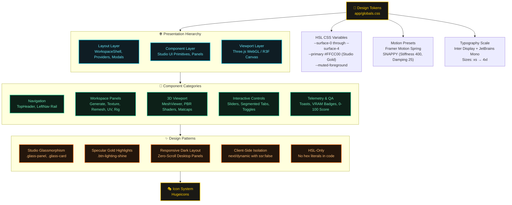
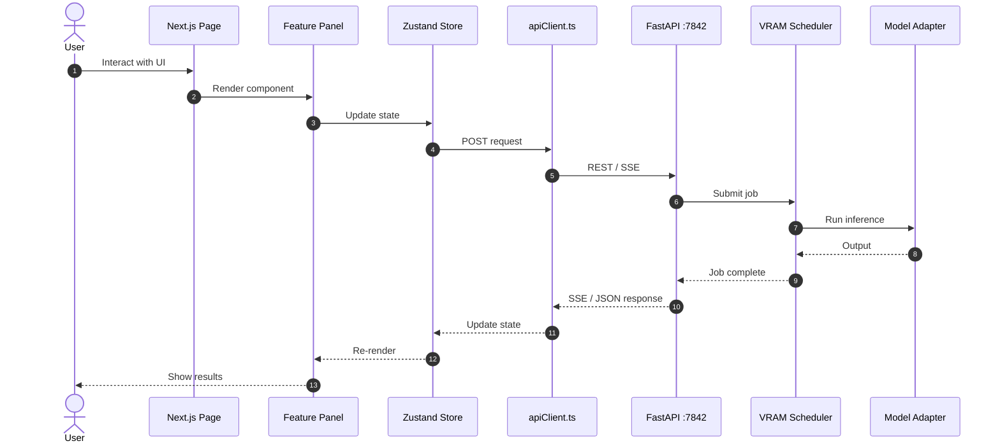

# UI Design System & Component Reference

> **Design Version**: 0.1.0
> **Last Updated**: October 20, 2026
> **Design System**: Studio Gold (`#FFCC00`, `48 100% 50%`) on Matte Black (`#080808`)

---

## 1. Design Tokens (`app/globals.css`)

All colors and surfaces in ForMesh 3D use HSL CSS variable design tokens. Direct hex color literals in UI code are strictly disallowed.

| Token | CSS Variable Value | Hex / Color Equivalent | Purpose / Usage |
| :--- | :--- | :--- | :--- |
| `background` | `0 0% 3.1%` | `#080808` | Global Matte Black app backdrop / canvas shell base |
| `foreground` | `0 0% 96%` | `#F5F5F5` | Primary high-contrast typography (clean crisp white) |
| `--surface-0` | `0 0% 2.4%` | `#060606` | Deepest surface (3D viewport, canvas background) |
| `--surface-1` | `0 0% 6.7%` | `#111111` | Primary panel backgrounds, cards, navigation rails |
| `--surface-2` | `0 0% 10.2%` | `#1A1A1A` | Secondary containers, active tabs, nested sub-panels |
| `--surface-3` | `0 0% 14.1%` | `#242424` | Hovered interactive states, input backgrounds |
| `--surface-4` | `0 0% 20%` | `#333333` | Raised borders, highlighted elements |
| `--primary` | `48 100% 50%` | `#FFCC00` | Vivid Studio Electric Gold (high-saturation, maximum LCD punch) |
| `--primary-foreground`| `0 0% 3%` | `#080808` | High-contrast dark typography on primary yellow (>12:1 WCAG contrast) |
| `--accent-dark` | — | `#E09800` | Pressed states, gradient bottom stop |
| `--accent-light` | — | `#FFE066` | Hover states, specular highlight top stop |
| `--border` | `0 0% 20%` | `#333333` | Standard card and container borders |
| `--muted-foreground` | `0 0% 63%` | `#A0A0A0` | Readable secondary/placeholder typography (>4.5:1 WCAG AA) |
| `--chart-gpu` | `48 100% 50%` | `#FFCC00` | Telemetry GPU telemetry line |
| `--chart-vram`| `48 100% 70%`| `#FFE066` | Telemetry VRAM telemetry line |
| `--chart-cpu` | `0 0% 75%` | `#BFBFBF` | Telemetry CPU telemetry line |
| `--chart-temp`| `40 100% 44%`| `#E09800` | Telemetry temperature line |
| Semantic Success | — | `#22C55E` / `emerald-400` | Online status, completed jobs, healthy checks |
| Semantic Warning | — | `#FFCC00` / `amber-400` | Degraded service, queue wait |
| Semantic Destructive | `0 72% 56%` | `#EF4444` / `rose-500` | Errors, deletion modals, fatal logs |
| Semantic Info | — | `#3B82F6` / `sky-400` | Info notices, informative tooltips |

### Color Palette Visual Reference


> The `assets/colors.jpeg` image shows the complete color palette used across the ForMesh 3D UI, including Studio Gold (`#FFCC00`), Matte Black (`#080808`), and all HSL design tokens.

---

## 2. Design System Architecture



---

## 2a. Icon System

**Primary Icon Library**: [Hugeicons](https://hugeicons.com) (`@hugeicons/react` + `@hugeicons/core-free-icons`).

> No other icon libraries are permitted. Custom SVGs are restricted to brand/logo assets only.

### Icon Size Hierarchy

| Size | CSS Class | Pixel Value | Usage |
| :--- | :--- | :--- | :--- |
| 12px | `h-3 w-3` | 12 | Inline status, compact badges |
| 14px | `h-3.5 w-3.5` | 14 | Secondary actions, refined inline |
| 16px | `h-4 w-4` | 16 | Default UI controls, buttons |
| 18px | `h-[18px] w-[18px]` | 18 | Enhanced inline, refined action |
| 20px | `h-5 w-5` | 20 | Featured actions, highlights |
| 24px | `h-6 w-6` | 24 | Card-level, panel actions |
| 28px+ | `h-7+ w-7+` | 28+ | Hero, empty states |

### Icon Usage Patterns

**With Text** (button):
```tsx
<HugeiconsIcon icon={PlayIcon} size={16} className="w-4 h-4 mr-2" />
<span>Generate</span>
```

**Icon-Only** (button):
```tsx
<button>
  <HugeiconsIcon icon={Settings01Icon} size={16} className="h-4 w-4" />
</button>
```

**Decorative** (background/empty):
```tsx
<HugeiconsIcon icon={BoxIcon} size={20} className="text-primary opacity-80" />
```

### Accessibility Requirements

- **Icon-only buttons** require `aria-label`.
- **Decorative icons** require `aria-hidden="true"`.
- **Interactive icons** should be wrapped in `SimpleTooltip` where appropriate.

### Lucide → Hugeicons Name Mapping

Key mappings (see `components/icons/hugeicons-mapping.ts` for the full list):

| Lucide Name | Hugeicons Name |
| :--- | :--- |
| `ArrowLeft` | `ArrowLeft01` |
| `ArrowRight` | `ArrowRight01` |
| `ChevronDown` | `ChevronDown` |
| `ChevronRight` | `ChevronRight` |
| `X` | `Cancel01` |
| `Check` | `Check` |
| `CheckCircle` | `CheckmarkCircle01` |
| `Loader2` | `LoaderCircle` |
| `Search` | `Search01` |
| `Settings` | `Settings01` |
| `Upload` | `Upload01` |
| `Download` | `Download01` |
| `RefreshCw` | `RefreshCw` |
| `Box` | `Box` |
| `Layers` | `Layers01` |
| `Cpu` | `Cpu` |
| `HardDrive` | `HardDrive` |
| `Eye` | `Eye` |
| `EyeOff` | `EyeOff` |
| `AlertCircle` | `AlertCircle` |
| `AlertTriangle` | `TriangleAlert` |
| `Zap` | `Zap` |
| `Flame` | `Flame` |
| `Database` | `Database01` |
| `Gauge` | `Gauge` |
| `Sparkles` | `Sparkles` |
| `Wand` | `MagicWand01` |
| `Lock` | `Lock` |
| `LockOpen` | `LockOpen` |
| `Shield` | `Shield01` |
| `ShieldCheck` | `ShieldCheck` |
| `Heart` | `Heart` |

---

---

## 3. Motion Presets (`lib/motion.ts`)

Universal motion specifications compatible with `motion/react`:

- `MOTION_FAST`: `{ duration: 0.15, ease: [0.16, 1, 0.3, 1] }` — Tooltips, micro-hovers, toggles.
- `MOTION_BASE`: `{ duration: 0.2, ease: [0.16, 1, 0.3, 1] }` — Tab transitions, dropdown menus.
- `MOTION_SLOW`: `{ duration: 0.3, ease: [0.16, 1, 0.3, 1] }` — Modal entry/exit, panel expand/collapse.
- `MOTION_SPRING`: `{ type: 'spring', stiffness: 300, damping: 30 }` — Mobile drawer slides, floating panels.
- `MOTION_SPRING_SNAPPY`: `{ type: 'spring', stiffness: 400, damping: 25 }` — Pill indicators, selection rings.

---

## 4. UI Components

### Existing UI Primitives
- `components/premium/*`: `GlassCard`, `NeonButton`, `Badge`, `StatusDot`, `MetricCard`, `ProgressBar`, `Spinner`.

### Core Components
- `components/ui/simple-tooltip.tsx`: Tooltip with configurable position and delay.
- `components/ui/skeleton.tsx`: Loading skeleton with shimmer animation.
- `components/Providers.tsx`: Root providers (Theme, Toast, etc.).

### Texture Studio & Generation Panel Components
- `TexturePanel.tsx`: Atlas resolution presets (1K, 2K, 4K, 8K), automatic engine routing (Paint3D for 1K/2K, Hunyuan3D-Paint for 4K/8K), reference image binding/upload, PBR map inspection. RealESRGAN runs as part of Hunyuan Paint; there is no separate UI toggle.
- `GeneratePanel.tsx`: Simplified Studio Interface with single Target Polycount / Output Preset card (six canonical preset chips derived from the backend catalogue), locked model inference profiles, single postprocessing master switch, and clean Advanced production drawer. Universal Textured Generation toggle for all image-to-3D geometry models, atlas resolution preset selector, VRAM warning for 4K/8K.
- Source-generation controls output raw geometry; texturing runs as a separate, optional, non-destructive stage preserving `master/source.glb`.
- `systemStats`: Real-time GPU/VRAM telemetry in texture panel
- Spot-mask mode draws to a separate UV mask canvas; localized inference remains visibly unavailable until supported by Paint3D/Hunyuan adapter calls.
- UV Inspector is bound to the loaded viewport mesh's UV attributes; sampled edges are for responsiveness and only computed counts/bounds are shown.

### Simplified Generate Studio Panel & Production Drawer (GeneratePanel.tsx)

The Generate studio interface is organized into a clean beginner-friendly flow and an uncluttered Advanced production drawer:

#### 1. Primary Flow (Beginner-Friendly Main Panel)
- **Reference Image Intake**: Single drag-and-drop zone, file upload, or bridge pre-load from Board (`useAppStore.pendingBoardImage`).
- **AI 3D Engine Selector**: Dropdown over the discovered model registry. Every row shows the model label, its VRAM requirement (`NGB VRAM`, or `Standard` when the model declares none) and a capability badge (`PBR Texture` or `Raw Mesh`). Models that are not ready carry an extra `GPU Req` (CUDA unavailable) or `Weights Missing` flag.
- **Single Post-Processing Master Switch**: Exactly one master toggle. When active, enables full production finishing. When toggled OFF, fast mode bypasses downstream finishing and returns raw geometry immediately.
- **Textured Generation Toggle**: Switches the optional texture stage on/off and shows the current atlas size. It is blocked (labelled `BLOCKED`) while post-processing is OFF, because texture baking and UV unwrapping are post-processing stages.
- **Single Target Polycount & Output Preset Card**:
  - Six production output recipes, defined by `backend/config/smart_presets.yaml`:
    - `mobile`: 20K triangles, 1K atlas, mobile LOD ratios.
    - `game_ready`: 50K triangles, 1K atlas, LOD chain, collision hull.
    - `cinematic`: 200K triangles, 2K atlas, LOD chain.
    - `animation`: 30K triangles, 1K atlas, LOD chain, auto-rig.
    - `3d_print`: raw mesh (no decimation), printability check, auto-repair.
    - `native`: raw generative mesh with post-processing bypassed.
  - Each chip's summary line is derived from the backend preset data (for example `50K · 1K PBR · LOD · Col`), not hardcoded in the UI.
  - Smooth polycount slider (5K–200K tris) for fine-tuning the budget; moving the slider clears the active preset. Chips other than `Native` are blocked while post-processing is OFF.
  - Preset clicks fill recommended defaults non-destructively and **never** trigger automatic generation submission.
- **Generate Button**: Shimmer action button with a live step label and progress bar, plus a `Queue Next` action that submits the job to the background queue. Missing or unapproved inputs are surfaced as an inline notice rather than a disabled control.

#### 2. Advanced Production Drawer (Genuine Production Controls Only)
- **Candidate Variations (Pick-Best-of-N)**: Multi-variation selector (1 to 4 seeds) with deterministic stepping (`base_seed + i × seed_step`) and composite quality scoring (`_score_and_select`) promoting the highest-scoring candidate to `master/source.glb`; the completed-asset card also allows manual promotion of any variation.
- **Topology Target**: Triangle decimation vs. quad-dominant retopology (AutoRetopo quad conversion).
- **Automatic UV Unwrapping**: Conformal seam placement and atlas chart packing (xatlas / PartUV) run inside the production pipeline. There is no user-facing UV-unwrapping toggle.
- **High-to-Low Normal Map Baking**: `Bake Normal Maps` toggle for ray-cast detail transfer from immutable `master/source.glb` to the decimated output mesh.
- **LOD Generation**: On/off toggle plus a ratio preset (mobile / low / medium / high) and a level count of 2, 3 or 4 levels — the pipeline supports at most LOD0–LOD3. Ratios come from the backend preset table (for example `high` = 100% / 60% / 30% / 15%, `medium` = 100% / 50% / 25% / 12.5%).
- **Topology Gate & Targeted Hole Repair**: The topology gate always runs as part of the production pipeline; the `Auto-Repair` toggle only decides whether the repair step may mutate the mesh (targeted boundary loop hole closure, ≤50 vertices).
- **Physics Preparation**: Collision toggle plus body behaviour, collision quality, density, mass and material quick presets (Default, Rubber, Stone, Wood, Ice, Metal), backed by convex hull generation (Trimesh) with optional CoACD multi-part decomposition.

#### 3. Banned & Removed Controls
- No inference step sliders, guidance scale inputs, sampler overrides, or octree resolution pickers (locked inside adapter code).
- No fake Fast/Balanced/High inference quality selector.
- No duplicate Target Polycount cards or duplicate post-process master switches.
- No separate UV-unwrapping toggle — unwrapping is automatic and gated by the production pipeline.
- No separate "Topology Gate" toggle — the gate always runs and the `Auto-Repair` toggle only controls whether repair may mutate the mesh.
- No Low VRAM toggles in the generation flow — adapter-owned profiles own the inference schedule.
- No "Max Detail" experiment toggle in the panel.

#### 4. Request Contract (`features/workspace/utils/buildGenerationParameters.ts`)

The panel builds the body for `POST /api/v1/mesh-generation/image-to-raw-mesh` from: `image_file_id` | `image_base64`, `candidate_count`, `asset_name`, `image_name`, `output_format`, `model_preference`, `intent`, `preprocessing_artifact_id`, `preprocessing_review_override`, `enhancement_enabled`, `enable_printability_check`, `enable_auto_repair`, `enable_auto_rig`, `auto_rig_mode`, `enable_postprocess`, `target_polycount`, `generate_lod`, `lod_preset`, `lod_count`, `model_parameters` (seed only), `physics_enabled`, `physics_config`, `topology_mode`, `quad_topology`, `bake_normal_maps`, `texture_enabled`, `generate_texture`, `texture_resolution`, `texture_resolution_preset`.

There is no `output_preset` body field and no `auto_optimize` field. The output preset reaches the backend through `intent`, and the preset-derived budgets are expanded into the explicit fields above. The minimal offline fallback table in `constants/smartPresetFallback.json` is guarded by `backend/tests/test_smart_preset_parity.py`, so the panel and `backend/config/smart_presets.yaml` cannot drift apart silently.


### Generation & Texture Power Tools (Batch 2)
- `GeneratePanel.tsx` (Pick-Best-of-N Candidate Generation): Multi-variation count selector (1 to 4) stepping seeds deterministically. Interactive Candidate Comparison Grid rendered on completion with individual candidate seed display, 3D viewport previewing (`loadModelInViewer`), and one-click promotion to `master/source.glb` with unselected candidate file garbage collection.
- `TexturePanel.tsx` (Spot Retexture / UV Region Mask): Sub-tool toggle between Surface Color Paint and Spot Retexture Mask. Interactive 3D surface painting generating a binary/grayscale UV mask aligned to the mesh's existing xatlas UV layout without re-unwrapping. Localized prompt input, brush dynamics, mask thumbnail preview, PNG mask export, and versioned non-destructive output reservation (`textures/<name>_textured_v{n}.glb`) with clear labeling of backend adapter limitations.
- `constants/models.ts` & `TexturePanel.tsx` (Material Prompt Presets): 8 curated material presets (Brushed Metal, Weathered Wood, Matte Plastic, Rough Stone, Fabric, Chrome, Carbon Fiber, Gold) with CSS gradient previews, pre-filling editable prompt guidance without parallel preset code paths.
- `GeneratePanel.tsx` (Physics Material Quick Presets): 6 friction/restitution preset chips (Default, Rubber, Stone, Wood, Ice, Metal) setting sliders non-destructively in the Physics Preparation drawer.
- `BoardPage.jsx`, `BoardAiPanel.jsx` & `boardHelpers.js` (Board-to-Generate Bridge): "Send to 3D Generate" action exporting canvas or selection to File and preloading it into GeneratePanel via `useAppStore.pendingBoardImage` without auto-triggering generation.

### Workspace UX & Inspector Components (Batch 1)
- `RightPropertyPanel.tsx`: 7 collapsible groups (Transform, Geometry Stats, Dynamic Context Inspector, Shading Overrides, Mesh Diff Viewer, Model Comparison Viewer, Production Export) implemented via `components/ui/collapsible.tsx`, state persisted in `useUIStore.rightPanelSections`, auto-expanding active tool with manual toggle overrides, and client-side label filtering.
- `CommandPalette.tsx`: Global command overlay via `components/ui/command.tsx` bound to `⌘K` / `Ctrl+K`. Indexes all tools, navigation routes, recent & favorite assets without telemetry or focus hijacking.
- `ModelComparisonViewer.tsx` & `AssetSelectorModal.jsx`: Full model comparison workflow replacing legacy stubs. Enables comparing two distinct assets or job lineage artifacts (`source.glb` vs `lod0.glb` / `game_ready.glb`), surfacing authoritative backend QA score deltas (Topology, UV, Budget) without client-side estimation.
- `SnapshotMenu.tsx`: Workspace session snapshot controller in header, managing named state snapshots (asset ID, active tool, collapsible sections, camera position/target) via `services/taskPersistence.ts`.

### Workspace & Studio Components (Batch 3)
- `AnimationLeftPanel.tsx` & `useAnimationStore.ts`: Quick-Apply Animation Preset Library with 1-click apply, bilateral symmetry X-mirror mapping (`getSymmetricBoneName`, `mapRetargetBones`), and clip timeline synchronizer for humanoid clips.
- `JobDetailView.tsx`: "Clone & Edit" action extracting source parameters and routing to the corresponding tool panel (`model`, `remesh`, `texture`, `uv`, etc.) with populated inputs and lineage continuity without mutating the original job.
- `NotificationCenter.tsx`: Durable Activity Center in the header tracking job completions, failures, and exports up to 100 entries via `services/taskPersistence.ts`, with unread count badge, links to job/asset, and clear/mark-all actions.
- `RightAssetsPanel.tsx`: Asset Collections (Folders/Grouping) system enabling custom user collections, collection filtering alongside type filters, and asset assignment/removal without destructive file deletions.
- `MeshViewer.tsx`: Viewport Turntable Capture leveraging native `MediaRecorder` + `canvas.captureStream(30)` over a fixed 90-frame full rotation loop with exact shading/lighting reproduction, `.webm`/`.mp4` download, snapshot PNG fallback, and activity center notification.

### Workspace & In-App Help Components (Batch 4)
- `ToolContextHelp.tsx` & `app/api/wiki/[id]/route.ts`: Tool-aware in-app contextual documentation drawer mapping `activeTool` (`model`, `remesh`, `uv`, `texture`, `rigging`, `segment`) directly to official wiki markdown articles in an accessible slide-over popover with graceful fallback for unmapped content.
- `ExportModal.tsx` & `services/settingsPersistence.ts`: Export Quick-Profiles with default presets ("GLB Game-Ready", "Unity Mobile", "Unreal High-Poly", "Blender Raw"), custom user combo saving/deletion, and full LOD level (LOD0-LOD3/All), collision mesh, and texture resolution toggles.
- `OutputsPage.tsx` & `/api/v1/system/storage-breakdown`: Interactive storage breakdown visualizer with authentic backend byte counts across `master/`, `game_ready/`, `textures/`, `lods/`, `rigging/`, and `temp/`, alongside safe intermediate cleanup with age threshold selection.
- `QueueTab.tsx` & `backend/core/scheduler/job_queue.py`: Scheduler administration interface supporting queue cancellation and live queued-job priority reordering (`Move Up`, `Move Down`) with dedicated Active Job single-GPU execution lock monitoring.
- `RightAssetsPanel.tsx`: DCC Bridge Quick-Send via asset 3-dots menu item "Send to {last-used DCC}", persisting DCC target in `settingsPersistence` and bypassing the full modal for configured endpoints with direct toast feedback.

---

## 5. Centralized Texture Pipeline Flow (Paint3D & Hunyuan3D-Paint)

```mermaid
flowchart TD
    classDef input fill:#1e293b,stroke:#3b82f6,stroke-width:2px,color:#fff
    classDef process fill:#0f172a,stroke:#10b981,stroke-width:2px,color:#fff
    classDef output fill:#1e293b,stroke:#ec4899,stroke-width:2px,color:#fff
    classDef guard fill:#0f172a,stroke:#f59e0b,stroke-width:2px,color:#fff

    IN["Immutable master/source.glb<br/>Raw Geometry"]:::input
    IN --> TEXTURE{"Textured Generation enabled?"}:::guard
    TEXTURE -->|No| RAW["Keep raw master<br/>No texture stage"]:::output
    TEXTURE -->|Yes| SIZE{"Requested atlas preset"}:::guard
    SIZE -->|1K / 2K| PAINT3D["Paint3D<br/>Coarse generation + UV refinement"]:::process
    SIZE -->|4K / 8K| HUNYUAN["Hunyuan3D-Paint v2.1<br/>RealESRGAN enabled internally"]:::process
    PAINT3D --> VERIFY["Inspect embedded base-colour atlas<br/>Require exact requested square size"]:::process
    HUNYUAN --> VERIFY
    VERIFY -->|Verified| EXPORT["Export separate textured GLB<br/>Keep source.glb untouched"]:::output
    VERIFY -->|Missing / mismatch / failure| RAWFAIL["Preserve raw master<br/>Record texture-stage failure"]:::output
```mermaid
flowchart TD
    classDef input fill:#1e293b,stroke:#3b82f6,stroke-width:2px,color:#fff
    classDef process fill:#0f172a,stroke:#10b981,stroke-width:2px,color:#fff
    classDef output fill:#1e293b,stroke:#ec4899,stroke-width:2px,color:#fff
    classDef guard fill:#0f172a,stroke:#f59e0b,stroke-width:2px,color:#fff

    IN["Immutable master/source.glb<br/>Raw Geometry"]:::input
    IN --> TEXTURE{"Textured Generation enabled?"}:::guard
    TEXTURE -->|No| RAW["Keep raw master<br/>No texture stage"]:::output
    TEXTURE -->|Yes| SIZE{"Requested atlas preset"}:::guard
    SIZE -->|1K / 2K| PAINT3D["Paint3D<br/>Coarse generation + UV refinement"]:::process
    SIZE -->|4K / 8K| HUNYUAN["Hunyuan3D-Paint v2.1<br/>RealESRGAN enabled internally"]:::process
    PAINT3D --> VERIFY["Inspect embedded base-colour atlas<br/>Require exact requested square size"]:::process
    HUNYUAN --> VERIFY
    VERIFY -->|Verified| EXPORT["Export separate textured GLB<br/>Keep source.glb untouched"]:::output
    VERIFY -->|Missing / mismatch / failure| RAWFAIL["Preserve raw master<br/>Record texture-stage failure"]:::output
```
```

---

## 6. Workspace Layout Architecture

The `WorkspaceShell` (`features/workspace/WorkspaceShell.tsx`) is the main application layout:

```
┌─────────────────────────────────────────────────────┐
│ TopHeader (h-16, z-50)                              │
│ ┌──────┐ ┌──────────────────────────┐ ┌──────────┐ │
│ │Logo  │ │ Navigation Title         │ │Settings  │ │
│ └──────┘ └──────────────────────────┘ └──────────┘ │
├──────┬──────────────────────────┬───────────────────┤
│      │                          │                   │
│ Left │    Center Viewport       │  Right Panel      │
│ Nav  │    (Three.js WebGL)      │  (Inspector)      │
│      │                          │                   │
│ Rail │                          │                   │
│      │                          │                   │
├──────┴──────────────────────────┴───────────────────┤
│ Bottom Dock (mobile only, z-20)                     │
│ [ Tools ] [ Inspector ]                             │
└─────────────────────────────────────────────────────┘
```

### Responsive Breakpoints
- **Desktop (≥1024px)**: Full 3-column layout with docked left nav rail (64px) and right inspector panel.
- **Tablet (768–1023px)**: Left nav rail stays; right panel collapses to overlay.
- **Mobile (<768px)**: Both panels become slide-over overlays; bottom dock provides toggle buttons. Panels are mutually exclusive.

### Workspace Session Snapshots
- **Explicit Snapshot Persistence**: User can save named snapshots capturing the active asset ID, active tool, right property panel section collapsed states, and current viewport camera transform (position and target vectors).
- **Graceful Restoration**: Restoring re-selects the asset (safely notifying if deleted), switches tool tabs, synchronizes collapsed accordion sections, and dispatches camera re-centering without reload.

---

## 7. Rendering Performance & SSR Architecture

- **Client Boundaries**: Heavy interactive pages use `'use client'` directive (e.g., `app/workspace/page.tsx`, `app/animation/page.tsx`).
- **Dynamic Imports**: 3D viewport uses `next/dynamic` with `ssr: false` and loading skeleton.
- **Motion**: All animations use `motion/react` for consistent runtime.

---

## 8. Workspace Route Mapping

| Route | Main Nav | Active Tool | Panel |
|---|---|---|---|
| `/` | dashboard | — | StudioDashboard |
| `/workspace` | workspace | model | GeneratePanel |
| `/workspace/texture` | workspace | texture | TexturePanel |
| `/workspace/remesh` | workspace | remesh | RemeshPanel |
| `/workspace/edit` | workspace | edit | SecondaryPanel |
| `/workspace/segment` | workspace | segment | SecondaryPanel |
| `/animation` | workspace | animation | AnimationStudio (ARDY) |
| `/rigging` | workspace | rigging | RiggingStudio (UniRig/AI) |
| `/outputs` | assets | — | OutputsPage |
| `/system` | system | — | SystemPage |
| `/admin` | — | — | AdminDashboard |

---

## 9. Keyboard Shortcuts & Remapping

| Shortcut (Default) | Action | Key ID |
|---|---|---|
| ⌘1 | Navigate to Dashboard | `nav_dashboard` |
| ⌘2 | Navigate to Assets | `nav_assets` |
| ⌘3 | Navigate to System | `nav_system` |
| ⌘, | Navigate to Settings | `nav_settings` |
| ⌘K / Ctrl+K | Command Palette | `cmd_palette` |
| G | Generate tool | `tool_generate` |
| R | Remesh tool | `tool_remesh` |
| T | Texture tool | `tool_texture` |
| A | Animation tool | `tool_animation` |
| K | Rigging tool | `tool_rigging` |
| S | Segment tool | `tool_segment` |

### Custom Keybinding Architecture
- **In-Place Recording**: Key combinations are editable in `Settings -> Shortcuts` (`PreferencesSections.tsx`). Clicking a shortcut records the next key combo press.
- **Conflict Detection**: Real-time warning is displayed if a desired key binding conflicts with another active action.
- **Persistence & Fallback**: Custom shortcuts persist in local storage via `services/settingsPersistence.ts`. Users can reset individual shortcuts or all bindings back to default with one click.
- **Dynamic Evaluation**: `WorkspaceShell.tsx` evaluates active shortcuts dynamically via `getEffectiveShortcuts()`, applying custom keybindings instantly without application reload.

---

## 10. Unified CSS Variable Theme & Studio Standards

- **Canonical CSS Surface Tokens**: All studios (3D Generation, Animation, and Rigging) strictly depend on global CSS design tokens defined in `app/globals.css`:
  - Canvas & Viewport Base: `bg-[hsl(var(--surface-0))]`
  - Side Panels & Toolbars: `bg-[hsl(var(--surface-1))]`
  - Cards, Containers & Inputs: `bg-[hsl(var(--surface-2))]`
  - Sliders, Checkboxes & Sub-elements: `bg-[hsl(var(--surface-3))]`
  - Subdued Borders: `border-white/[0.08]` and `border-white/[0.12]`
  - Brand Accent: `text-primary`, `bg-primary`, `border-primary` (`hsl(var(--primary))`)
- **Dual-Track Animation Timeline**:
  - Clean `h-[148px]` compact layout avoiding mesh clutter.
  - **Track 1**: Generated Motion clip bar with character prompt label, duration, and FPS badge.
  - **Track 2**: Discrete keyframe pose markers with diamond badges and tooltips.
  - Scrubber with draggable triangular playhead needle and transport playback controls.
- **Rigging Architecture (UniRig AI & Manual Symmetry)**:
  - **Auto-Rig (UniRig AI)**: Invokes backend `unirig_auto_rig` pipeline with user-chosen target skeleton presets (`biped`, `humanoid`, `quadruped`). No ARDY references appear in the rigging module.
  - **Manual Rig with Bilateral Symmetry (X-Mirror)**: Interactive 3D bone placement with automatic opposite-side mirroring (`[-x, y, z]`). Editing or translating a bone on one side automatically mirrors to its anatomical counterpart (`Left*` <-> `Right*`, `*_L` <-> `*_R`). Saving persists the editor-bone snapshot locally; it does not create skin weights or export a rigged mesh, so motion generation remains gated until a real rigged artifact exists.
  - **Real 3D Armature**: Three.js octahedron bone meshes and glowing spherical joints rendered natively in `MeshViewer` (no fake 2D SVG overlays), with gizmo controls (`select`, `move`, `rotate`, `scale`).
  - **Rigged Artifact Preview**: Auto-rig stores native FBX for DCC downloads and a converted GLB for the browser viewport. The viewer uses canonical artifact-format URLs instead of stale asset metadata; replacing a mesh clears its previous thumbnail so a new preview can be captured.

---

## 11. Specular Lighting, Button Shine & DCC Bridge Integration

- **Button Specular Sweep (`.btn-lighting-shine`)**:
  - Implements an interactive lighting shine animation (`btn-specular-sweep`) across primary generation buttons (3D Generation, PBR Texturing, Retopology, Segmentation, Motion, and Export).
  - Uses an angled pseudo-element `linear-gradient(90deg, transparent 0%, rgba(255,255,255,0.45) 50%, transparent 100%)` translating across the surface on idle and hover.
- **Glassmorphism Tokens**:
  - `.glass-panel`: Ultra-clean frosted glass container with `backdrop-blur-xl`, subtle background tint, and 1px specular border highlights (`rgba(255,255,255,0.12)`).
  - `.glass-card-interactive`: Elevated interactive card with hover transform, shadow elevation, and primary border transition.
- **Studio Environment Engine**:
  - Real-time Three.js scene environment customization with 6 backdrop color presets, 5 lighting atmospheres, and 4 chromatic light tones (Studio, Warm Gold, Cyber Cool, Neutral).
  - Fully dynamic directional lighting calculation (Key, Fill, Rim, Ambient) and contact shadow intensity.
- **DCC Live Bridge (`DccBridgeModal.tsx`) & Quick-Send (`RightAssetsPanel.tsx`)**:
  - Out-of-the-box bridge support for Blender 4.x/5.x, Unreal Engine 5 (Remote Control API), Unity Editor, and Autodesk Maya.
  - Features local daemon health checking, custom port binding, pipeline toggle flags, and 1-click Python ingestion scripts.
  - Quick-Send from asset 3-dots menu ("Send to {last-used DCC}") bypasses the full modal when a target application has been used, testing/dispatching directly to configured local ports with real-time toast feedback and fallback to modal configuration when unconfigured.

---

## 12. Multi-View Workspace UX (Removed 2026-10-11)

The Zero123++ workspace, manual multi-view collection UI, and dedicated reconstruction route have been removed from the active interface. Third-party vendored source was left untouched for separate manual cleanup.

---

## 13. Component Interaction Flow



## Production Asset Delivery UI — 2026-09-29

Workspace export actions treat game_ready/ as the default user-facing artifact. Source master is an explicit raw option.

The ZIP option snapshots the complete canonical workspace; it is not a selective package builder.

Post-processing stage and progress reuse the existing job status model rather than introducing a second progress subsystem.

Export Quick-Profiles (`ExportModal.tsx`) enable 1-click loading and custom creation of format/LOD/collision combinations (e.g. "GLB Game-Ready", "Unity Mobile", "Unreal High-Poly", "Blender Raw") persisted in `services/settingsPersistence.ts`. Profiles only pre-fill validated toggles and reuse the single canonical export execution pipeline.

Storage Breakdown & Safe Cleanup (`OutputsPage.tsx`, `/api/v1/system/storage-breakdown`, `/api/v1/system/storage-cleanup`) provides an authentic byte-level overview across `master/`, `game_ready/`, `textures/`, `lods/`, `rigging/`, and `temp/` using canonical server filesystem sizes. The safe cleanup action removes obsolete intermediate processing artifacts older than a user-specified day threshold while strictly preserving `master/source.glb` lineage and primary game-ready files.

## Physics UX
The Generate panel keeps Physics Preparation behind a compact Advanced Generation drawer so the primary workflow stays short and scroll-light. The viewer exposes a top-level Test Physics action. On Physics Ready assets it uses the canonical collision runtime; on ordinary loaded meshes it falls back to a lightweight bounds-based rigid-body smoke test without mutating the asset or running post-processing. The viewer still provides Play, Pause, Step, Reset, collider debug, Drop, Bounce, Slide, and Spin controls. Deformable/jiggle simulation remains capability-gated and is not faked.

## Viewport Inspect UX
The viewport keeps frequent actions in the center-view rail: camera, shading, wireframe, turntable, Test Physics, and Mirror/Reflection Peek. Reflection Peek is an event-driven viewport snapshot that provides a real-time thumbnail preview of the mesh and lighting. Rather than running an unthrottled timer loop, snapshot capture executes once on initial mesh load and then listens to OrbitControls `'end'` events debounced at 250ms. Previous object URLs are revoked upon each capture to prevent memory bloat, and the capture loop is completely halted when the scene is static or unmounted.

Turntable 360° capture (`MeshViewer.tsx`) enables client-side recording of a complete 360° rotation directly from the canvas via native `MediaRecorder` and `canvas.captureStream(30)`. Capture executes over a deterministic 90-frame rotation loop (3.0s at 30fps) with synchronized shadow map updates, leaving scene materials, lighting, and shading identical to viewport inspection. Outputs standard `.webm` or `.mp4` video with fallback to PNG snapshot for unsupported browsers, and logs an export activity record.

## Pipeline Execution UX — 2026-09-29
The live execution panel is a telemetry surface, not a simulated progress animation. It renders the backend stage/message stream, global progress, completed-stage count, elapsed time, estimated remaining time, worker log timeline, and artifact readiness from the actual job result. Hidden browser tabs reduce polling activity, and log auto-scroll preserves manual inspection when the user scrolls upward.

Jobs & Execution follows the same rule: active jobs refresh frequently, idle history refreshes less often, and no UI fallback invents a non-zero progress percentage.

The live execution panel no longer offers an "Enable Low VRAM Mode (<8GB) & Retry" action. That button could not change anything in the submitted request — adapter-owned profiles own the inference schedule — so it was removed rather than left as a dead control.

Job Clone & Edit (`JobDetailView.tsx`) allows users to clone completed or historical jobs and re-run them with modified parameters. Clicking "Clone & Edit" reads the job's original parameter payload, navigates to the relevant studio tool panel (`model`, `remesh`, `texture`, `uv`, etc.), pre-populates parameter inputs, and maintains source asset lineage without mutating the historical job or its artifacts.

## Workspace Data Integrity
Mesh statistics, segmentation part counts, and result metadata are rendered only when supplied by the backend. Client-side sample numbers are not treated as factual asset statistics.

## Resource/Status Header UI — 2026-10-04

The top-level resource status strip shows live system telemetry with negligible performance impact:

| Metric | Backend Source | Refresh |
|--------|---------------|---------|
| CPU usage % | `/api/v1/system/stats` `cpu_percent` | 5s |
| RAM used / total GB | `/api/v1/system/stats` `ram_used_gb`, `ram_total_gb` | 5s |
| GPU usage % | `/api/v1/system/stats` `gpu_percent` | 5s |
| GPU VRAM used / total GB | `/api/v1/system/stats` `vram_used_gb`, `vram_total_gb` | 5s |
| GPU temperature C | `/api/v1/system/stats` `gpu_temp_c` | 5s |
| GPU name | `/api/v1/system/stats` `gpu_name` | On load |

The backend uses `psutil.cpu_percent(interval=0.1)` for an accurate delta reading without blocking the event loop. GPU telemetry is best-effort via `GPUtil`; absence does not fail the request.

Frontend pattern:
- Poll `/api/v1/system/stats` every 5 seconds from the workspace header.
- Hide or degrade gracefully when `gpu_name` is `"Unknown"` or GPU fields are `0.0`.
- Do not run heavy polling while the workspace tab is hidden.
- Notification / Activity Center (`NotificationCenter.tsx`) provides persistent tracking of job completions, failures, and exports. Backed by `taskPersistence.ts` with a 100-item FIFO cap, the bell icon in `TopHeader.tsx` displays an unread count badge and opens a glassmorphic dropdown with direct links to view the generated job or select the target asset.

## Model Parameter Contract — 2026-10-04

The frontend never hardcodes model inference schedules. Each model exposes its parameter schema through:

```
GET /api/v1/system/models/{model_id}/parameters
```

Response shape:
```json
{
  "model_id": "trellis_image_to_textured_mesh",
  "feature_type": "image_to_textured_mesh",
  "vram_requirement": 11776,
  "schema": {
    "parameters": {
      "texture_resolution": {
        "type": "integer",
        "default": 2048,
        "minimum": 512,
        "maximum": 4096,
        "description": "Output texture resolution"
      }
    }
  },
  "timestamp": "2026-10-04T00:00:00Z"
}
```

Frontend rules:
- Use the returned `schema.parameters` for defaults, constraints, and validation.
- Treat the backend schema as the source of truth; do not duplicate parameter definitions in TypeScript.
- When the schema is unavailable, disable dependent controls rather than guessing defaults.
- The Generate panel exposes no schema-driven inference controls: the reported schedules are adapter-owned and read-only, and only the seed is forwarded as a runtime model parameter.

## Generation Quality Presets — 2026-10-04

Output presets in the Generate panel are UI convenience shortcuts. The actual inference schedule remains model-specific and is owned by the adapter; it is resolved at submission time and reported through the backend `/system/models/{model_id}/parameters` endpoint.

Current adapter-owned inference profiles:
- Hunyuan3D-Shape-v2.1: octree 1300, 150 steps, guidance 5.0
- Hunyuan3D-DiT-v2-mini-Turbo: octree 768, 20 steps, guidance 7.5
- TripoSG: 100 steps, guidance 9.0, dense octree depth 10, hierarchical octree depth 11
- TRELLIS: 100 steps, guidance 7.5
- TRELLIS.2: 1536_cascade pipeline, 524288 max tokens
- Pixal3D: 1536_cascade pipeline, resolution 2048
- TaoFlowForge: `fill_holes` enabled, offload `auto`
- Unique3D: `input_processing` and `do_refine` enabled, expansion weight 0.1

The visible output preset chips (`Mobile / Game Ready / Cinematic / Animation / 3D Print / Native`) map to production post-processing budgets, not inference schedules. `Native` preserves the model-native source density and skips downstream polycount reduction.

## Resource-Aware Generation UX — 2026-10-08

The workspace receives the normalized runtime capability contract. Model-specific controls are shown only when supported; quality/polycount choices are routed through the scheduler and production post-process rather than silently changing model-native source density. High-fidelity source and game-ready derivatives remain separately inspectable.

## Phase 1 Generation UX Contract

### Generation Preview
The Generate panel exposes Original versus Generation Preview, approval/reuse, regeneration, manual editor navigation, and a disable path. Changing the source invalidates the previous preprocessing artifact.

### Smart Intent
Compact controls expose Game Ready, Cinematic, Animation, 3D Print, and Mobile, plus a `Native` chip that bypasses post-processing and returns the raw generative mesh. Selecting an intent fills the panel's settings from the backend preset catalogue without submitting a job; at submission time the backend resolves the actual chosen model for that intent and the normal generation lifecycle runs. The UI does not reimplement resource admission.

### Production QA
Printability, Auto-Repair, and Auto-Rig are explicit controls. All execute through the existing scheduler/post-process lifecycle and expose degraded failure state rather than false success.

## High-Fidelity Generation UX Contract — 2026-10-08

The generation experience exposes model capability state, output preset, polycount, texture quality, progress/fallback state and high-fidelity vs optimized output variants without exposing controls unsupported by the selected model.

An output preset must never silently downgrade the immutable master. A requested polycount applies to derivative generation, not to the master.

## UI/UX Pro Max Studio Interface & Navigation Unification — 2026-10-13

### Compact Studio Information Density
- **Spacing Grid**: Standardized on 8px/12px/16px padding grids across control toolbars, cards, and inspector panels.
- **Surface Elevation**: Dark glassmorphic background surfaces (`--surface-0: 0 0% 3.1%`, `--surface-1: 0 0% 7.5%`, `--surface-2: 0 0% 11.5%`) paired with subtle structural borders (`border-white/[0.08]` to `border-white/[0.12]`) and backdrop blur (`16px`).
- **Tactile Feedback**: Interactive buttons and toggle rows feature micro-interactions (`active:scale-[0.98]`), gold accent focus rings (`ring-primary/40`), and smooth ease-out transitions (`200ms`).

### Navigation & Settings Icon Harmonization
- **Admin Navigation**: Each sidebar and shell route resolves to a designated semantic icon without duplicate or fallback icons (`LayoutDashboardIcon`, `BoxesIcon`, `Activity01Icon`, `ScrollTextIcon`, `Briefcase01Icon`, `ListOrderedIcon`, `HeartPulseIcon`, `HardDriveIcon`, `Database01Icon`, `Settings01Icon`).
- **Settings Sub-Tabs**: Admin settings sections and workspace settings modal share aligned icons:
  - **General**: `Settings02Icon`
  - **Generation / AI Inference**: `SparklesIcon`
  - **Workspace / Viewport**: `LayoutGridIcon`
  - **Export & Backup**: `Download01Icon`
  - **API & Server**: `ServerIcon`
  - **Shortcuts**: `KeyboardIcon`
  - **Notifications**: `BellIcon`
  - **Advanced & Controls**: `SlidersHorizontalIcon`
- **Cross-Surface Synchronization**: Workspace `SettingsModal` footer deep-links directly to the corresponding active section in Admin Settings (`/admin?tab=settings&section=${activeSection}`).
- **Zero Icon Leaks**: Placeholders, tooltips, button texts, and comments strictly display plain language labels (`Refresh`, `Search`, `Target Mesh`, `Brush Dynamics`, etc.) with zero literal `*Icon` tokens.

## Continuous 3D Viewport & Dynamic-Tab Studio Architecture — 2026-10-13

### Non-Destructive Viewport Stage
- **Persistent WebGL Stage**: The full-bleed 3D viewport (`MeshViewer`) and tool overlay (`ViewportToolOverlay`) remain permanently mounted across all workspace tool switches (`Model`, `Poly/Remesh`, `Texture`, `UV`, `Segment`, `Edit`, `Animate`, `Rigging`).
- **Zero Canvas Tearing**: WebGL context, Three.js shaders, active mesh geometry, camera angle, turntable rotation, and lighting are completely preserved during tool transitions with sub-16ms response time.
- **Dynamic Floating Rails**:
  - **Left Rail**: Floating context panel renders tool-specific controls (`GeneratePanel`, `RemeshPanel`, `TexturePanel`, `UVUnwrapPanel`, `MeshSegmentPanel`, `MeshEditPanel`, `AnimationLeftPanel`, `RiggingLeftPanel`) with Framer Motion slide-in transitions.
  - **Right Rail**: Contextual property inspector renders tool-aware inspect panels (`RightPropertyPanel`, `UVInspector`, `SegmentInspector`, `MeshEditInspector`, `AnimationRightInspector`, `RiggingRightInspector`).
  - **Bottom Dock**: Viewport overlay docks `AnimationTimelineDock` during animation workflows, exposing transport controls, dual-track keyframe/clip scrubbing, and FPS selection directly within the viewport.
- **Overlay Navigation**: Top-level views (`Overview`, `Assets`, `Jobs`, `System`) render as lightweight Framer Motion overlays via `window.history.replaceState`, preserving underlying 3D scene state.

## High-Performance Viewport Engine & Interactive Manipulation System — 2026-10-14

### Zero-Allocation Shading Switcher UX
- **Instant Mode Switching**: Allows artists to toggle between render modes without GPU hitching or garbage collection frame drops.
  - **Textured / Default**: Native PBR textures with diffuse, roughness, and normal mapping.
  - **Clay (`#D6D9DF`, Roughness 0.75, Metalness 0.05)**: Clean matte finish for geometric silhouette and form evaluation.
  - **Ceramic (`#FFFFFF`, Roughness 0.12, Metalness 0.05)**: Specular gloss for curvature and surface continuity inspection.
  - **Metallic Chrome (`#F0F3F8`, Roughness 0.04, Metalness 0.95)**: High-reflectivity chrome for detecting surface irregularities and pinching.
  - **Gold (`#F9CF00`, Roughness 0.22, Metalness 0.88)**: Satin metallic shader for highlight roll-off.
  - **Normals**: `THREE.MeshNormalMaterial` mapping RGB normal vectors for topology orientation verification.
  - **X-Ray Diagnostic (`#3B82F6`, 75% opacity)**: Translucent blue wireframe pass for internal structure and non-manifold edge detection.
  - **Turquoise Matcap (`#06B6D4`)**: Stylized studio matcap for sculpting appraisal.
- **Persistent Material Cache**: All alternate shaders are lazily cached on `mesh.userData.__shadingMaterialCache`. Switching modes reassigns existing Three.js material instances and toggles `.wireframe = isWire` dynamically with zero object instantiation.

### Interactive TransformControls & 3D Manipulator UX
- **Floating Edit Toolbar (`ViewportToolOverlay.tsx`)**: When the active workspace tool is `edit`, a sleek vertical toolbar floats on the left viewport edge (`bg-[hsl(var(--surface-1))]/90 backdrop-blur-md border border-white/[0.08]`):
  - **Select Tool (▲)**: Reverts viewport interaction to Orbit mode (`setInteractionMode('orbit')`).
  - **Move Manipulator (`MoveIcon`)**: Activates 3D translate gizmo (`setInteractionMode('move')`).
  - **Rotate Manipulator (`RotateCcwIcon`)**: Activates 3D spherical rotation gizmo (`setInteractionMode('rotate')`).
  - **Scale Manipulator (`Maximize02Icon`)**: Activates 3D scale manipulator (`setInteractionMode('scale')`).
  - **Toggle Grid (`GridIcon`)**: Instantly toggles the ground plane grid (`toggleGrid`) without scene re-renders.
- **Gizmo State & Orbit Mutual Exclusion**: Active manipulator attaches directly to `currentMeshGroupRef.current` or the selected rigging bone joint (`animSelectedBone`). Dragging any axis of `TransformControls` temporarily locks `OrbitControls` (`controls.enabled = false`) until release, eliminating accidental camera navigation while transforming assets.

### Axial Camera Alignment Presets
- **Quick-Snap Perspective Bar**: Floating horizontally at the top of the viewport in UV, segment, and edit modes, offering one-click alignment pills:
  - **Perspective**: Standard 45° isometric diagnostic angle.
  - **Front**: Normal snap to Z-axis (`[0, 0, distance]`).
  - **Side**: Orthographic-style snap to X-axis (`[-distance, 0, 0]`).
  - **Top**: Downward planar snap along Y-axis (`[0, distance, 0]`).
- Dispatches `setCameraPreset` custom events handled by `applyCameraPreset()`, maintaining model focal point and bounding-sphere framing.

### MeshDiffViewer Dual-Scene WebGL Architecture
- **Uncoupled Animation Loop**: Dual comparative viewports (`leftScene` / `rightScene`) operate on an independent `requestAnimationFrame` loop completely decoupled from React state, eliminating 60–120fps component re-renders.
- **Synchronized Camera Orbiting**: Interacting with either the left or right viewport smoothly mirrors camera matrices to provide seamless side-by-side mesh diffing.
- **Resource Management**: Automatically cleans up animation frames (`cancelAnimationFrame(animId)`) and WebGL renderer contexts on unmount.

---

## Premier Personal SaaS Home Page — 2026-10-14

### Architecture & Experience Design (`app/page.tsx`)
- **Portal Persona**: Replaced the previous raw redirect with a world-class, premium SaaS-grade Command Center specifically tailored for personal workstation usage.
- **Color Token Consistency**: Implements strict Matte Black (`--background: 0 0% 3.1%`, `--surface-1: 0 0% 6.7%`) and Studio Gold (`--primary: 48 100% 50%`, `#FFCC00`) HSL tokens with zero arbitrary hex styles.
- **Sticky Glassmorphic Header**:
  - Brand identity with Pro Studio badge and golden 3D emblem.
  - Live hardware telemetry pill connecting to `/api/v1/system/stats`, showing real-time VRAM allocation (`4.8 / 24 GB`) and GPU accelerator health with a pulsing emerald status dot.
  - Direct routing to all internal applications (`Workspace`, `Generate`, `Retopo`, `Textures`, `Rigging`, `Outputs`, `Telemetry`, `System`).
- **Interactive Quick-Launch Hero**:
  - Interactive multi-mode console directly on the hero section (`Image / Text to 3D`, `Quad Retopo`, `PBR Texture`, `Auto-Rigging`).
  - Real-time intent preset pills (`Game Ready 50k`, `Cinematic 200k`, `3D Print Watertight`, `Mobile 20k`, `Animation Rigged`) and model selection (`Trellis 2`, `Hunyuan3D 2.1`, `Unique3D`, `TripoSG`).
  - Submitting routes straight to `/workspace/generate` with pre-filled parameters.
- **Autonomous Tool Matrix**:
  - 6 interactive bento cards (`glass-card-interactive`) showcasing the core workstation engines with hover lift, amber specular border glow, technical specs, and instant launch buttons.
- **Target Preset Comparison Grid**:
  - Deep-dive breakdown of the 5 production intent contracts (Game Ready, Cinematic VFX, 3D Print Watertight, Animation Rigged, Mobile WebXR) displaying target face budgets, texture dimensions, LOD falloffs, and engine compatibility.
- **Hardware Telemetry Monitor**:
  - Live GPU VRAM gauge, job queue status, and engine latency counter connecting directly to workstation health diagnostics.
- **Global Keyboard Navigation**:
  - Interactive hotkey cheat sheet listening to window events (`G` → Generate, `R` → Retopo, `T` → Texture, `U` → UV, `A` → Animation, `D` → Dashboard, `O` → Outputs, `S` → System) for lightning-fast power-user navigation.
- **Responsive Layout**: Designed mobile-first, maintaining optimal hierarchy and touch targets from 375px mobile screens up to 4K ultra-wide monitors.


## Generation Output Recipes

Workspace Settings → AI Inference → Generation Output Recipes is a native disclosure drawer inside the existing Settings modal (`features/workspace/Modals/GenerationPresetDrawer.tsx`). It reuses the workspace generation settings and `queueGenerationJob()` rather than adding another inference or persistence service.

- Presets persist in browser localStorage under `ai3d:generation:presets:v1`; profiles can be saved, updated, deleted, imported, and exported individually or as a library.
- Controls expose the seed and a revision / experiment ID. There are no guidance-scale, inference-step, sampler, or primitive-parameter controls: those schedules are adapter-owned and are not editable from the UI.
- Saved recipes restore the panel's generation settings (model, polycount, LOD, texture, QA and physics options) on top of the model-specific defaults.
- Revision/experiment ID is metadata, not an inference argument. Presets omit image bytes, upload IDs, and preprocessing artifacts, so loading a preset keeps the current image.
- UI uses existing surface tokens and native browser controls; no new dependency is introduced.
