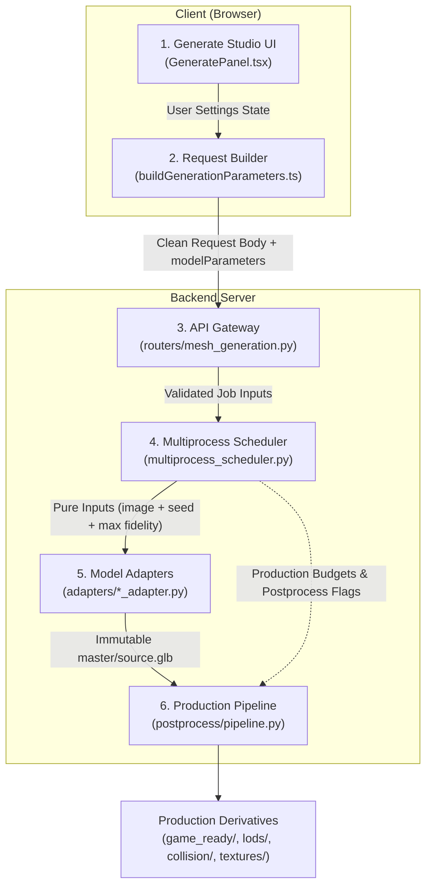

# Generation UI End-to-End Contract Specification

> **Contract Version**: 1.0.0  
> **Status**: APPROVED & ACTIVE  
> **Date**: October 21, 2026  
> **Reference**: ADR-056, ADR-057, `Docs/ARCHITECTURE.md`, `Docs/TASKS.md`

---

## 1. Executive Summary & Core Invariants

This document defines the canonical contract governing the 3D generation lifecycle in ForMash3D across six operational tiers:



### Core Architectural Invariants

1. **Inference settings live exclusively inside model adapters**: Fixed model-specific step counts, guidance scales, octree resolutions, samplers, and decoders belong in adapter code (`_LOCKED_INFERENCE_PROFILE`). The UI must not expose unbacked or fake inference quality sliders.
2. **No control without a verified consumer**: Every button, slider, or toggle presented to the user must map to an active API field with a verified backend execution stage. Mock or cosmetic controls are strictly forbidden.
3. **Preset clicks configure jobs non-destructively; they never auto-submit**: Selecting an output preset fills recommended parameters into the UI state. The user must explicitly press **Generate** to enqueue the job.
4. **Single Source of Truth (SSOT)**: Target budgets, crease angles, hole thresholds, and baking margins are defined once in `backend/config/quality.yaml`. Model VRAM reservations and hardware facts are defined in `backend/config/models.yaml`.
5. **Raw Master Immutability**: The initial generator output is saved to `master/source.glb` and protected by SHA-256 byte-level verification. All downstream decimation, retopology, unwrapping, baking, and LODs produce separate derived artifacts.

---

## 2. Component Responsibility & Boundary Contracts

### Tier 1: Presentation UI (`features/workspace/Panels/GeneratePanel.tsx`)

The Generate panel is divided into a clean primary workflow and an advanced production drawer:

- **Primary Panel Flow**:
  - Reference image upload/drop zone or pre-load from Board (`useAppStore.pendingBoardImage`).
  - Model selector with real-time VRAM requirement indicator and authentic hardware readiness badge (`READY`, `LOW VRAM`, `MISSING DEPS`).
  - Single **Post-Processing Master Switch**: Exactly one master toggle. When OFF, returns raw generative mesh immediately and marks downstream production controls as bypassed.
  - Universal **Textured Generation Toggle**: Optional post-processing texture stage routed to Paint3D (1K/2K) or Hunyuan3D-Paint (4K/8K).
  - Single **Target Polycount / Output Preset Card**: Consolidates output presets and explicit polycount budgets into one cohesive card.
- **Advanced Production Drawer**:
  - **Candidate Variations (Pick-Best-of-N)**: Multi-variation selector (1 to 4 seeds).
  - **Topology Target**: Triangle decimation vs. Quad-dominant retopology (FastMesh / QuadriFlow).
  - **UV Unwrapping**: Automatic conformal seam placement and atlas chart packing (PartUV / xatlas).
  - **Normal Detail Baking**: High-to-low ray-cast bake from immutable master source.
  - **LOD Generation**: Multi-resolution chain (LOD0 through LOD3).
  - **Topology Gate & Repair**: Boundary loop closure ($\le 50$ vertices) and manifold repair.
  - **Physics Colliders**: Watertight CoACD convex hull generation with physics material presets (Default, Rubber, Stone, Wood, Ice, Metal).
- **Prohibited UI Controls**:
  - No inference steps, guidance scale, sampler overrides, or octree resolution pickers.
  - No Fast/Balanced/High inference quality selector.
  - No duplicate polycount sliders or duplicate postprocess master switches.

### Tier 2: Client Request Builder (`features/workspace/utils/buildGenerationParameters.ts`)

- Pure serialization function without React dependencies.
- Translates UI `GenerationSettings` into `{ endpoint, body, modelParameters }`.
- Does **not** inject hardcoded numeric inference schedules or duplicate adapter profiles.
- Packages production post-processing options: `target_polycount`, `output_preset`, `auto_optimize`, `generateLOD`, `bake_normal_maps`, `enable_auto_repair`, `quad_topology`, `physics_collider`, `candidate_count`, `seed`.

### Tier 3: API Gateway (`backend/api/routers/mesh_generation.py`)

- Validates request payloads against Pydantic schemas.
- Stores validated inputs into the job record and enqueues to `JobQueue`.
- Enforces preset precedence: Explicit request body parameters override output preset defaults.
- Strips or ignores unbacked legacy fields (`requested_quality`, `mesh_style`, `object_type`, `symmetry`) so they cannot mutate model inference.

### Tier 4: Multiprocess Scheduler (`backend/core/scheduler/multiprocess_scheduler.py`)

- Manages worker processes, GPU locks, and VRAM reservations.
- Manages multi-candidate execution: Steps seeds deterministically (`seed + i`), invokes worker for each candidate, evaluates geometric metrics (`compute_mesh_metrics`), applies early stopping ($\ge 0.85$), and promotes the winning candidate to `canonical_dest_path`.
- **Sanitizes adapter inputs via `_build_model_inference_inputs`**:
  - Strips postprocess-only fields (`_POSTPROCESS_ONLY_INPUTS`).
  - Strips adapter-owned inference keys (`_ADAPTER_OWNED_INFERENCE_INPUTS`).
  - Forwards strictly: `image_path`, `seed`, and `source_quality="max"`.
- Retains post-processing budgets and flags in job inputs for downstream execution.

### Tier 5: Model Adapters (`backend/adapters/*_adapter.py`)

- Authoritative owner of model inference schedules (`_LOCKED_INFERENCE_PROFILE`).
- Overwrites request-side inference parameters with locked constants:
  - **Hunyuan3D-Shape-v2.1**: Octree resolution 1300, 150 steps, guidance 5.0, 80,000 chunks, native dense decoder.
  - **TripoSG**: 100 steps, guidance 9.0, dense depth 10, hierarchical depth 11.
  - **Hunyuan3D-DiT-v2-mini-Turbo**: 20 steps, octree resolution 768, guidance 7.5, 80,000 chunks.
  - **TRELLIS / TRELLIS.2 / Pixal3D / TaoFlowForge**: Adapter-locked schedules.
- Generates high-fidelity raw extraction without downsampling and writes to `master/source.glb`.
- Attaches SHA-256 hash and geometric telemetry to output metadata.

### Tier 6: Production Post-Processing Engine (`backend/postprocess/pipeline.py`)

- Reads immutable `master/source.glb` in read-only mode.
- Executes production recipe stages based on `output_preset` and explicit flags:
  1. **Topology Gate**: Evaluates 14 geometric metrics; skips repair if manifold, routes small holes ($\le 50$ verts) to targeted repair.
  2. **Feature-Aware Decimation**: Reduces mesh to `target_polycount` while preserving 35° crease edges (`memory_safe_decimate`).
  3. **Retopology**: Optional FastMesh quad-dominant retopology when `quad_topology` is true.
  4. **UV Unwrapping**: PartUV deep-learning unwrap when $\ge 500\text{k}$ tris and $\ge 7\text{ GB}$ VRAM, else xatlas directly on NumPy buffers (`uv_backend_resolver`).
  5. **Normal Detail Bake**: Ray-casts fine geometric detail from immutable `master/source.glb` to decimated output mesh.
  6. **LOD Generation**: Produces `lods/lod0.glb` (100%), `lod1.glb` (50%), `lod2.glb` (25%), `lod3.glb` (12.5%).
  7. **Collision Hull**: Produces `collision/collision.glb` using watertight CoACD convex decomposition.
  8. **Texture Packing**: Applies PBR material maps (Albedo, Normal, Roughness, Metallic, AO) and writes canonical `metadata/asset.json`.

---

## 3. Data Flow & Parameter Lifecycle Matrix

The table below traces every parameter from the UI through to execution:

| Parameter | UI Control | Request Builder Output | API Validation | Scheduler Action | Adapter Action | Postprocess Pipeline |
| :--- | :--- | :--- | :--- | :--- | :--- | :--- |
| `image_path` / `image_file_id` | Image drop zone / file input | `body.image_file_id` | Required string | Resolves to local path | Consumed as input | Source reference for texturing |
| `model_preference` / `aiModel` | Model selector dropdown | `body.model_preference` | Validated against `models.yaml` | Allocates GPU / worker | Identifies adapter class | Recorded in asset metadata |
| `seed` | Advanced number input | `body.seed` | Safe integer or null | Preserved / stepped | Sets RNG seed | Stored in metadata |
| `candidate_count` | 1–4 variation selector | `body.candidate_count` | Clamped 1–4 | Dispatches Best-of-N loop | Runs per candidate | Promotes winning mesh |
| `output_preset` | Preset chips (`game_ready`, etc.) | `body.output_preset` | Validated preset ID | Preserved in job inputs | Ignored | Determines recipe defaults |
| `target_polycount` | Budget slider / chips | `body.target_polycount` | Clamped integer | Stripped from adapter | Ignored | Target face count for decimation |
| `quad_topology` | Topology toggle (Tri vs Quad) | `body.quad_topology` | Boolean | Stripped from adapter | Ignored | Routes to FastMesh retopology |
| `bake_normal_maps` | Normal bake toggle | `body.bake_normal_maps` | Boolean | Stripped from adapter | Ignored | High-to-low normal map bake |
| `generateLOD` | LOD toggle | `body.generateLOD` | Boolean | Stripped from adapter | Ignored | Builds LOD0–LOD3 chain |
| `enable_auto_repair` | Mesh repair toggle | `body.enable_auto_repair` | Boolean | Stripped from adapter | Ignored | Runs topology gate & hole repair |
| `physics_collider` | Collision toggle | `body.physics_collider` | Boolean | Stripped from adapter | Ignored | Runs CoACD hull generator |
| `enable_postprocess` | Master pipeline switch | `body.enable_postprocess` | Boolean | Preserved in job inputs | Ignored | When false, bypasses postprocess |
| `num_inference_steps` | **REMOVED FROM UI** | Omitted | Ignored / rejected | **Stripped** | **Overridden by locked profile** | N/A |
| `guidance_scale` | **REMOVED FROM UI** | Omitted | Ignored / rejected | **Stripped** | **Overridden by locked profile** | N/A |
| `octree_resolution` | **REMOVED FROM UI** | Omitted | Ignored / rejected | **Stripped** | **Overridden by locked profile** | N/A |
| `requested_quality` | **REMOVED FROM UI** | Omitted | Ignored / rejected | **Stripped** | **Overridden by locked profile** | N/A |

---

## 4. Production Output Presets Matrix

Presets function exclusively as **production output recipes** applied during post-processing. They never alter model generator schedules:

| Preset ID | Display Label | Target Tris | Topology | Normal Baking | LOD Chain | Auto Repair | Physics Collision | Typical Use Case |
| :--- | :--- | :--- | :--- | :--- | :--- | :--- | :--- | :--- |
| `mobile` | Mobile / WebGL | 15,000 | Triangles | Yes (1K) | Yes (LOD0–LOD2) | Minimal | No | Mobile games, WebGL viewers, AR |
| `game_ready` | Game Ready | 35,000 | Triangles | Yes (2K) | Yes (LOD0–LOD3) | Full | Yes (Convex Hull) | Unreal, Unity, standard game engines |
| `cinematic` | Cinematic / Studio | 100,000 | Triangles | Yes (4K) | No | Full | No | Offline rendering, high-end film / VFX |
| `animation` | Animation Quad | 40,000 | Quads | Yes (2K) | Yes (LOD0–LOD2) | Full | No | Character rigging, skeletal deformation |
| `3d_print` | 3D Printing | Native | Triangles | No | No | Full Watertight | No | STL / 3D printing, boundary hole closure |
| `native` | Native Raw | Native (0) | Generator | No | No | None (Bypassed)| No | Raw generative research, unedited mesh |

---

## 5. Preset Precedence & Deterministic Overrides

When constructing and executing a generation request, configuration values are resolved deterministically using the following order of precedence (highest to lowest):

```
1. Explicit Request Body Parameter (e.g. body.target_polycount = 20000)
       ↓ (if omitted)
2. Selected Output Preset Recipe Default (from quality.yaml: presets.<id>)
       ↓ (if omitted)
3. Global Single Source of Truth Default (from quality.yaml: shared / default_tier)
```

### Precedence Rules

1. **Explicit values always take precedence**: An explicit parameter passed in the API request body overrides any default specified in the output preset.
2. **Explicit false and zero are preserved**: If a user explicitly specifies `generateLOD: false` or `target_polycount: 0`, the preset's `true` or positive default will **not** overwrite it.
3. **Preset selection is non-destructive**: Clicking a preset card in the UI updates the state form fields. It never initiates network requests or job submissions.
4. **Adapter profiles are immutable**: Regardless of any request body inputs, adapter-owned inference profiles (`_LOCKED_INFERENCE_PROFILE`) overwrite all incoming inference parameters.
