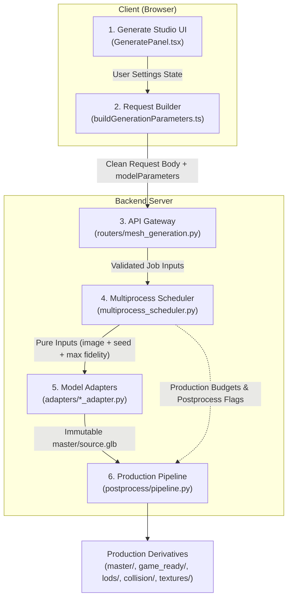

# Generation UI End-to-End Contract Specification

> **Contract Version**: 1.1.2  
> **Status**: APPROVED & ACTIVE  
> **Date**: October 21, 2026  
> **Reference**: ADR-056, ADR-057, ADR-093, `Docs/ARCHITECTURE.md`, `Docs/TASKS.md`

---

## 1. Executive Summary & Core Invariants

This document defines the canonical contract governing the 3D generation lifecycle in ForMash3D across six operational tiers:



### Core Architectural Invariants

1. **Inference settings live exclusively inside model adapters**: Fixed model-specific step counts, guidance scales, octree resolutions, samplers, and decoders belong in adapter code (`_LOCKED_INFERENCE_PROFILE`). The UI must not expose unbacked or fake inference quality sliders.
2. **No control without a verified consumer**: Every button, slider, or toggle presented to the user must map to an active API field with a verified backend execution stage. Mock or cosmetic controls are strictly forbidden.
3. **Preset clicks configure jobs non-destructively; they never auto-submit**: Selecting an output preset fills recommended parameters into the UI state. The user must explicitly press **Generate** to enqueue the job.
4. **Single Source of Truth (SSOT)**: Output preset recipes live in `backend/config/smart_presets.yaml`; production thresholds, crease angles, hole thresholds, and baking margins live in `backend/config/quality.yaml`. Model VRAM reservations and hardware facts are defined in `backend/config/models.yaml`.
5. **Raw Master Immutability**: The initial generator output is saved to `master/source.glb` and protected by SHA-256 byte-level verification. All downstream decimation, retopology, unwrapping, baking, and LODs produce separate derived artifacts.
6. **One production option, one owner**: Every production option is resolved exactly once, at the API gateway, from a single tri-state contract (see §5).
7. **The intent → model resolve is advisory**: `POST /api/v1/smart-generation/resolve` reports which model an intent maps to; it is not a gate. Model readiness and resource admission belong to the scheduler, so a failed resolve must not block a submission — the client keeps the user's explicit model and the backend re-resolves the intent (ADR-094).

---

## 2. Component Responsibility & Boundary Contracts

### Tier 1: Presentation UI (`features/workspace/Panels/GeneratePanel.tsx`)

The Generate panel is divided into a clean primary workflow and an advanced production drawer:

- **Primary Panel Flow**:
  - Reference image upload/drop zone or pre-load from Board (`useAppStore.pendingBoardImage`).
  - **AI 3D Engine Selector**: dropdown over the discovered model registry. Each row shows the VRAM requirement (`NGB VRAM` or `Standard`), a capability badge (`PBR Texture` or `Raw Mesh`), and `GPU Req` / `Weights Missing` when a model is not runnable.
  - **Textured Generation Toggle**: switches the texture stage on/off, displays the current atlas size, and is blocked while post-processing is off.
  - **Output Preset Card**: the six canonical preset chips (Mobile, Game Ready, Cinematic, Animation, 3D Print, Native) plus the polycount slider (5K–200K). The chip summary line is derived from the backend preset catalogue, not hardcoded.
  - **Post-Processing Master Switch**: exactly one master toggle. When OFF, the raw generative mesh is returned and every downstream production control is bypassed.
- **Advanced Production Drawer** (the complete, verified control list):
  - **Candidate Variations (Pick-Best-of-N)**: 1 to 4 candidates.
  - **Topology**: Tri / Quad target (`topology_mode`, `quad_topology`).
  - **Bake Normal Maps**: high-to-low ray-cast bake from the immutable master source.
  - **LOD**: on/off toggle, LOD ratio preset (`mobile`, `low`, `medium`, `high`) and a level count limited to 2, 3, or 4 levels.
  - **Production QA**: Printability Check, Auto-Repair, and Auto-Rig (with `auto_rig_mode`).
  - **Physics Preparation**: collision toggle plus the body type, collision quality, density, mass, and material block.
- **Prohibited UI Controls**:
  - No inference steps, guidance scale, sampler overrides, or octree resolution pickers.
  - No Fast/Balanced/High inference quality selector.
  - No UV-unwrapping toggle (unwrapping is automatic and gated inside the pipeline).
  - No Topology Gate toggle (the gate always runs; `Auto-Repair` only decides whether repair may mutate the mesh).
  - No Low VRAM toggles in the generation flow (adapter-owned profiles own the inference schedule).
  - No "Max Detail" experiment toggle.
  - No duplicate polycount sliders or duplicate postprocess master switches.

### Tier 2: Client Request Builder (`features/workspace/utils/buildGenerationParameters.ts`)

- Pure serialization function without React dependencies.
- Translates UI `GenerationSettings` into `{ endpoint, body, modelParameters }` and POSTs to `/api/v1/mesh-generation/image-to-raw-mesh`.
- Does **not** inject hardcoded numeric inference schedules or duplicate adapter profiles.
- Packages only production options: `target_polycount`, `generate_lod`, `lod_preset`, `lod_count`, `bake_normal_maps`, `enable_auto_repair`, `enable_printability_check`, `enable_auto_rig`, `auto_rig_mode`, `quad_topology`, `topology_mode`, `physics_enabled`, `physics_config`, `candidate_count`, `enable_postprocess`, `texture_enabled`, `generate_texture`, `texture_resolution`, `texture_resolution_preset`, `intent`, `model_preference`, and the runtime `seed` inside `model_parameters`.
- There is **no** `output_preset`, `auto_optimize` or `physics_collider` request field, and no camelCase `generateLOD` / `lodPreset` / `lodCount` request field.

### Tier 3: API Gateway (`backend/api/routers/mesh_generation.py`)

- Validates request payloads against Pydantic schemas (`ImageToRawMeshRequest`, `ImageToTexturedMeshRequest`).
- Stores validated inputs into the job record and enqueues to `JobQueue`.
- Resolves every production option with the tri-state contract: explicit request value → intent preset (`backend/config/smart_presets.yaml`) → backend default (see §5).
- Validates `topology_mode` (`triangle` / `quad`), `lod_preset` (`mobile` / `low` / `medium` / `high` / `cinematic`) and `auto_rig_mode` (`full` / `skeleton` / `skin`) at the API boundary; the client builder also normalizes stale persisted values.
- Ignores the legacy `model_parameters` production keys `generateLOD`, `lodPreset`, `lodCount`: they are popped and never reach the job inputs.
- Accepts the deprecated fields `requested_quality`, `mesh_style`, `object_type`, `symmetry` for planner routing only; they can never mutate model inference.

### Tier 4: Multiprocess Scheduler (`backend/core/scheduler/multiprocess_scheduler.py`)

- Manages worker processes, GPU locks, and VRAM reservations.
- Manages multi-candidate execution: steps seeds deterministically (`seed + i`), invokes the worker for each candidate, evaluates geometric metrics (`compute_mesh_metrics`), applies early stopping (≥ 0.85), and promotes the winning candidate to `canonical_dest_path`.
- **Sanitizes adapter inputs via `_build_model_inference_inputs`**:
  - Strips postprocess-only fields (`_POSTPROCESS_ONLY_INPUTS`).
  - Strips adapter-owned inference keys (`_ADAPTER_OWNED_INFERENCE_INPUTS`).
  - Forwards `image_path`, `seed`, and `source_quality="max"` plus adapter-owned inputs.
- Retains post-processing budgets and flags in the job inputs for downstream execution.

### Tier 5: Model Adapters (`backend/adapters/*_adapter.py`)

- Authoritative owner of model inference schedules (`_LOCKED_INFERENCE_PROFILE`).
- Overwrites request-side inference parameters with locked constants:
  - **Hunyuan3D-Shape-v2.1**: Octree resolution 1300, 150 steps, guidance 5.0, 80,000 chunks, `mc_algo` `mc`.
  - **Hunyuan3D-DiT-v2-mini-Turbo**: Octree resolution 768, 20 steps, guidance 7.5, 80,000 chunks.
  - **TripoSG**: 100 steps, guidance 9.0, dense depth 10, hierarchical depth 11.
  - **TRELLIS**: 100 steps (sparse/slat sampling 100), guidance 7.5, simplify 0.0.
  - **TRELLIS.2 / Pixal3D / TaoFlowForge / Unique3D**: adapter-locked schedules.
- Generates high-fidelity raw extraction without downsampling and writes to `master/source.glb`.
- Attaches a SHA-256 hash and geometric telemetry to the output metadata.

### Tier 6: Production Post-Processing Engine (`backend/postprocess/pipeline.py`)

- Reads the immutable `master/source.glb` in read-only mode.
- Executes the production recipe from the resolved job inputs:
  1. **Topology Gate**: evaluates the geometric metrics and routes small boundary loops (≤ 50 vertices, `quality.yaml` `holes.max_hole_vertices`) to targeted repair.
  2. **Retopology**: optional quad-dominant conversion when `quad_topology` is true.
  3. **Feature-Aware Decimation**: reduces the mesh to `target_polycount` while preserving feature edges; angle-weighted normals use a 35° crease angle.
  4. **UV Unwrapping**: automatic (PartUV or xatlas through `uv_backend_resolver`); no user-facing toggle.
  5. **Normal Detail Bake**: ray-casts fine geometric detail from the immutable master source onto the decimated mesh.
  6. **Texture Packing**: applies PBR material maps (Albedo, Normal, Roughness, Metallic, AO) and writes `metadata/asset.json`.
  7. **LOD Generation**: builds the LOD chain from the selected ratio preset, at most 4 levels (LOD0–LOD3).
  8. **Collision Hull**: produces `collision/collision.glb` (Trimesh hull with optional CoACD decomposition).
  9. **Auto-Rig**: runs UniRig when `enable_auto_rig` is true.
  10. **Printability QA**: reports the final QA state.

---

## 3. Data Flow & Parameter Lifecycle Matrix

The table below traces every parameter from the UI through to execution:

| Parameter | UI Control | Request Builder Output | API Validation | Scheduler Action | Adapter Action | Postprocess Pipeline |
| :--- | :--- | :--- | :--- | :--- | :--- | :--- |
| `image_path` / `image_file_id` | Image drop zone / file input | `body.image_file_id` | Required string | Resolves to local path | Consumed as input | Source reference for texturing |
| `model_preference` / `aiModel` | Engine selector dropdown | `body.model_preference` | Validated against `models.yaml` | Allocates GPU / worker | Identifies adapter class | Recorded in asset metadata |
| `seed` | Advanced number input | `body.model_parameters.seed` | Safe integer or null | Preserved / stepped | Sets RNG seed | Stored in metadata |
| `candidate_count` | 1–4 variation selector | `body.candidate_count` | Clamped 1–4 | Dispatches Best-of-N loop | Runs per candidate | Promotes winning mesh |
| `intent` | Preset chips (`game_ready`, etc.) | `body.intent` | Canonical intent ID | Preserved in job inputs | Ignored | Supplies recipe defaults |
| `target_polycount` | Budget slider | `body.target_polycount` | Optional integer | Stripped from adapter | Ignored | Target face count for decimation |
| `quad_topology` / `topology_mode` | Topology toggle (Tri vs Quad) | `body.quad_topology`, `body.topology_mode` | Boolean / enum | Stripped from adapter | Ignored | Routes to quad conversion |
| `bake_normal_maps` | Normal bake toggle | `body.bake_normal_maps` | Boolean | Stripped from adapter | Ignored | High-to-low normal map bake |
| `generate_lod` | LOD toggle | `body.generate_lod` | Optional boolean | Stripped from adapter | Ignored | Builds the LOD chain |
| `lod_preset` | LOD ratio select | `body.lod_preset` | Optional enum | Stripped from adapter | Ignored | Selects the LOD ratios |
| `lod_count` | LOD level count (2–4) | `body.lod_count` | Optional integer 0–4 | Stripped from adapter | Ignored | Number of LOD levels |
| `enable_auto_repair` | Mesh repair toggle | `body.enable_auto_repair` | Optional boolean | Stripped from adapter | Ignored | Runs the topology gate and hole repair |
| `enable_printability_check` | Printability toggle | `body.enable_printability_check` | Optional boolean | Stripped from adapter | Ignored | Final printability QA |
| `enable_auto_rig` / `auto_rig_mode` | Auto-rig toggle and mode | `body.enable_auto_rig`, `body.auto_rig_mode` | Optional boolean / enum | Stripped from adapter | Ignored | Runs UniRig |
| `physics_enabled` / `physics_config` | Collision toggle and material block | `body.physics_enabled`, `body.physics_config` | Optional boolean / object | Stripped from adapter | Ignored | Runs the collision hull generator |
| `texture_enabled` / `generate_texture` | Textured generation toggle | `body.texture_enabled`, `body.generate_texture` | Optional boolean | Stripped from adapter | Ignored | Runs the texture stage |
| `texture_resolution` | Atlas size derived from the preset / atlas select | `body.texture_resolution` | Optional integer | Stripped from adapter | Ignored | Atlas size for the texture stage |
| `enable_postprocess` | Master pipeline switch | `body.enable_postprocess` | Boolean | Preserved in job inputs | Ignored | When false, bypasses postprocess |
| `num_inference_steps` | **REMOVED FROM UI** | Omitted | Ignored / rejected | **Stripped** | **Overridden by locked profile** | N/A |
| `guidance_scale` | **REMOVED FROM UI** | Omitted | Ignored / rejected | **Stripped** | **Overridden by locked profile** | N/A |
| `octree_resolution` | **REMOVED FROM UI** | Omitted | Ignored / rejected | **Stripped** | **Overridden by locked profile** | N/A |
| `requested_quality` | **REMOVED FROM UI** | Omitted | Planner routing only | **Stripped** | **Overridden by locked profile** | N/A |
| `low_vram` | **REMOVED FROM UI** | Omitted | Ignored / rejected | **Stripped** | **Overridden by locked profile** | N/A |

---

## 4. Production Output Presets Matrix

Presets function exclusively as **production output recipes** applied during post-processing. They never alter model generator schedules. The table mirrors `backend/config/smart_presets.yaml`:

| Preset ID | Display Label | Target Tris | Atlas | LOD Chain | Auto Rig | Printability | Auto Repair | Physics Collision | Typical Use Case |
| :--- | :--- | :--- | :--- | :--- | :--- | :--- | :--- | :--- | :--- |
| `mobile` | Mobile | 20,000 | 1K | Yes (`mobile`, 4 levels) | No | No | No | No | Mobile games, WebGL viewers, AR |
| `game_ready` | Game Ready | 50,000 | 1K | Yes (`high`, 4 levels) | No | No | No | Yes | Unreal, Unity, standard game engines |
| `cinematic` | Cinematic | 200,000 | 2K | Yes (`high`, 4 levels) | No | No | No | No | Offline rendering, high-end film / VFX |
| `animation` | Animation | 30,000 | 1K | Yes (`high`, 4 levels) | Yes | No | No | No | Character rigging, skeletal deformation |
| `3d_print` | 3D Printing | 0 (full resolution) | None | No | No | Yes | Yes | No | STL / 3D printing, boundary hole closure |
| `native` | Native Raw | -1 (native sentinel) | None | No | No | No | No | No | Raw generative research, unedited mesh |

The Generate panel mirrors these values from the backend catalogue (`GET /api/v1/smart-generation/presets`). The minimal offline fallback table lives in `constants/smartPresetFallback.json` and is guarded by `backend/tests/test_smart_preset_parity.py`.

---

## 5. Preset Precedence & Deterministic Overrides

When constructing and executing a generation request, configuration values are resolved deterministically using the following order of precedence (highest to lowest):

```
1. Explicit Request Value (e.g. body.target_polycount = 20000, body.generate_lod = false)
       ↓ (if the field was omitted)
2. Selected Intent Preset Recipe Default (from backend/config/smart_presets.yaml)
       ↓ (if the preset does not define it)
3. Backend Default (from backend/config/quality.yaml or the API schema)
```

### Precedence Rules

1. **Explicit values always take precedence**: an explicitly supplied request value overrides any default specified by the intent preset.
2. **Omitted means "not supplied"**: the tri-state production fields `texture_resolution`, `enable_printability_check`, `enable_auto_repair`, `enable_auto_rig`, `physics_enabled`, `generate_lod`, `lod_preset`, and `lod_count` default to `None`. `None` means "the preset may supply this value"; it never silently becomes `false` or `0`.
3. **Explicit false is preserved**: `generate_lod: false`, `physics_enabled: false`, or `enable_auto_repair: false` in the request disables the preset's `true` default.
4. **`target_polycount` uses a numeric presence contract**: an explicit value greater than 0, or the `-1` native sentinel, wins. `0` means "no explicit budget" and falls back to the intent preset, so an unset slider can never silently destroy a preset budget. Native/Raw geometry is expressed with `intent=native` (-1) or `enable_postprocess=false`.
5. **Legacy production keys are ignored, not honoured**: `model_parameters.generateLOD`, `model_parameters.lodPreset`, and `model_parameters.lodCount` are popped and discarded so they can never leak into the job inputs or override the intent preset.
6. **Preset selection is non-destructive**: clicking a preset chip updates the UI state fields only. It never initiates network requests or job submissions.
7. **Adapter profiles are immutable**: regardless of any request body inputs, adapter-owned inference profiles (`_LOCKED_INFERENCE_PROFILE`) overwrite all incoming inference parameters.

## 10. Batch 3/4 Request-Path Invariants (2026-10-21)

- A non-empty user-selected model is authoritative. Intent resolution is advisory and may supply a model only for auto-model requests; capability incompatibility should be reported by the backend, not hidden by a silent UI swap.
- Direct, queued and batch submissions use the same model-capability resolver. Capabilities come from selected-model manifest metadata, with the model ID as a raw-mesh fallback when metadata is unavailable.
- Batch snapshots retain the atlas resolution and production settings selected when the item was enqueued, including candidate count, LOD, normal baking, QA/repair, rigging and physics. Inference steps, guidance, sampler overrides, extraction resolution and Low-VRAM are not generation controls.
- Legacy output recipes may contain removed inference keys; import filters those keys. Preset clicks configure the job and do not submit it.
- Manual atlas changes clear conflicting preset intent. Re-enabling post-processing from Native/Raw also restores a visible production budget.
