# Generation UI and backend contract

This is the change guide for the standard image-to-asset path. It records component ownership and the hand-off between the UI, API, model scheduler, adapters, and production pipeline. It does not replace the request schema in [api-documentation.md](./api-documentation.md).

## Runtime flow

```mermaid
flowchart LR
    UI["GeneratePanel"] -->|"uploaded image file ID + settings"| BUILDER["buildGenerationParameters"]
    BUILDER -->|"POST /api/v1/mesh-generation/image-to-raw-mesh"| PROXY["Next API proxy"]
    PROXY --> API["FastAPI mesh_generation router"]
    API --> JOB["JobRequest"]
    JOB --> SCHED["Multiprocess scheduler"]
    SCHED --> ADAPTER["Selected model adapter"]
    ADAPTER --> MASTER["Raw master artifact"]
    MASTER -->|"when enabled"| PIPE["postprocess.pipeline"]
    PIPE --> DERIVATIVES["Game-ready mesh, optional textures/LODs/collision, QA and manifest"]
```

| Stage | Owner | Contract |
|---|---|---|
| Input and controls | `features/workspace/Panels/GeneratePanel.tsx` | Collects the image, model choice, seed, intent, and supported production settings. Sample SVGs are rasterized and sent through the same upload route as other image inputs. |
| Request serialization | `features/workspace/utils/buildGenerationParameters.ts` | Pure serializer. Chooses the raw-mesh endpoint, requires an uploaded file ID or valid data URL, sends seed only in `model_parameters`, keeps production settings top-level, and strips unsupported/legacy inference overrides. |
| Browser API boundary | `app/api/v1/[...path]/route.ts` | Forwards authorized requests and preserves upload streaming, cancellation, upstream status, and SSE behavior. |
| Request validation and job construction | `backend/api/routers/mesh_generation.py` | Resolves file input, validates model/intent, creates `JobRequest`, and keeps request-origin metadata for explicit versus automatic model selection. |
| Resource and worker selection | `backend/core/scheduler/` | Selects a feature-compatible model, allocates workers/resources, builds adapter inputs, and owns retries/fallbacks. An explicitly selected model is a hard requirement; automatically selected models may fall back after load failure. |
| Inference | `backend/adapters/` | Owns fixed model-specific schedules and native inference settings. The caller controls the input image and supported seed, not step counts, guidance, samplers, or model-specific resolutions. |
| Asset production | `backend/postprocess/pipeline.py` and `backend/postprocess/services/` | Preserves/promotes the raw master, then conditionally creates and validates derivatives. The scheduler calls this pipeline; the scheduler is not the implementation owner for repair, UV, baking, LOD, collision, or topology algorithms. |

## Option ownership and precedence

- **Model facts and feature capabilities:** `backend/config/models.yaml`, consumed by the model registry and scheduler.
- **Automatic planner routes and eligibility:** `backend/config/planner_rules.yaml`, consumed by `backend/core/planner.py`.
- **Intent/output recipes:** `backend/config/smart_presets.yaml`; an explicit supported request value takes precedence over the intent recipe, which takes precedence over backend defaults.
- **Quality, repair, comparison, collision, and post-processing policy:** `backend/config/quality.yaml`, loaded and validated by `backend/core/config.py`.
- **Physics settings in the UI:** `constants/physicsDefaults.json` is a minimal mirror of backend defaults and input bounds; `backend/tests/test_config_ssot.py` enforces parity. Backend configuration remains authoritative.
- **Adapter inference profiles:** the adapter implementation; do not duplicate them in the UI, API, planner, or request builder.
- **UI-only presentation choices:** `constants/` and feature UI code. A UI mirror of a backend recipe must stay minimal and have a parity test.

The workspace request builder sends production options separately from `model_parameters`. The backend scheduler removes production-only fields before invoking model adapters. The adapter's output becomes the immutable raw master; production operations work on derived artifacts.

## Bypass and failure semantics

- With `enable_postprocess=false`, the scheduler bypasses production post-processing. Texture, collision, LOD, repair, and other production-stage controls are disabled or omitted by the request builder; do not describe the result as game-ready.
- A successful inference is not evidence that every requested derivative succeeded. The post-process result and `production_status` report ready, degraded, or failed outcomes, including failed or unverified quality gates.
- Automatic model-load fallback must remain feature-compatible. Explicit user model selections must not be silently replaced.
- GPU inference, installed-checkpoint readiness, and measured asset quality require runtime evidence. Frontend contract tests and CPU backend tests do not establish those claims.

## Change checklist

1. Identify the owning stage in the table above; do not add a second request path or parallel source of truth.
2. Update the owner and its focused contract test together.
3. If a visible control changes, trace it from `GeneratePanel` through the builder, API schema, `JobRequest`, scheduler, and actual production consumer.
4. Update this guide and [GENERATION-CONTROL-AUDIT.md](./GENERATION-CONTROL-AUDIT.md) when the control or ownership contract changes.
5. Run the focused frontend and backend contracts described in [CONTRIBUTING.md](../CONTRIBUTING.md). Record GPU, browser, and deployment checks separately as not run unless they were actually executed.
