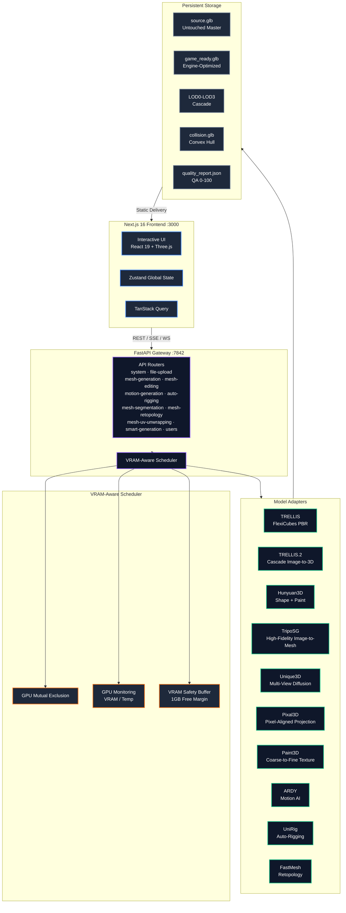
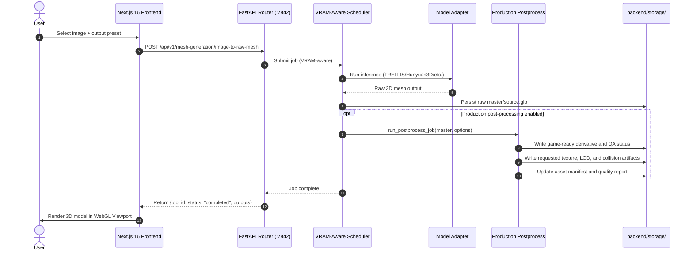
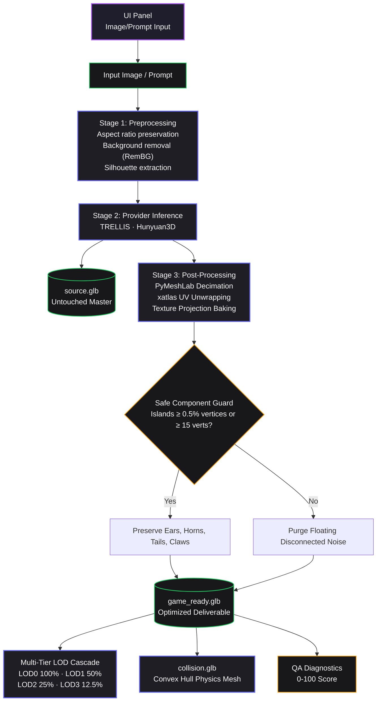

# Product Requirements Document — ForMesh 3D

## Product

**ForMesh3D** — An open-source, self-hosted platform for generative 3D asset creation, neural mesh synthesis, and automated game-ready post-processing.

## Problem & Product Position

Creating high-quality 3D assets requires expensive software, extensive artistic skill, and hours of manual work. Many 3D generation workflows require separate model runtimes, GPU setup, manual post-processing, and multiple tools to turn raw model output into a usable asset.

Existing open-source AI 3D tools produce raw outputs that lack the post-processing pipeline needed for game-ready assets (LOD cascades, physics colliders, quad retopology, UV unwrapping, QA validation).

**ForMesh3D addresses this workflow gap** by combining model integrations, local GPU execution, asset preservation, and production-oriented finishing in one studio.

## Target Users

- Game developers needing rapid, production-ready 3D asset prototyping (Unreal Engine 5, Unity, Godot 4)
- 3D technical artists seeking local AI-assisted workflow acceleration
- Researchers experimenting with generative 3D shape, texture, and motion models
- Studios requiring offline, self-hosted 3D generation with absolute data privacy

## Goal

Create a centralized, local AI 3D asset factory that takes a reference image and automatically produces the highest-quality practical 3D asset possible. Text prompts remain supported for mesh painting, localized mesh editing, and motion generation; direct Text → 3D mesh generation is out of scope.

## Core Features

### 1. Neural Shape Generation
- **Image-to-3D**: Generate raw untextured meshes from reference images using Hunyuan3D-Shape-v2-1, Hunyuan3D-DiT-v2-mini-Turbo, TRELLIS, TRELLIS.2, TripoSG, Unique3D, Pixal3D
- **Raw Geometry Output**: Normal shape generation produces raw geometry only, preserving clean topology without model-level texture baking or auto-chaining.
- **Low-VRAM Path**: Hunyuan3D-DiT-v2-mini-Turbo for 6GB GPUs
- **Official-Parity Inference**: Each model uses its own upstream/tuned inference schedule and supported raw extraction ceiling; a generic 75-step contract is not used.
- **Adapter-Owned Inference Profiles**: Locked schedules live in the adapters, and the UI exposes no step, guidance, sampler, or extraction-resolution controls. Adapters own the values; the scheduler filters request-side overrides. Configured and effective runtime values may differ when the implementation has an explicit safety limit. See `Docs/EXPERIMENTAL-MODEL-SETTINGS.md`; GPU execution and output-quality benchmarking are separate verification requirements.
- **Immutable Source Fidelity**: Raw model-native geometry is captured before production polycount/LOD optimization; hardware safety guards may reduce density only when required for safe VRAM execution.
- **Central Source-Fidelity Firewall**: The scheduler removes production-only target, decimation, remesh, LOD, physics, and paint orchestration controls before model inference.

### 2. Centralized PBR Texture Pipeline & Texture Studio
- **Centralized Texture Routing**: Automatic model selection based on user-visible output resolution preset:
  - **1K / 2K**: Paint3D (`OpenTexture/Paint3D`) coarse-to-fine UV texture diffusion
  - **4K / 8K**: Hunyuan3D-Paint-v2-1 with RealESRGAN x4+ enhancement
- **Universal Texture Toggle**: Single Textured Generation toggle available across all image-to-3D geometry models.
- **Durable Reference Image Preservation**: Passes the original reference image directly to the selected texture adapter along with the raw mesh.
- **Non-Destructive Texture Export**: Raw master geometry is preserved untouched (`master/source.glb`); textured models are exported separately (`textures/<name>_textured.glb`), allowing independent texture retries.

### 3. Post-Processing Pipeline
- **Mesh Decimation**: PyMeshLab quadric-edge-collapse decimation to target polycounts (fast_simplification fallback), building every LOD from the original mesh
- **UV Unwrapping**: xatlas conformal UV unwrapping
- **High-to-Low Detail Baking**: Enabled by default where the production path supports it, projecting source detail into normal/AO maps on derived game-ready UVs; the immutable source checkpoint is never mutated.
- **Safe Component Guard**: Preserve anatomical features (≥0.5% vertices or ≥15 verts)

### 4. Multi-Tier LOD Generation
- LOD0–LOD3 at most, with the level count selectable as 2, 3 or 4 levels
- UV and material preservation across LOD levels
- Ratio presets drive the cascade: mobile (100/35/12/5%), low (100/50/20/8%), medium (100/50/25/12.5%), high (100/60/30/15%), cinematic (100/75/50/25%)
- The per-job triangle budget comes from the target polycount chosen in the Generate panel's Target & Output Preset card

### 5. Physics Colliders
- Convex hull collision geometry via Trimesh, with optional CoACD multi-part convex decomposition
- Watertight mesh validation

### 6. Objective QA Diagnostic Engine
- Composite 0–100 score
- Topology & Geometry Integrity (35 pts)
- UV Mapping & Material Retention (35 pts)
- Platform Polycount Budget (30 pts)
- Non-manifold edge detection, UV overlap analysis, component count

### 7. Modular Game-Ready Export
- One-click download of structured ZIP packages
- Formats: GLB, OBJ, STL, FBX
- Organized: master/, game_ready/, lods/, collision/, textures/, previews/, metadata/

### 8. Animation & Rigging
- **UniRig**: Automated bipedal skeletal armature generation
- **ARDY**: Interactive autoregressive text-to-motion generation, executed locally on CPU without GPU/VRAM reservation
- Browser-playable `motion.json` format for Three.js

### 9. Mesh Segmentation
- The generic segmentation interface remains, but no segmentation model adapter is currently configured.

### 10. Mesh Editing
- The generic mesh-editing interface remains, but no mesh-editing model adapter is currently configured.
- Provider-specific inference is unavailable until an adapter is added.

### 11. Retopology
- **FastMesh**: Fast neural retopology (V1K, V4K)
- Manifold cleanup and target face count control

### 12. UV Unwrapping
- **PartUV**: Automated seam placement and UV chart packing
- Part-based UV unwrapping with LSCM

### 13. Multi-View Generation (Removed 2026-10-11)
- The Zero123++ model integration, dedicated workspace, reconstruction API, and download/install-manager entries have been removed from the active product.
- Vendored third-party source directories were intentionally left untouched for separate manual cleanup.

## MVP

- Image-to-3D shape generation (Hunyuan3D-Shape-v2-1, TRELLIS)
- PBR texture painting (Hunyuan3D-Paint-v2-1)
- Post-processing pipeline (decimation, UV, LOD, collision)
- QA scoring (0–100)
- Game-ready export (ZIP package)
- Web UI with 3D viewport

## Out of Scope

- Mobile application
- Payment system
- AI chatbot
- Social features
- Cloud-based processing (local-only by default)
- Real-time multiplayer collaboration

## Success Criteria

A user should be able to:
1. Upload a reference image or enter a text prompt
2. Select a model and generation parameters
3. Receive a complete game-ready 3D asset with LODs, collision, and QA report
4. Download a structured ZIP package for engine integration
5. View the 3D model in an interactive viewport with lighting controls

## Platform Triangle Budgets

| Platform | Target Triangle Budget | Max Vertices | Draw Calls |
|---|---|---|---|
| Mobile | ≤ 18,000 | ~10,000 | 1–2 |
| Low | ≤ 28,000 | ~16,000 | 1–2 |
| Medium | ≤ 45,000 | ~25,000 | 1–3 |
| High | ≤ 85,000 | ~50,000 | 1–4 |
| Cinematic | ≤ 180,000 | ~100,000 | 1–5 |

These rows are the reference targets used to choose a target polycount in the Generate panel's Target & Output Preset card. The backend enforces one budget per job — the requested target polycount — and scores the result against it in the QA polycount category.

## Technology Stack

- **Frontend**: Next.js 16, React 19, TypeScript, Tailwind CSS v4, Three.js, React Three Fiber
- **Backend**: FastAPI, Python 3.10, Pydantic V2
- **Scheduler**: VRAM-aware multiprocess scheduler
- **Queue**: Redis 7 (optional, multi-worker mode)
- **Package Manager**: Bun (frontend), Conda/uv (backend)
- **GPU**: NVIDIA CUDA 12.4, PyTorch 2.6.0

## Architecture



## Generation Request Flow



The scheduler owns worker selection and job state. `backend/postprocess/pipeline.py` owns derivative generation; disabling production post-processing bypasses these derivative stages and returns raw output.

## Quality Pipeline



## VRAM Requirements by Model

| Model | VRAM Required | Quality | Speed |
|---|---|---|---|
| TRELLIS | 11.5 GB | High quality | ~60 seconds |
| TRELLIS.2 | 23 GB | Highest quality | ~60 seconds |
| Hunyuan3D-Shape-v2-1 | 10 GB (shape stage) | High quality | ~90 seconds |
| Hunyuan3D-Paint-v2-1 | 12 GB separately configured scheduler reservation (no verified hard minimum; actual peak can exceed it) | PBR texture with RealESRGAN x4+ | ~120 seconds |
| Hunyuan3D-DiT-v2-mini-Turbo | ~6 GB | Low-resource shape | ~30 seconds |
| TripoSG | 8 GB | High-fidelity image/scribble | ~10-20 seconds |
| Unique3D | 10 GB | High-fidelity multi-view reconstruction | Not benchmarked (balanced latency class) |
| Pixal3D | 18 GB (10 GB in low-VRAM mode) | Pixel-aligned projection geometry | Not benchmarked (quality latency class) |
| ARDY | CPU-only; no GPU VRAM reservation | Motion AI & Animation; CPU/RAM-bound | Host-dependent; slower than GPU inference |
| UniRig | 9 GB | Auto-rigging | ~20 seconds |
| FastMesh-V1K | 16 GB | Retopology | ~30 seconds |
| FastMesh-V4K | 24.5 GB | High-res retopology | ~30 seconds |

FastMesh's V1K/V4K VRAM figures above are conservative ForMesh3D scheduler budgets, not official minimums published by the model authors. Upstream lists an A6000-tested environment and uses batch size 3 for V1K and 1 for V4K, but does not state an exact minimum VRAM. Public weight files are approximately 4.38 GB and 4.39 GB respectively; disk size is not peak inference memory. When one card cannot meet the reservation, the adapter uses Accelerate automatic layer placement and admits aggregate memory only if the generated map spans at least two selected GPUs. GPU/checkpoint inference and peak memory still require validation on the target hardware.

## QA Scoring Methodology

| Category | Weight (Points) |
|---|---|
| Topology & Geometry Integrity | 35 |
| UV Mapping & Material Retention | 35 |
| Platform Polycount Budget | 30 |

- **Topology & Geometry Integrity** (35 pts): Non-zero geometry, consistent normals, watertight manifoldness, connected component cleanliness
- **UV Mapping & Material Retention** (35 pts): Valid UVs, texture retention, UV overlap detection
- **Platform Polycount Budget** (30 pts): Target triangle budget compliance, LOD cascade correctness

## Third-Party Model Licenses

ForMesh 3D does not own or claim rights to third-party architectures or weights. See `backend/thirdparty/LICENSE` and `backend/postprocess/THIRD_PARTY_LICENSE.md` for complete licensing information.

## Configuration

Key environment variables in `.env`:

```env
ENVIRONMENT=development
DEBUG=true
APP_NAME=ForMesh 3D API
APP_VERSION=0.1.0
BACKEND_URL=http://localhost:7842
REDIS_URL=redis://localhost:6379/0
CUDA_DEVICE=auto
MAX_VRAM_MB=0
VRAM_SAFETY_MARGIN_MB=1024
AUTO_UNLOAD_AFTER_JOB=true
FORMSH3D_CPU_THREADS=auto
FORMSH3D_CPU_WORKERS=auto
STORAGE_LOCAL_PATH=./backend/storage
API_V1_PREFIX=/api/v1
CORS_ORIGINS=["http://localhost:3000"]
P3D_USER_AUTH_ENABLED=false
```

## Access Points

| Service | URL | Port | Description |
|---|---|---|---|
| Frontend Workspace | `http://localhost:3000` | 3000 | Interactive generation and 3D viewport |
| Backend REST API | `http://localhost:7842` | 7842 | FastAPI application gateway |
| Interactive API Docs | `http://localhost:7842/docs` | 7842 | Swagger UI with test sandbox |
| Health Check | `http://localhost:7842/health` | 7842 | Service health status |

## Project Structure

```text
ForMash3D/
├── app/                               # Next.js 16 App Router
├── features/                          # Feature modules
├── components/                        # Shared UI components
├── hooks/                             # React hooks
├── services/                          # API clients
├── stores/                            # Zustand stores
├── backend/                           # FastAPI backend
│   ├── api/                           # Routers
│   ├── core/                          # Scheduler, VRAM manager
│   ├── adapters/                      # Model adapters
│   ├── config/                        # models.yaml, system.yaml
│   ├── postprocess/                   # Production pipeline and mesh-processing services
│   ├── scripts/                       # install.sh, download_models.sh
│   ├── thirdparty/                    # Third-party source code
├── scripts/                           # Setup and lifecycle scripts
├── Docs/                              # Technical documentation
├── backend/storage/                   # Generated assets
├── backend/thirdparty/wheels/         # Prebuilt wheels
├── .env.example                       # Environment template
├── README.md
├── LICENSE
├── Docs/SECURITY.md
└── package.json
```

## Deployment Modes

### Single-Worker Mode
```bash
cd backend && conda activate 3daigc-api
uvicorn api.main_singleworker:app --workers 1 --port 7842
```

### Multi-Worker Mode (Redis Queue)
```bash
redis-server
conda activate 3daigc-api
python backend/scripts/scheduler_service.py
cd backend && conda activate 3daigc-api
uvicorn api.main_multiworker:app --workers 4 --port 7842
```

## Future Roadmap

- [ ] Cloudflare tunneling for remote access
- [ ] Automated test suite (backend e2e tests)
- [x] DCC Bridge (Blender, Unreal, Unity, Maya)
- [x] Advanced animation studio with timeline
- [ ] Model-specific fine-tuning UI
- [ ] Batch generation queue management
- [ ] Collaborative workspace features
- [ ] Mobile-responsive PWA support

## Current Production Post-Processing Contract — 2026-09-29

Generation requests enter production post-processing only when `enable_postprocess` is enabled. Native/Raw requests bypass production processing; enabled requests preserve the raw generation output in the immutable master workspace before derivatives are created.

The canonical workspace contains master/, game_ready/, lods/, collision/, textures/, previews/, and metadata/. Only artifacts that actually succeed are written.

Normal downloads target game_ready/. ZIP export is an on-demand snapshot of the entire workspace.

### Production Export & Quick-Profiles
The studio provides 1-click Quick-Profiles ("GLB Game-Ready", "Unity Mobile", "Unreal High-Poly", "Blender Raw") and custom profile saving in `ExportModal.tsx`. Profiles preserve combinations of format, target LODs (LOD0-LOD3/All), collision geometry, and texture resolutions. Profiles strictly pre-fill configuration without bypassing the single canonical export pipeline.

## Physics capability
The product now supports an optional Physics Ready generation intent. Users can enable physics preparation before generation and adjust body behaviour, mass mode, collision quality, friction, restitution, damping, and gravity. Physics-ready assets expose collision and physics metadata and can be interactively tested in the existing model viewer. The first production scope is rigid-body simulation; deformable/jiggle behaviour remains capability-gated rather than being faked. Physics preparation reuses the existing collision pipeline and does not add an AI model.

## Phase 1 Product Contract

### Image Enhancement
Generation Preview is optional. The approved artifact is content-addressed and reused exactly by the generation job. High-resolution images are not blindly upscaled; enhancement failures carry explicit fallback metadata.

### Printability
Printability QA is deterministic topology inspection in the shared production post-process path. Auto-repair is explicit. A failed final check is surfaced as a degraded result. In the `3d_print` smart preset, `target_polycount: 0` ensures complete passthrough without decimation artifacts, preserving strict watertight manifold geometry for physical slicing.

### Quad Retopology & Polygonal Export
Supports quad-dominant retopology via the AutoRetopo quad conversion in the production pipeline, exporting standard Wavefront OBJ format with 4-vertex polygonal faces (`f v1 v2 v3 v4`). When quad-dominant topology is requested and generated, the postprocessing optimization stage automatically preserves quad topology without destructive triangle decimation.

### Auto-Rigging
One canonical enable_auto_rig flag runs UniRig after the final production mesh. The immutable source/master is never replaced by the rigged derivative. A rigged artifact is not reported ready until the child job has produced a durable output.

### Smart Intent
Five built-in intent presets (`game_ready`, `cinematic`, `animation`, `3d_print`, `mobile`) are backend-owned and deterministic in `backend/config/smart_presets.yaml`: game_ready 50K tris / 1K atlas with collision, cinematic 200K / 2K, animation 30K / 1K with auto-rig, 3d_print raw with printability check and auto-repair, mobile 20K / 1K. The Generate panel exposes these five plus a `Native` chip that bypasses post-processing and returns the raw generative mesh, and it mirrors the backend catalogue through a minimal offline fallback table in `constants/smartPresetFallback.json` guarded by `backend/tests/test_smart_preset_parity.py`. Explicit top-level budget inputs take precedence over nested defaults and presets (`_resolve_target_polycount_precedence`). Explicit model selection remains an override; the scheduler remains the final concurrency and VRAM authority.
