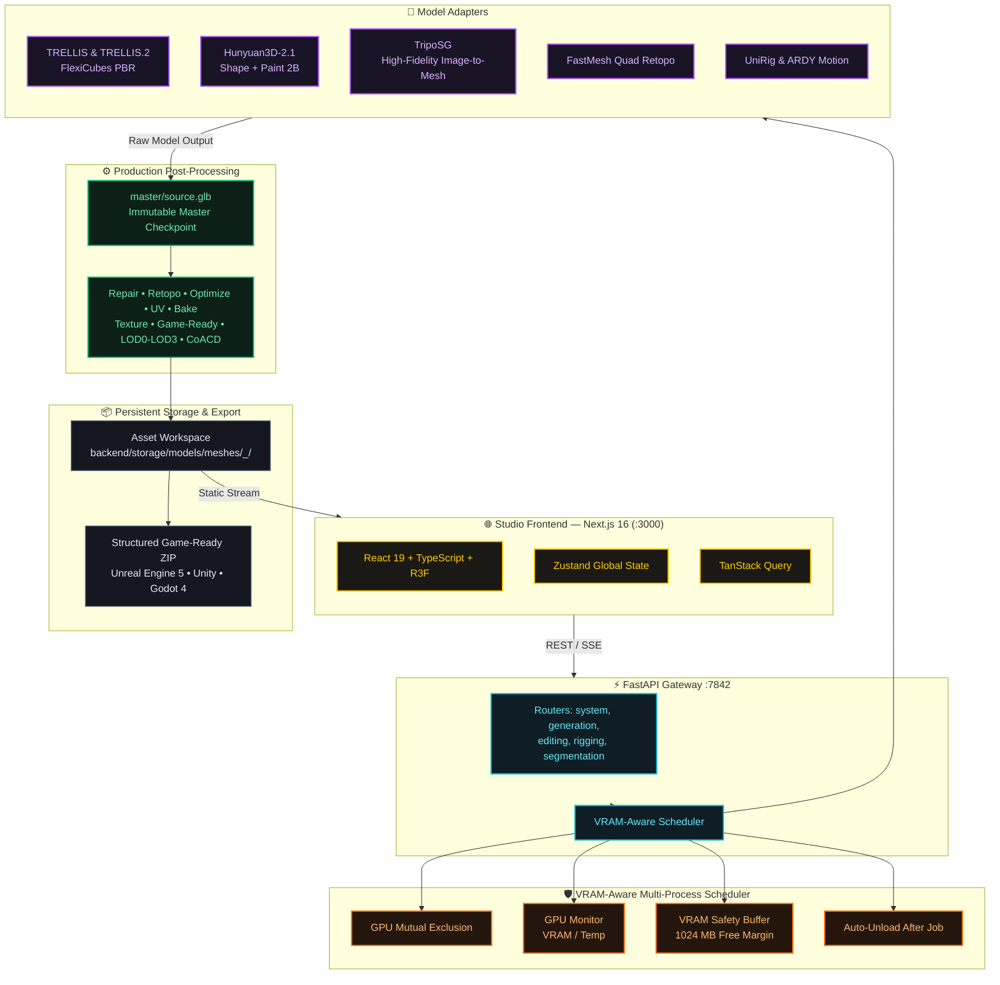
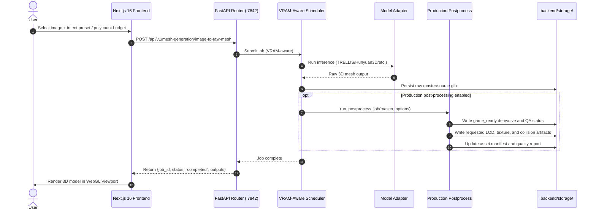

## 2026-10-19 Texture, UV and Rigging Contract Update

- Paint3D/Hunyuan3D-Paint requests reject user-supplied localized UV masks until an adapter actually wires them into inference; full-mesh texturing remains available.
- The UV inspector requests the selected channel from the live viewport mesh, draws sampled triangle edges and shows only measurable counts/bounds. UV-island count, overlap and texel density are not claimed without analysis code.
- PartUV honors the requested distortion threshold and individual-part output flag; a failed/missing pack artifact fails the operation instead of returning a false packed result.
- UniRig UI sends no unsupported topology/IK/weight overrides. Manual symmetry remains editor-only, and persistence failures block the legacy inspector's success navigation.

## 2026-09-30 Review Audit Runtime Contracts

- Redis control-plane data uses noeviction; result payloads use dedicated TTL keys.
- Scheduler SQLite persistence is offloaded from the async event loop.
- Processing jobs are recovered after backend restart.
- Timeout and cancellation terminate the owning worker before the job becomes terminal.
- Client filesystem paths are root-restricted and upload/base64 ingestion is bounded.
- Resource-blocked jobs rotate instead of globally blocking compatible work.

# 🏛️ ForMesh 3D — Complete System Architecture & Pipeline Blueprint

> **System Version**: 0.1.0 (FastAPI + Next.js 16, Python 3.10)
> **Target Deployments**: Single- or multi-GPU Linux / Cloud GPU / Local Workstations
> **Last Verified**: October 19, 2026
> **Design Tokens**: Studio Gold `#FFCC00` (`48 100% 50%`) on Matte Black `#080808`

---

## 1. Executive System Overview

ForMesh 3D is an end-to-end generative 3D reconstruction and asset optimization platform that converts reference images into game-ready 3D assets. Text prompts remain supported for mesh painting, localized mesh editing, and motion generation.

### Core Stack
- **Frontend**: Next.js 16 (React 19, TypeScript, Three.js, React Three Fiber, Tailwind CSS)
- **API Gateway**: FastAPI (Python 3.10, Conda env `3daigc-api`, Pydantic V2, AsyncIO)
- **Model Adapters**: Python adapters for TRELLIS, TRELLIS.2, Hunyuan3D-2.1 (Shape/Paint/Mini Turbo), Paint3D, PartUV, UniRig, FastMesh, TripoSG, Unique3D, ARDY, Pixal3D and TaoFlowForge
- **Scheduler**: VRAM-aware multiprocess scheduler with GPU monitoring
- **Queue/Broker**: Redis 7 (optional, multi-worker mode only)
- **File Storage**: Local filesystem + Redis FileStore (multi-worker mode)

### Model-Native Source Fidelity Contract
1. The frontend sends no model-specific inference schedule; numeric inference profiles (steps, guidance, octree/depth resolution, samplers) are owned by each adapter's `_LOCKED_INFERENCE_PROFILE`. Only the seed and the image identity stay caller-controlled.
2. Scheduler removes post-process-only target, extraction/decimation/remesh, LOD, physics, and paint controls before model inference, and also strips adapter-owned inference keys.
3. Adapter extraction and inference profiles are adapter-owned; the canonical values live in the adapter implementations and must not be copied into a second documentation table. Configured requests and effective runtime values are not interchangeable; see `Docs/EXPERIMENTAL-MODEL-SETTINGS.md` for known limits and the verification boundary.
4. Source texture settings are model-owned and separate from downstream production atlas resolution.
5. master/source.glb is immutable; derived retopo, UV, LOD, collision, and bake artifacts cannot rewrite it.


### Intent Preset Contract

Intent presets (`backend/config/smart_presets.yaml`, version 1) define the default production budget for a generation request:

| Intent | Target polycount | Atlas | LOD | Collision | Auto-rig | Printability | Auto-repair |
|---|---:|---:|---|---|---|---|---|
| `mobile` | 20,000 | 1024 | on (`mobile` preset, 4 levels) | off | off | off | off |
| `game_ready` | 50,000 | 1024 | on (`high` preset, 4 levels) | on | off | off | off |
| `cinematic` | 200,000 | 2048 | on (`high` preset, 4 levels) | off | off | off | off |
| `animation` | 30,000 | 1024 | on (`high` preset, 4 levels) | off | on | off | off |
| `3d_print` | 0 (native passthrough) | 0 (none) | off | off | off | on | on |
| `native` | -1 (backend-only sentinel) | 0 | off | off | off | off | off |

- `native` is a backend sentinel (`backend/core/smart_presets.py`), not a YAML preset entry. The workspace's Native card reaches the same Native/Raw outcome by setting `enable_postprocess=false`.
- Production-option precedence is explicit request value > intent preset > backend default.
- `texture_resolution`, `enable_printability_check`, `enable_auto_repair`, `enable_auto_rig`, `physics_enabled`, `generate_lod`, `lod_preset` and `lod_count` are tri-state request fields; omitting them lets the intent preset supply the value.
- `target_polycount`: an explicit value > 0 or the `-1` native sentinel wins, `0` means "no explicit budget" and falls back to the intent preset. Native/Raw output is requested with `intent=native` or `enable_postprocess=false`.
- The request builder posts to `/api/v1/mesh-generation/image-to-raw-mesh` and sends only `seed` inside `model_parameters`; there is no `output_preset`, `auto_optimize` or `physics_collider` request field.

### Shared Model Runtime Dependency Contract

- ARDY is explicitly CPU-only in the model manifest and scheduler. The worker reserves no GPU memory and hides CUDA in its dedicated process; the model and local LLM2Vec encoder both receive device=cpu.
- The vendored LLM2Vec text encoder keeps non-CUDA requests on the single-process path even when multiple GPUs are visible on the host. CPU generation is slower and requires sufficient system RAM and access to the gated text-encoder checkpoint.
- Transformers is pinned at 4.48.3 for Hunyuan3D Mini's upstream minimum and PEFT's `HybridCache` import; Diffusers 0.30.3 and PyTorch 2.6.0 + CUDA 12.4 stay pinned.
- Hunyuan loaders resolve vendored module roots explicitly, validate expected source/checkpoint paths, and keep full initialization tracebacks in backend logs.

### GPU Placement & Derived Artifact Contract
- The scheduler combines tracked reservations with live per-device free memory. Aggregate VRAM is admitted only for adapters that actually shard model layers or place independent components on multiple GPUs.
- FastMesh uses Accelerate automatic device mapping and rejects a multi-GPU plan if its map does not use at least two selected GPUs. Hunyuan3D-Paint uses bounded row-chunk raster work and separate renderer/super-resolution and multiview diffusion devices when a multi-GPU plan is supplied.
- Paint3D child-stage processes remain single-GPU and are not declared multi-GPU capable. UniRig, PartUV, and ARDY retain their existing single-device inference paths until their own adapters implement and verify actual sharding.
- Rigging stores native FBX plus a GLB viewport artifact. The viewer obeys canonical artifact-format query values, and rigged geometry invalidates the previous thumbnail.




---

## 2. End-to-End Generation Lifecycle



The scheduler owns model workers and job state; `backend/postprocess/pipeline.py` owns derivative generation and final production status. When production post-processing is disabled, the scheduler marks it bypassed and returns the raw master result.

---

## 3. Paint-v2-1 Pipeline Flow

```mermaid
flowchart TD
    classDef input fill:#1e293b,stroke:#3b82f6,stroke-width:2px,color:#fff
    classDef process fill:#0f172a,stroke:#10b981,stroke-width:2px,color:#fff
    classDef output fill:#1e293b,stroke:#ec4899,stroke-width:2px,color:#fff
    classDef guard fill:#0f172a,stroke:#f59e0b,stroke-width:2px,color:#fff

    IN["Immutable master/source.glb<br/>Raw Geometry"]:::input
    IN --> TEXTURE{"Textured Generation enabled?"}:::guard
    TEXTURE -->|No| RAW["Keep raw master<br/>No texture stage"]:::output
    TEXTURE -->|Yes| SIZE{"Requested atlas preset"}:::guard
    SIZE -->|1K / 2K| PAINT3D["Paint3D<br/>Coarse generation + UV refinement"]:::process
    SIZE -->|4K / 8K| HUNYUAN["Hunyuan3D-Paint v2.1<br/>RealESRGAN enabled internally"]:::process
    PAINT3D --> VERIFY["Inspect embedded base-colour atlas<br/>Require exact requested square size"]:::process
    HUNYUAN --> VERIFY
    VERIFY -->|Verified| EXPORT["Export separate textured GLB<br/>Keep source.glb untouched"]:::output
    VERIFY -->|Missing / mismatch / failure| RAWFAIL["Preserve raw master<br/>Record texture-stage failure"]:::output
```mermaid
flowchart TD
    classDef input fill:#1e293b,stroke:#3b82f6,stroke-width:2px,color:#fff
    classDef process fill:#0f172a,stroke:#10b981,stroke-width:2px,color:#fff
    classDef output fill:#1e293b,stroke:#ec4899,stroke-width:2px,color:#fff
    classDef guard fill:#0f172a,stroke:#f59e0b,stroke-width:2px,color:#fff

    IN["Immutable master/source.glb<br/>Raw Geometry"]:::input
    IN --> TEXTURE{"Textured Generation enabled?"}:::guard
    TEXTURE -->|No| RAW["Keep raw master<br/>No texture stage"]:::output
    TEXTURE -->|Yes| SIZE{"Requested atlas preset"}:::guard
    SIZE -->|1K / 2K| PAINT3D["Paint3D<br/>Coarse + UV refinement"]:::process
    SIZE -->|4K / 8K| HUNYUAN["Hunyuan3D-Paint v2.1<br/>RealESRGAN enabled internally"]:::process
    PAINT3D --> VERIFY["Inspect embedded base-colour atlas<br/>Require exact requested dimensions"]:::process
    HUNYUAN --> VERIFY
    VERIFY -->|Verified| EXPORT["Export separate textured GLB<br/>Keep source.glb untouched"]:::output
    VERIFY -->|Failed / mismatch| RAWFAIL["Preserve raw master<br/>Record texture-stage failure"]:::output
```

    style IN fill:#1e293b
    style SHAPE fill:#0f172a
    style PAINT fill:#0f172a
    style RES fill:#0f172a
    style PBR fill:#0f172a
    style VRAM fill:#0f172a
    style OK fill:#1e293b
    style EXPORT fill:#1e293b
```

---

## 4. High-Throughput & Low-Latency Performance Architecture

### 4.1 VRAM-Aware Scheduling

| Optimization | Mechanism | Impact |
|---|---|---|
| **GPU Mutual Exclusion** | Strict locking prevents multi-provider GPU OOM | Safe concurrent inference |
| **GPU Monitoring** | Real-time VRAM/temperature polling via `GPUMonitor` | Dynamic scheduling decisions |
| **VRAM Safety Buffer** | `memory_buffer=1024` (1GB free) + `VRAM_SAFETY_MARGIN_MB=1024` | Prevents OOM on loaded models |
| **Auto Unload** | `AUTO_UNLOAD_AFTER_JOB=true` | Frees VRAM between jobs |

### 4.2 API Performance

| Optimization | Mechanism | Impact |
|---|---|---|
| **Request Timing** | `X-Process-Time` response header on every request | Latency visibility |
| **Connection Reuse** | Frontend uses axios singleton (`services/apiClient.ts`) | Eliminates per-request overhead |
| **SSE Streaming** | Server-Sent Events for generation progress | Real-time feedback without polling |
| **Pydantic Serialization** | `FastAPI native response_model` | 10-20x faster JSON |
| **GZip Compression** | `GZipMiddleware(minimum_size=1000)` | 75-85% response size reduction |
| **Native Dense Decoder Enforcement** | `configure_native_dense_decoder()` forces `VanillaVolumeDecoder + MCSurfaceExtractor` with `mc_algo="mc"`, disables FlashVDM | Eliminates detail smoothing/loss in Hunyuan3D raw geometry |
| **Official Mini Turbo Resolution** | `octree_resolution=768` (adapter-locked `_LOCKED_INFERENCE_PROFILE`) | Locks Mini Turbo geometry sampling to the adapter-owned profile |
| **TripoSG Max Hierarchical Depth** | `dense_octree_depth=10`, `hierarchical_octree_depth=11` (adapter-locked; no automatic VRAM downgrade) | Preserves fine details in TripoSG raw extraction |

### 4.3 VRAM Requirements by Model

| Model | VRAM Required | Quality | Speed |
|---|---|---|---|
| TRELLIS | 11.5 GB | High quality | ~60 seconds |
| TRELLIS.2 | 23 GB | Highest quality | ~60 seconds |
| Hunyuan3D-Shape-v2-1 | 10 GB (shape) / 29 GB (shape+texture) | High quality | ~90 seconds |
| Hunyuan3D-Paint-v2-1 | ~21 GB | PBR texture with RealESRGAN x4+ | ~120 seconds |
| Hunyuan3D-DiT-v2-mini-Turbo | ~6 GB | Low-resource shape | ~30 seconds |
| TripoSG | 8 GB | High-fidelity image/scribble | ~10-20 seconds |
| ARDY | CPU-only; no GPU VRAM reservation | Motion AI & Animation; CPU/RAM-bound | Host-dependent; slower than GPU inference |
| UniRig | 9 GB | Auto-rigging | ~20 seconds |
| FastMesh-V1K | 16 GB | Retopology | ~30 seconds |
| FastMesh-V4K | 24.5 GB | High-res retopology | ~30 seconds |

**FastMesh VRAM and weights note:** The 16 GB (V1K) and 24.5 GB (V4K) values are conservative ForMesh3D scheduler reservations, not minimums published by upstream. The official repository lists an A6000-tested environment and uses batch size 3 for V1K and 1 for V4K, but does not publish an exact minimum VRAM. Public checkpoint files are about 4.38 GB (V1K) and 4.39 GB (V4K) on disk; disk size is not peak inference memory. FastMesh is single-GPU-only in the current adapter, so 2×T4 aggregate memory is not combined for admission. [Upstream FastMesh](https://github.com/jhkim0759/FastMesh) · [V1K checkpoint](https://huggingface.co/WopperSet/FastMesh-V1K) · [V4K checkpoint](https://huggingface.co/WopperSet/FastMesh-V4K)

---

## 5. Multi-Format Asset Packaging & Delivery

Generated assets are packaged for delivery via the API. The following formats are supported for export:

| Format | Target Software / Engine | PBR Support |
|---|---|---|
| **GLB** | WebGL, Three.js, Godot 4 | Complete PBR (Roughness/Metallic) |
| **GLTF** | WebGL, Three.js | Complete PBR |
| **FBX** | Unreal Engine 5, Unity | Skeletal Rig + Materials |
| **OBJ** | Wavefront, ZBrush | Geometry + MTL |
| **STL** | 3D Printing, CAD | Pure Surface Geometry |
| **PLY** | Point Clouds, MeshLab | Vertex Coordinates & Colors |

Production ZIP bundles mirror the canonical asset workspace (the archive is built from the workspace root, so the real folder names are preserved):
```
Project_Export_<job_id>.zip
├── master/
│   └── source.glb             # Original byte-for-byte neural output
├── game_ready/
│   └── <asset>_<job_id>.glb    # Engine-compliant decimated mesh
├── lods/
│   ├── lod0.glb               # 100% of the game-ready triangles
│   ├── lod1.glb               # LOD ratio preset (e.g. 60% for 'high')
│   ├── lod2.glb               # LOD ratio preset (e.g. 30% for 'high')
│   └── lod3.glb               # LOD ratio preset (e.g. 15% for 'high')
├── collision/
│   └── collision.glb          # Watertight physics convex hull
├── textures/                  # Textured GLB and packed maps (when the texture stage ran)
├── previews/                  # Asset preview images
└── metadata/
    ├── quality_report.json    # Topology validation score (0-100)
    ├── asset.json             # Canonical asset manifest
    └── physics.json           # Physics configuration (when requested)
```

LOD ratios come from the `lod_preset` table — `mobile` [1.0, 0.35, 0.12, 0.05], `low` [1.0, 0.5, 0.2, 0.08], `medium` [1.0, 0.5, 0.25, 0.125], `high` [1.0, 0.6, 0.3, 0.15], `cinematic` [1.0, 0.75, 0.5, 0.25]. At most four levels are produced (LOD0-LOD3) and `lod_count` is clamped to 1-4; there is no fixed 100/50/25/12.5 default.

> **Note**: Asset delivery uses GET /api/v1/system/jobs/{job_id}/download?artifact_format=.... ZIP archives are generated on demand from the canonical asset workspace.

---

## 6. Deployment Modes

### Single-Worker (Default)

```bash
cd backend && conda activate 3daigc-api
uvicorn api.main_singleworker:app --workers 1 --port 7842
```

- Embedded VRAM-aware scheduler
- No external broker required
- Best for single-GPU and CPU deployments

### Multi-Worker (Redis Queue)

```bash
# Terminal 1: Start Redis
redis-server

# Terminal 2: Start scheduler service
conda activate 3daigc-api
python backend/scripts/scheduler_service.py

# Terminal 3: Start API workers
cd backend && conda activate 3daigc-api
uvicorn api.main_multiworker:app --workers 4 --port 7842
```

- Redis-backed job queue (`RedisJobQueue`)
- Multiple uvicorn workers
- Redis FileStore for cross-worker metadata sharing
- Optional Redis-based authentication (`P3D_USER_AUTH_ENABLED=true`)

---

## 7. Verification & Health Check

The backend exposes a health endpoint for runtime verification:
```bash
curl -s http://localhost:7842/health | jq .
# {"status": "healthy", "timestamp": ..., "version": "0.1.0"}
```
`/health` is a liveness check and does not load or validate inference models. Use
`/api/v1/system/models` for non-loading per-model readiness, which checks the
manifest path and local weight/config files, and reports CUDA availability.

The frontend can be type-checked and built with:
```bash
npx tsc --noEmit
bun run build
```

> **Note**: An automated `backend/tests/test_backend_e2e.py` test script referenced in earlier documentation does not currently exist. The health endpoint and TypeScript compiler provide the available self-check mechanisms.

## Production Asset Lifecycle & Two-Way PostProcess Pipeline

ForMesh3D executes post-processing via two complementary pathways:
1. **Conditional Production Chaining:** When `enable_postprocess` is enabled, generation -> raw model output -> immutable `master/source.glb` -> scheduler call to `run_postprocess_job` (repair -> conditional retopo -> target budget -> UV -> bake/texture -> requested LOD/collision -> QA) -> production completion -> `WorkspaceContext.tsx` artifacts. Native/Raw requests with post-processing disabled bypass this chain.
2. **Manual On-Demand PostProcess: Users can select any workspace model or upload an external mesh (`.glb`, `.obj`, `.stl`, `.ply`) inside `RemeshPanel.tsx`, `UVUnwrapPanel.tsx`, or `MeshSegmentPanel.tsx` to execute discrete operations on demand via REST API (`/api/v1/mesh-retopology/*`, `/api/v1/mesh-uv-unwrapping/*`, `/api/v1/mesh-segmentation/*`).
The post-processing stage runs in `asyncio.to_thread` so CPU/GPU mesh operations do not block FastAPI's event loop.

## Physics path
Generation requests may carry a physics intent and provider-neutral controller values. The scheduler preserves those values as job metadata. Post-processing conditionally reuses the existing collision service and writes `metadata/physics.json`. The viewer consumes the canonical collision artifact and metadata through a pinned Rapier 0.19.3 browser adapter while the existing Three.js rendering pipeline remains unchanged. Physics binding waits for asset-load completion to prevent cross-asset state leakage.

## Review Audit — Current Job Lifecycle

Browser JobStore / Workspace jobs → FastAPI submit → scheduler → GPU worker → **raw model result** → immutable master → production postprocess → game-ready/LOD/physics/QA artifacts → terminal completion.

Batch submissions use a scheduler-owned batch identifier and `max_parallel`; blocked batch items remain queued without consuming another worker slot.

## Review Audit Final Runtime Flow

Browser → versioned API → canonical model/capability readiness → scheduler/resource reservation → worker → raw result visible → background post-processing → canonical asset manifest → QA/game-ready/export artifacts.

Batch jobs share one batch ID but retain independent job IDs. Cancellation is centralized through the scheduler control plane, including Redis deployments.


## 2026-09-30 Final Runtime Contract Reconciliation

- Container dependency paths resolve against the repository's backend layout and the maintained Wheels release.
- SQLite status/progress persistence is offloaded and bounded; status reads do not mutate or synchronously persist jobs.
- Successful raw inference is terminal for GPU execution; background production post-processing carries independent status/progress/error metadata and preserves input lineage until completion.
- Model readiness is based on canonical manifest paths, local checkpoint payloads plus model descriptors for directory paths, CUDA availability, capabilities, and manifest VRAM; adapter defaults do not override that contract. Health routes remain liveness-only and never load models.
- The workspace uses backend capability metadata for route selection, maintains bounded LRU GLB cache accounting, and rehydrates final production artifacts into the same job asset.
- Artifact naming is UUID-based across generation/segmentation/rig outputs, and stale request temp directories are removed during scheduler recovery.


## Runtime Contract Update — 2026-10-02
- Interactive mesh tools run in-process through `/api/v1/mesh-tools/*`; the default runtime does not launch a browser-facing port 8200 sidecar.
- Durable job polling owns generation progress; mesh-tool operations may use SSE for operation-level progress.
- Failed production post-processing keeps the canonical asset root and immutable master so the job can retry without model inference.

## High-Fidelity Generation Control Plane — 2026-10-08

The production path is now conceptually:

`Input -> capability detection -> model-aware preprocessing -> resource-aware routing -> retained model -> immutable master -> conservative repair/remesh/retopo -> UV -> bake -> optimized derivative -> LOD/game-ready -> quality gates`

Resource placement is handled centrally. Single-GPU loading is preferred when safe; multi-GPU loading is attempted only for adapters that explicitly declare a supported strategy. Current supported generic multi-GPU integration uses Accelerate component dispatch for compatible diffusers-style pipelines, including the TRELLIS.2 adapter path.

The production result distinguishes the immutable high-fidelity master from the optimized game-ready mesh and exposes quality diagnostics without turning non-ground-truth metrics into false absolute scores.

## Normalized Capability Contract — 2026-10-08

Model configuration is normalized once at load time into a shared capability contract. The same contract drives smart intent admission, scheduler routing, optional preprocessing profiles, runtime model details, multi-GPU eligibility and UI capability state. Production QA reports finite-geometry checks, UV/material checks, LOD lineage and master-to-derivative drift without modifying master/source.glb.

## Continuous 3D Viewport & Dynamic-Tab Architecture — 2026-10-13

The Next.js 16 Presentation Layer runs a persistent, non-destructive 3D workspace:
- **Permanent WebGL Viewport (`MeshViewer`)**: The Three.js 3D canvas and `ViewportToolOverlay` stay mounted continuously in `#center-viewport-stage` across all workspace tool switches (`model`, `remesh`, `texture`, `uv`, `segment`, `edit`, `animation`, `rigging`), eliminating canvas destructions, WebGL context recreation lag, and mesh re-loading.
- **Dynamic Floating Rails**:
  - Left floating rail routes via `renderToolPanel()` to lightweight modules (`GeneratePanel`, `RemeshPanel`, `TexturePanel`, `UVUnwrapPanel`, `MeshSegmentPanel`, `MeshEditPanel`, `AnimationLeftPanel`, `RiggingLeftPanel`).
  - Right inspector rail routes via `RightWorkspacePanel` to tool-specific inspectors (`RightPropertyPanel`, `UVInspector`, `SegmentInspector`, `MeshEditInspector`, `AnimationRightInspector`, `RiggingRightInspector`).
  - Viewport-anchored overlays (`AnimationTimelineDock`) provide in-canvas transport controls, scrubbing, and FPS selection.
- **Non-Destructive Navigation**: `navigateToMain` in `WorkspaceContext` uses `window.history.replaceState` for hub views (`overview`, `assets`, `jobs`, `system`), preserving the 3D scene state in memory without page destruction.

## Viewport Performance Engine & Postprocessing Hardening — 2026-10-14

### Viewport Performance & Manipulator Controls
- **Zero-Allocation Material Switcher**: Caches alternate shading materials lazily on `child.userData.__shadingMaterialCache`, dynamically toggling wireframe and swapping materials with 0 runtime memory allocations.
- **Event-Driven Reflection Peek**: Replaced 1-second continuous polling with OrbitControls `'end'` event listener debounced at 250ms, eliminating idle GPU load and revoking stale object URLs cleanly.
- **Interactive TransformControls**: Embedded 3D translate/rotate/scale gizmo in Edit mode, synchronized with OrbitControls mutual exclusion to prevent camera rotation while dragging.
- **Axial Camera View Presets**: Perspective, Front, Side, and Top alignment presets smoothly snapping camera position to cardinal coordinate axes.
- **Decoupled MeshDiffViewer RAF Loop**: Replaced stateful React animation frame re-render loop with a direct `requestAnimationFrame` render loop with `cancelAnimationFrame` cleanup, eliminating 60–120fps component re-render overhead.

### Postprocessing Pipeline Hardening
- **Quad OBJ Polygonal Export**: `_export_quad_obj` serializes genuine 4-vertex polygonal faces (`f v/vt/vn ...`), with automatic decimation passthrough when quad retopology is requested.
- **Smart Preset Budget Precedence**: `_resolve_target_polycount_precedence` gives explicit top-level request budgets (a positive value or the `-1` native sentinel) priority over nested parameters and smart presets, while `_resolve_preset_option` resolves every other production option as explicit request value > intent preset > backend default. A request value of `0` means "no explicit budget" and falls back to the intent preset; Native/Raw output is requested with `intent=native` or `enable_postprocess=false`.
- **Headless Blender Execution**: `blender_worker_argv` and `blender_expr_argv` prefer `BLENDER_EXECUTABLE` on `PATH` with automatic fallback to `sys.executable` via the embedded `bpy` Python wheel.
- **Dynamic Canonical Storage**: `get_storage_base_dir()` dynamically resolves `STORAGE_LOCAL_PATH` relative to project root or defaults to `backend/storage`, preventing directory nesting bugs.
- **Watertight 3D Print Preservation**: AutoRetopo shell reconstruction respects existing watertightness without voxel-rounding distortion, and `3d_print` presets set `target_polycount: 0` for 100% native resolution passthrough.
