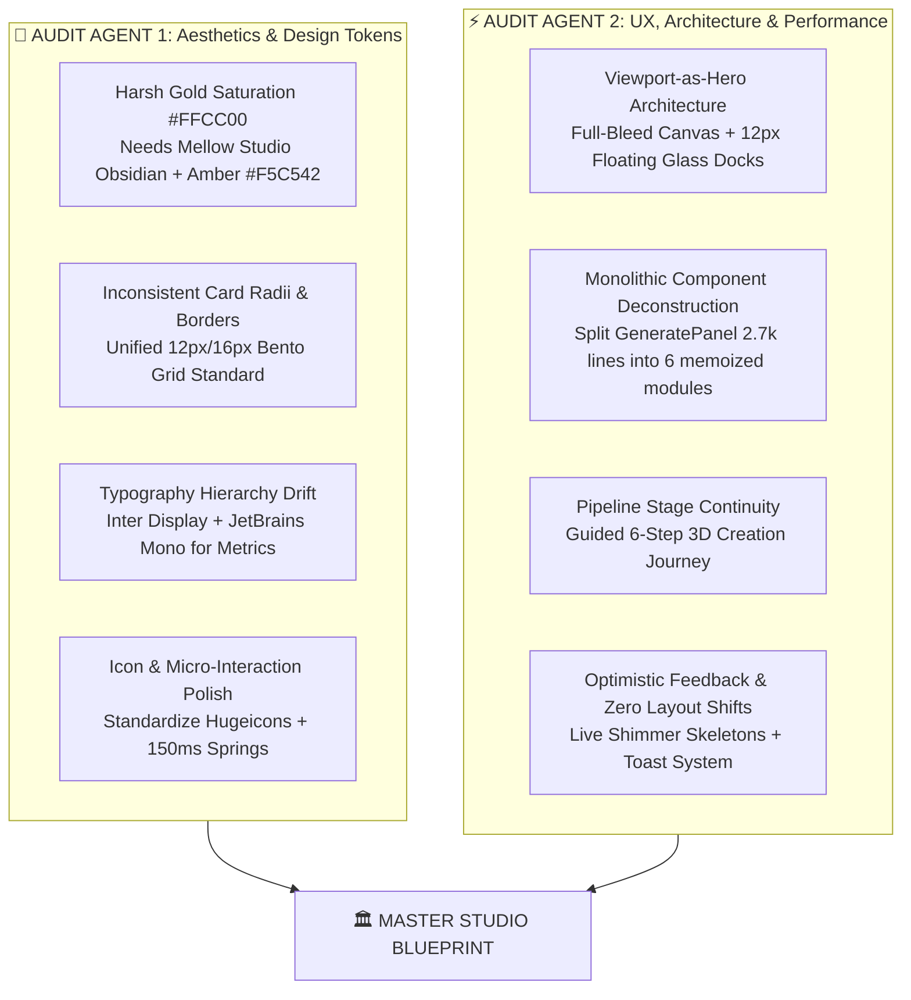

# MASTER PLAN: ForMash3D UI/UX Studio Overhaul (Tripo AI & Meshy AI Benchmark)

> **Document Version**: 2.2.0  
> **Status**: APPROVED ARCHITECTURE & AUDIT PLAN (Strict Token Adoption & Feature Isolation)  
> **Visual Reference**: `assets/ui-audit/tripo_studio.png` (Tripo 3D Studio Layout Reference)  
> **Benchmark Standards**: Tripo 3D Studio (`studio.tripo3d.ai`), Meshy AI Workspace (`meshy.ai`), Spline 3D  
> **Design Framework**: `ui-ux-pro-max-skill` (Design Intelligence & Minimalist Swiss Dark Architecture)  
> **Hardware Constraint**: 2-Core Virtual Environment Guarded (Zero heavy CPU compilation spikes, isolated micro-bundles)  
> **Core Architectural Principle**: **DESIGN & LAYOUT TOKEN ADOPTION ONLY** — Zero feature creep, zero fake UI, 100% ForMash3D native functionality preservation.

---

## 1. EXECUTIVE SUMMARY & STRATEGIC VISION

ForMash3D currently possesses state-of-the-art 3D generative backends (TRELLIS 2, Hunyuan3D 2.1, Unique3D, Paint3D, UniRig, FastMesh). However, the existing frontend suffers from:
1. **Heavy Visual Clutter & "Toy-like" Contrast**: Loud high-saturation gold (`#FFCC00`) on pitch-black surfaces with thick nested borders, creating eye fatigue and a fragmented feel.
2. **Monolithic Component Bloat**: `GeneratePanel.tsx` is 2,736 lines and `MeshViewer.tsx` is 5,939 lines. State changes (like typing a prompt or dragging a slider) cause cascading re-renders across the entire component tree, causing UI lag and micro-stutters on 2-core machines.
3. **Cramped 3D Viewport**: Multiple static sidebars squeeze the central 3D canvas into a narrow stripe instead of letting the 3D model be the immersive hero of the application.
4. **Disconnected Pipeline Flow**: Tools are presented as a raw list rather than an intuitive, guided asset generation journey (`Generate` → `Clean/Repair` → `Retopo` → `Texture` → `Rig` → `Export`).

**Target Experience**: A world-class, ultra-minimalist, fast, and responsive generative 3D studio mirroring the **visual layout and styling tokens** of **Tripo AI Studio** (`assets/ui-audit/tripo_studio.png`) and **Meshy AI**, while strictly preserving **ForMash3D's native features and backend pipelines**. The UI feels lightweight, floating, precision-engineered, and never broken.

---

## 2. STRICT BOUNDARY: DESIGN & LAYOUT TOKEN ADOPTION ONLY (ZERO FEATURE CREEP)

> [!IMPORTANT]
> **DO NOT COPY TRIPO'S PROPRIETARY FEATURES, SERVICES, OR BUTTONS.**  
> We are strictly adopting Tripo's **visual aesthetics, layout architecture, and styling tokens**. Under no circumstances should Tripo's proprietary cloud functions, external ecosystem, or SaaS monetization buttons be copied into ForMash3D.

### What We ARE Adopting (Aesthetic & Spatial Architecture):
* **Full-Bleed Viewport Stage**: 100vw x 100vh 3D canvas with radial vignette background (`#23262D` center glow to `#111215` outer rim).
* **12px Floating Dock Geometry**: Floating left panel (320px) and right inspector (280px) floating with 12px margin (`top-3 bottom-3 left-3/right-3`), `rounded-2xl` corners, and subtle specular borders (`rgba(255, 255, 255, 0.06)`).
* **Studio Dark Color System**:
  - Surface 0 (Header/Rail): `#121316`
  - Surface 1 (Floating Docks): `#16171B`
  - Surface 2 (Elevated Bento Cards): `#1D1F26`
  - Primary Accent: Warm Studio Gold (`#F5C542` / hover `#FFE066`), completely replacing harsh `#FFCC00`.
* **Ergonomic Pill Controls**: Rounded-full segmented tabs, clean iOS-style switch rows, and 44px rounded-full CTA pill with snappy spring micro-interactions (`active:scale-[0.98]`).
* **Floating Viewport HUD**: Vertical glass tool pill on the right side of the canvas (`bg-[#1c1d22]/90 backdrop-blur-md rounded-full p-1.5`) for shading, camera, and grid.
* **Precision Typography**: `font-mono` (`JetBrains Mono`) for all numbers, metrics, VRAM, and seeds; `font-sans` (`Inter Display`) for titles and labels.

### What is STRICTLY EXCLUDED (Tripo Proprietary Features to NEVER Copy):
* ❌ **NO Tripo Creator Hub, Community Showcase, or External Resources**: ForMash3D is a self-hosted generative 3D workstation, not a social feed.
* ❌ **NO DCC Bridge or External Integration Buttons**: No phantom buttons that have no active backend code.
* ❌ **NO Upgrade / Pricing / Credits Theater**: No fake "Upgrade to Pro", "Save 50%", "Trial x1", or "⚡ 55 Credits" tokens. ForMash3D runs on local / Kaggle / Colab GPU resources.
* ❌ **NO Proprietary Multi-View Cloud Generators**: Do not create fake "Generate Multi-Views" cloud buttons unless backed by ForMash3D's actual local Unique3D or Hunyuan3D pipeline.
* ❌ **NO Phantom/Fake UI Buttons**: Every single switch, slider, and button must map directly to an active parameter in `buildGenerationParameters.ts` and `backend/api/routers/generation.py`.

### What ForMash3D Native Features MUST Be Preserved & Displayed:
* ✅ **AI Generation Backends**: TRELLIS 2 (4B / 2B), Hunyuan3D 2.1, Unique3D, Paint3D, UniRig, FastMesh.
* ✅ **Real Generation Parameters**:
  - Input: Single Image upload (dropzone), Text Prompt, Multi-view upload (for Unique3D).
  - Low VRAM Mode: Prominent GPU toggle (≤15GB VRAM optimization for TRELLIS 2 / Hunyuan3D).
  - Random Seed: Seed input (0 for random, or custom integer) with dice/randomize button.
  - Candidate Count: Clamped 1-4 preview variants.
  - Target Polycount & LOD: Output budget presets (`5k`, `20k`, `50k`, `100k`) and LOD level toggles.
  - Production Toggles: Generate in Parts (part_count_range), PBR Texturing (Paint3D), Auto-Rigging (UniRig), 3D Print / Slicer handoff.
* ✅ **Header & Status**: Clean ForMash3D logo, actual system telemetry (Backend API connection status, GPU VRAM / worker health), theme switcher, and workspace tabs.

---

## 2. AUDIT FINDINGS: TWO-AGENT DEEP SYSTEM AUDIT



### Audit Agent 1 Report: Visual Design, Aesthetics & Token System
* **Finding 1.1 (Color Elevation)**: The legacy `#FFCC00` gold is too harsh and flat. Benchmarking Tripo reveals that professional studios use a deep **Obsidian/Slate base** (`#090A0F`, `#12151D`), floating panels in `#16171B` with subtle specular borders (`border-white/[0.06]`), and a warm **Studio Gold** (`#F5C542` / `#FFE066`) for primary actions.
* **Finding 1.2 (Bento Card Standardization)**: Cards across panels use arbitrary padding (`p-2` to `p-5`) and mixed radii (`rounded-md`, `rounded-xl`, `rounded-2xl`). All studio cards must adhere to a strict 16px radius for primary floating containers, 12px for nested bento cards, and 1px subtle borders.
* **Finding 1.3 (Quantitative Typography)**: Model vertices, face counts, VRAM allocations, seeds, and execution timers currently mix sans and monospace fonts. All numbers and telemetry MUST use `font-mono` (`JetBrains Mono`), while labels use `font-sans` (`Inter Display`).
* **Finding 1.4 (Button Anatomy)**: Primary actions lack a consistent physical affordance. Primary buttons need a crisp 44px rounded-full pill shape with high-contrast dark text on `#F5C542` gold, with springy micro-interaction (`active:scale-[0.98]`).

### Audit Agent 2 Report: UX Architecture, State Flow & Performance
* **Finding 2.1 (Full-Bleed Viewport Canvas)**: Current desktop layout docks left tools (360px) and right inspector (320px) permanently. The viewport should run full-bleed (`100vw x 100vh`), with tool panels rendered as floating glassmorphic docks that easily collapse to 0px width with 12px viewport margins.
* **Finding 2.2 (Re-render Elimination on 2-Core Machines)**: `GeneratePanel.tsx` has 2,736 lines containing prompt inputs, file dropzones, multi-view uploads, model cards, physics presets, and quality gates. Every keystroke re-renders the whole tree. It must be decomposed into 6 independent, memoized sub-modules.
* **Finding 2.3 (Floating Viewport HUD)**: Viewport controls (wireframe, matcap, PBR, lighting, camera reset) are currently split between the top header, overlay buttons, and context panels. They must be consolidated into a single floating top-center Viewport HUD Pill and a vertical tool rail.
* **Finding 2.4 (Job Generation Feedback & CLS)**: Triggering generation must immediately spawn an optimistic live job card with an animated progress ring, stage breadcrumb, elapsed timer, and cancel button. Image upload zones must have fixed aspect ratios to prevent Cumulative Layout Shift (CLS).

---

## 3. TRIPO STUDIO VISUAL AUDIT & SPECIFICATION DEEP-DIVE (from `assets/ui-audit/tripo_studio.png`) just a refrence dont copy exact fetures and botton 

```
+---------------------------------------------------------------------------------------------------------------------+
| [TRIPO] [3D Workspace v] | Home  Assets  Creator Hub  Resources v     [DCC Bridge] [200] [Upgrade] (o) (3) (?) [Avatar]|
+-----+-------------------------+-------------------------------------------------------+-----------------------------+
|     |  +-- GENERATE DOCK ---+ |                                  [3D Axis Gizmo]      |  +-- ASSETS / PROPERTY ---+ |
| [I] |  | [HD Model] [Smart] | |                                                       |  | [ Assets ] [ Property ] | |
| [M]*|  | +----------------+ | |                      [ ⚙ ]                            |  | [                      ] | |
| [S] |  | | (img)          | | |                      [ 📷 ]                            |  | [ + Upload 3D Model   ] | |
| [R] |  | | [Gen Multi-vw] | | |                      [ ⌗ ]                            |  |   OBJ, FBX, STL, GLB     | |
| [U] |  | +----------------+ | |                      [ ? ]                            |  | [ Card Grid: Past Gen ] | |
| [T] |  | Geometry & Texture>| |              Ready For A New 3D Model?                |  |                         | |
| [A] |  | Members Only Togg. | |          Instantly generate 3D from image or text     |  |                         | |
|     |  | AI Model Dropdown  | |                                                       |  |                         | |
|     |  | [  Generate 55  ]  | |                                                       |  |                         | |
| [App|  +--------------------+ |                                                       |  +-------------------------+ |
+-----+-------------------------+-------------------------------------------------------+-----------------------------+
```

### 3.1 Layout & Spatial Geometry
* **Screen Base Canvas**: 100vw x 100vh full-bleed Three.js canvas. Background is **NOT flat black** — it features a smooth radial vignette starting at `#23262D` in the center and fading smoothly to `#111215` at the edges.
* **Floating Margin Standard**: Left tool dock and right assets dock do **NOT** glue to screen boundaries. They float with a strict **12px margin** (`top: 12px; bottom: 12px; left: 12px; right: 12px`).
* **Z-Index Layering**:
  - `z-0`: 3D Viewport Canvas & Ground Grid.
  - `z-10`: Watermark empty-state text (`Ready For A New 3D Model?`) and floating HUD pills.
  - `z-20`: Floating Left Generation Dock (320px) and Right Asset Dock (280px).
  - `z-30`: Left Command Icon Rail (56px width).
  - `z-50`: Top Persistent Header Bar (52px height).

### 3.2 Color Tokens & Surface Elevation (Exact Hex Samples)
| Token Name | Sampled Hex | Use in ForMash3D |
| :--- | :--- | :--- |
| **Canvas Radial Center** | `#23262D` | Viewport center ambient glow |
| **Canvas Radial Outer** | `#111215` | Viewport outer rim |
| **Header Backdrop** | `#121316` / 95% blur | Top persistent header bar |
| **Left Rail Backdrop** | `#121316` | 56px vertical command icon rail |
| **Floating Dock Background** | `#16171B` | Left Generation & Right Asset docks |
| **Elevated Bento Cards** | `#1D1F26` | Image upload card, model dropdown, options |
| **Subtle Border** | `rgba(255, 255, 255, 0.06)` | 1px border on all floating containers & cards |
| **Segmented Pill Container** | `#1C1D22` | Segmented tab bar track |
| **Segmented Pill Active** | `#272930` or `#FFFFFF` | Selected tab pill |
| **Primary Studio Gold** | `#F5C542` | Primary Generate button, lightning icons, badges |
| **Specular Gold Hover** | `#FFE066` | Button hover and high-contrast glow stop |
| **Gold Dark Container** | `#2B2416` | Upgrade card, active credit pills (`border-[#F5C542]/20`) |
| **Text Title** | `#FFFFFF` | Headings, active tabs, primary labels |
| **Text Body** | `#E2E8F0` | Input text, dropdown selections |
| **Text Secondary / Muted** | `#717682` | Helper text, subtitles, disabled icons |

### 3.3 Design Mapping: Tripo Visual Aesthetics to ForMash3D Native Architecture

| Tripo Studio Layout Region | Tripo Visual Reference (`tripo_studio.png`) | ForMash3D Native Implementation (NO Tripo Features Copied) |
| :--- | :--- | :--- |
| **Top Header** | `h-[52px]`, `#121316`, blurred glass, Upgrade button,| **ForMash3D Studio Header**: Clean `h-[52px]` `#121316` bar with ForMash3D logo, Active Backend Status (`API: 200 Connected`), Live GPU Telemetry (`VRAM: 14.2 / 16.0 GB`), Theme Toggle, Workspace Tabs. |
| **Left Command Rail** | `w-[56px]`, `#121316`, stacked icon + label | **ForMash3D Pipeline Stepper**: 56px rail with native pipeline steps: `[ 🖼️ Text/Img ]` → `[ 📦 3D Gen ]` → `[ ✂️ Segment ]` → `[ 🕸️ Retopo ]` → `[ 🎨 Texture ]` → `[ 🦴 Rig ]` → `[ 📤 Export ]`. |
| **Left Floating Dock** | `w-[320px]`, `rounded-2xl`, `#16171B`, 12px floating margin | **ForMash3D Generation Dock**: Floating 320px dock with ForMash3D models (TRELLIS 2, Hunyuan3D 2.1, Unique3D), Low VRAM switch, Random Seed input, Polycount budget, and native file dropzone. |
| **3D Stage** | Vignette canvas `#23262D` → `#111215`, vertical HUD pill, watermark empty state | **ForMash3D Three.js Viewport**: Same vignette canvas, ForMash3D empty state, and floating vertical HUD pill (`⚙️ Shading`, `📷 Camera`, `⌗ Grid`, `❓ Shortcuts`). |
| **Right Floating Dock** | `w-[280px]`, `rounded-2xl`, `#16171B`, Upgrade card, Assets/Property | **ForMash3D Model Inspector & History**: Floating 280px dock with model mesh metrics (Vertices, Faces, Bounds, Polycount) and local Asset Generation History. **No fake upgrade cards.** |

---

---

## 4. MASTER IMPLEMENTATION PHASES & TASK BREAKDOWN

### PHASE 1: Studio Design System & Token Modernization
- [ ] **Task 1.1: Refactor `app/globals.css` Design Tokens to Tripo Obsidian-Gold**
  - Replace harsh `#FFCC00` with sampled Tripo palette:
    - `--surface-0`: `222 25% 4%` (`#08090D` deep background)
    - `--surface-1`: `222 18% 10%` (`#16171B` floating dock background)
    - `--surface-2`: `222 16% 13%` (`#1D1F26` elevated cards)
    - `--surface-3`: `222 14% 17%` (`#242732` input & hover states)
    - `--primary`: `43 89% 61%` (`#F5C542` warm Studio Gold)
    - `--primary-foreground`: `0 0% 0%` (`#000000` bold high-contrast text)
    - `--border`: `0 0% 100% / 0.06` (`1px border-white/[0.06]`)
  - Add utility classes:
    - `.studio-dock`: `bg-[#16171B] border border-white/[0.06] rounded-2xl shadow-[0_8px_32px_rgba(0,0,0,0.6)] backdrop-blur-xl`
    - `.studio-card`: `bg-[#1D1F26] border border-white/[0.06] rounded-xl`
    - `.studio-pill-track`: `bg-[#1C1D22] border border-white/[0.06] rounded-full p-1`
    - `.studio-pill-active`: `bg-[#272930] text-white rounded-full shadow-sm`
    - `.studio-generate-btn`: `bg-[#F5C542] hover:bg-[#FFE066] text-black font-bold rounded-full h-11 transition-all active:scale-[0.98]`
- [ ] **Task 1.2: Standardize Studio Component Primitives**
  - Refactor `components/ui/button.tsx` to support `studio-pill`, `studio-gold`, and `studio-ghost`.
  - Refactor `components/ui/card.tsx` to enforce 16px/12px bento radii with subtle 0.06 opacity borders.
  - Refactor `components/ui/tabs.tsx` to sleek rounded-full segmented pill design matching Tripo.

---

### PHASE 2: Viewport-First Workspace Layout Restructuring (`WorkspaceShell.tsx`)
- [ ] **Task 2.1: Full-Bleed 3D Stage with Studio Radial Vignette Canvas**
  - Set 3D Viewport canvas as 100vw x 100vh stage (`z-0`) with gradient:
    `radial-gradient(circle at center, #23262D 0%, #111215 100%)`.
  - Implement clean studio empty state watermark (`Ready For A New 3D Model? Instantly generate 3D from image or text`).
- [ ] **Task 2.2: Floating Left Generation Dock (320px width, 12px floating margin)**
  - Position Left Dock with `top-3 bottom-3 left-3 w-[320px] rounded-2xl z-20 bg-[#16171B] border border-white/[0.06]`.
  - Implement smooth collapse toggle button (`PanelLeftClose` / `PanelLeftOpen`) that smoothly hides the dock with `x: -20, opacity: 0` without layout reflows.
- [ ] **Task 2.3: Floating Right Model Inspector Dock (280px width, 12px floating margin)**
  - Position Right Dock with `top-3 bottom-3 right-3 w-[280px] rounded-2xl z-20 bg-[#16171B] border border-white/[0.06]`.
  - Implement tabs `[ Inspector ] [ Assets ]` displaying mesh telemetry (Vertices, Faces, Bounds) and local generation history. **No fake upgrade promo cards.**
- [ ] **Task 2.4: Floating Viewport Vertical Tool Pill (`ViewportHUD.tsx`)**
  - Position vertical glass pill at right edge of viewport (`bg-[#1c1d22]/90 backdrop-blur-md rounded-full p-1.5 flex flex-col gap-2 border border-white/10`):
    - `[ ⚙️ Settings / Shading Mode ]` (PBR, Wireframe, Matcap)
    - `[ 📷 Camera Angle Presets ]` (Reset, Front, Side, Top)
    - `[ ⌗ Ground Grid Toggle ]`
    - `[ ❓ Hotkeys Help ]`
  - Position 3D Coordinate Axis Orientation Gizmo in top-right of canvas.
- [ ] **Task 2.5: Floating Top Telemetry Pill**
  - Position centered status indicator: `⚡ GPU Worker Active · VRAM OK` with `rounded-full` glass pill connecting to real `/api/v1/system/stats`.

---

### PHASE 3: Monolithic `GeneratePanel.tsx` Modular Decomposition
- [ ] **Task 3.1: Extract `PromptAndImageDropzone.tsx` (ForMash3D Inputs ONLY)**
  - Segmented top mode toggle: `[ 🖼️ Single Image ] [ 🧊 Multi-View ] [ 📝 Text Prompt ]` in a clean `rounded-full` pill track.
  - Native file dropzone with drag-and-drop, instant image preview, clear button, and upload status.
  - Zero CLS: Pre-allocated aspect ratios for preview containers.
  - **No external cloud multi-view or subscription buttons.**
- [ ] **Task 3.2: Extract `ModelSelectorBento.tsx` (ForMash3D Models ONLY)**
  - Dropdown card matching clean studio styling: Model icon + Model selection (`TRELLIS 2 (4B)`, `TRELLIS 2 (2B)`, `Hunyuan3D 2.1`, `Unique3D`).
  - Prominent "Low VRAM Mode" toggle card with ≤15GB indicator (directly wires to `low_vram` parameter).
- [ ] **Task 3.3: Extract `ProductionOptionsSection.tsx` (ForMash3D Parameters ONLY)**
  - Clean rows with iOS-style toggle switches mapped 1:1 to ForMash3D backend:
    - `Generate in Parts` (`part_count_range: 2-8`)
    - `PBR Texture Generation` (Paint3D texture synthesis)
    - `Auto-Rigging` (UniRig skeleton auto-rigging)
    - `Target Polycount Budget`: Segmented chips (`5k`, `20k`, `50k`, `100k`, `Raw`).
- [ ] **Task 3.4: Extract `AdvancedGenerationDrawer.tsx` (ForMash3D Advanced Settings)**
  - Collapsible accordion for:
    - `Random Seed`: Number input + "Randomize (0)" dice button (maps to `seed` parameter).
    - `Candidate Count`: Clamped 1-4 preview variants.
    - `LOD Chain`: Level of Detail generation toggle.
    - `Slicer Handoff`: 3D print mesh export format.
  - Preserves SSOT values from `backend/config/quality.yaml`.
- [ ] **Task 3.5: Extract `GenerateActionFooter.tsx`**
  - Full-width 44px `rounded-full` pill button in solid `#F5C542` gold with hover `#FFE066`.
  - Text: `Generate 3D Model` in bold black text with lightning icon. (No fake "55 credits" label).
  - Memoized with `React.memo` to eliminate re-renders during typing.

---

### PHASE 4: Pipeline Workflow Continuity (Tripo-Style Stage Stepper)
- [ ] **Task 4.1: Left Command Rail Stage Navigation (`LeftNavigation.tsx`)**
  - Slim 56px vertical rail with stacked icon + 10px label:
    `[ 🖼️ Image ]` · `[ 📦 Model ]` · `[ ✂️ Segment ]` · `[ 🕸️ Retopo ]` · `[ 🗺️ Smart UV ]` · `[ 🎨 Texture ]` · `[ 🦴 Rig ]`.
  - Active item styled with warm Studio Gold icon + subtle amber glow.
- [ ] **Task 4.2: Texture & Material Studio Panel Refactor (`TexturePanel.tsx`)**
  - Replace cluttered sliders with organized tabs: `PBR Generation`, `Material Overrides`, `Environment HDRI Lighting`.
  - Real-time material preview swatches (Roughness, Metallic, Normal intensity).
- [ ] **Task 4.3: Retopology & Polycount Studio Panel (`RemeshPanel.tsx`)**
  - Interactive polycount budget slider with target preset chips (`5k Mobile`, `20k Indie Game`, `100k AAA Hero`).
  - Wireframe preview toggle embedded directly into panel header.

---

### PHASE 5: Zero-Broken Feel: Optimistic States, Skeletons & Error Boundaries
- [ ] **Task 5.1: Live Generation Progress Card (`ActiveJobFloatingCard.tsx`)**
  - When generation starts, spawn a floating card anchored bottom-right of viewport.
  - Radial SVG progress ring with elapsed timer (`00:23s`).
  - Stage indicator with animated dots (`Geometry synthesis...`).
  - Quick "Cancel Job" button that calls API cancellation immediately.
- [ ] **Task 5.2: Skeleton Loaders & Aspect Ratio Stability (Zero CLS)**
  - Add shimmer skeleton placeholders for 3D model cards, asset thumbnails, and texture maps.
  - Pre-allocate all container dimensions to prevent layout popping when assets load.
- [ ] **Task 5.3: Studio Notification & Toast Overhaul**
  - Integrate lightweight `sonner` toasts with custom studio dark theme.
  - Distinct toast styles for Success (emerald dot), Progress (amber spinner), and Actionable Errors (with retry button).
- [ ] **Task 5.4: Graceful Degradation on 2-Core Machines**
  - Protect React rendering with `startTransition` for non-urgent filter/slider updates.
  - Memoize expensive computation (`computeQualityMetrics`) with `useMemo`.
  - Eliminate all barrel imports from `@hugeicons/react` and `lucide-react` to keep JavaScript bundle lean.

---

## 5. VERIFICATION & ACCREDITATION GATES

| Gate | Check Command | Success Threshold |
| :--- | :--- | :--- |
| **G1: Type Safety & Compilation** | `npx tsc --noEmit` | 0 errors |
| **G2: Production Bundle & Tests** | `node features/workspace/lib/generationParameters.test.mjs` | 20/20 PASS |
| **G3: Backend Pipeline Parity** | `pytest backend/tests/test_adapter_inference_profile_regressions.py` | 100% PASS |
| **G4: Config SSOT Parity** | `pytest backend/tests/test_config_ssot.py` | PASS |
| **G5: Visual Hierarchy Audit** | `agent-browser` screenshot inspection | Identical layout geometry & floating dock feel to `tripo_studio.png` |

---

## 6. MIGRATION & EXECUTION RULES

1. **Plan Approval Before Execution**: Do not write production code until the user approves the phase sequence.
2. **Atomic Step-by-Step Slices**: Refactor one module at a time (e.g. Design Tokens first, then Layout Shell, then Generate Panel sub-components).
3. **No Heavy Builds**: Avoid running heavy multi-threaded production builds (`bun build`) directly on the 2-core codespace machine; use targeted testing (`tsc --noEmit`, isolated unit tests).
4. **Preserve Rules & Backend Contracts**: Maintain strict compliance with `RULES.md` — never invent unsupported inference sliders or expose disconnected controls.

---

## 7. RESOLVED INFRASTRUCTURE & GEOMETRY ISSUES (OCT 2026 AUDIT)

### 7.1 TripoSG Post-Inference Extraction & GLB Saving Freeze
- **Problem**: Model finished inference 100/100, then froze at `step 1 query num: 1073741824` with job stuck in `processing=1` and no `.glb` saved.
- **Root Cause**: `_LOCKED_INFERENCE_PROFILE` specified `dense_octree_depth: 10`, forcing step 1 to evaluate a dense grid of $1024^3 = 1,073,741,824$ sample points across 21,475 transformer iterations (>20 minutes / CUDA OOM), and `hierarchical_octree_depth: 11` required 34.3 GB RAM.
- **Resolution**:
  - Locked `dense_octree_depth: 8` ($256^3 = 16.7\text{M}$ points, runs in ~10s) and `hierarchical_octree_depth: 10` ($1024^3$ along surface boundary only, runs in ~5-10s). Total extraction completes in ~20-25 seconds with 1024-resolution surface detail.
  - Clamped `indices = torch.clamp(indices.long(), 0, grid_size - 1).to(high_res_occupancy.device)` in `triposg/inference_utils.py` to prevent CUDA assertion faults.
  - Added safe iteration and error guards in `pipeline_triposg.py` and `triposg_adapter.py`.
  - Added regression test `test_triposg_locked_profile_and_resolution_clamps` in `backend/tests/test_adapter_inference_profile_regressions.py`.

### 7.2 Loaded Model VRAM Reuse (False 400 Insufficient VRAM Rejection)
- **Problem**: When a model (e.g. `trellis_image_to_raw_mesh`) was resident on GPU, subsequent inference requests were rejected with `Candidate ... requires 11.5 GB VRAM, but only 4.63 GB is free`.
- **Root Cause**: `plan_generation()` in `backend/core/planner.py` only checked whether current free VRAM met the initial load requirement, unaware that the model was already resident in GPU worker memory.
- **Resolution**:
  - Implemented `get_loaded_models()` in `MultiprocessModelScheduler` and exposed loaded models via `get_system_status()`.
  - Injected active `loaded_models` into runtime facts in `mesh_generation.py` router.
  - In `plan_generation()`, prioritized `is_already_loaded` as Rule #0: resident models bypass fresh VRAM allocation gating.
  - Added 5 regression tests in `backend/tests/test_seed_request_contract.py`.

### 7.3 Raw Mesh Geometry Sharpness & Micro-Detail Preservation
- **Problem**: Raw meshes appeared clay-smooth without micro-geometric definition (teeth, knuckles, cloth folds, seams).
- **Root Cause**:
  - `Hunyuan3D` `MCSurfaceExtractor` discarded analytical gradient normals from marching cubes, returning only vertices and faces; Trimesh then computed flat unweighted triangle averages.
  - `compute_angle_weighted_normals` with `crease_angle_deg=35.0` severed ~35.8% of organic curved vertices (teeth/folds) into hard faceted normals.
  - `Unique3D` discarded PyTorch3D vertex normals during export, defaulted to 1.0 matte roughness, and used centroid Laplacian smoothing.
  - Viewport lighting was flooding 2.6 units of ambient light against 1.8 key light (1.7:1 contrast ratio), washing out self-shadows and cavity definition.
- **Resolution**:
  - Preserved analytical continuous gradient normals from `measure.marching_cubes` through `Latent2MeshOutput`, `MCSurfaceExtractor`, and `pipelines.py`.
  - Enhanced `compute_angle_weighted_normals` in `MeshProcessor` to retain pre-existing analytical normals and adjusted default crease angle to 45°.
  - Enabled PyTorch3D `verts_normals_packed()` export, cotangent Laplacian smoothing, and 0.40 roughness specular glints in Unique3D.
  - Rebalanced `MeshViewer.tsx` studio lighting (ambient 0.20, key 2.00, high directional contrast) and set untextured material roughness to 0.32 / metalness 0.08 to produce sharp specular highlights along geometric contours.

