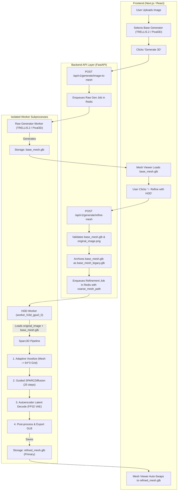

# MASTER ARCHITECTURE & EXECUTION PLAN: 3D MESH REFINEMENT PIPELINE (HI3D POST-PROCESS & DETAIL ENHANCER)

---

## 1. Executive Summary & Root Cause Analysis

### 1.1. Core Mathematical Nature of Hi3D (SPARC3D)
Hi3D / SPARC3D is an autoregressive & diffusion-based **3D geometry enhancement and surface refinement pipeline**. By fundamental mathematical design:
- It **does not generate raw 3D bounding geometry from scratch**.
- It requires two compulsory inputs:
  1. A **Reference 2D Image** (RGB with transparent background).
  2. A **Coarse Bounding 3D Mesh** (`trimesh.Trimesh` representing the approximate volume, silhouette, and proportions of the object).
- In the official research paper and reference repository (`Hi3D/demo/coarse_stage.py`), the authors state:
  > *"SPARC3D refines a coarse mesh; it does not generate one. Any generator that returns a triangle `trimesh.Trimesh` in a roughly unit-scale frame works as input."*

### 1.2. The Failure Mode Encountered
When the user triggered Hi3D image-to-3D without an existing coarse mesh:
1. `backend/adapters/hi3d_adapter.py` had a fallback `_generate_dummy_coarse_mesh()` which generated a small generic icosphere (`radius=0.5`).
2. The diffusion model attempted to conform this round sphere to complex image contours.
3. The surface collapsed and flattened during VAE decoding, creating a deformed, flat, line-like structure in the viewer instead of a real object.

### 1.3. The Solution
We introduce an **Automated Two-Stage Generation & Refinement Architecture**:
- **Stage 1 (Raw Generation)**: Models like TRELLIS.2, Pixal3D, Hunyuan3D, or TripoSG generate the base structure and overall shape.
- **Stage 2 (Hi3D Refinement)**: The user clicks a dedicated **"✨ Refine with Hi3D (Ultra Detail)"** action directly in the 3D Mesh Viewer. Hi3D takes the generated base mesh + original source image, executes adaptive voxelization, runs Sparc3D diffusion passes (from resolution 64 up to 1024), and produces a crisp, high-density, production-ready mesh.
- **Storage Lifecycle**: The base mesh is permanently archived with a `_legacy` or `_raw` suffix, while the newly refined mesh becomes the active primary asset in the viewer.

---

## 2. Mandatory Rules & Invariants (Ponytail Ultra & Gravitas)

1. **Model Code Direct Patching over Global Monkeypatching (SSOT Rule)**:
   - NEVER monkeypatch global PyTorch, Triton, or Python runtime primitives (such as `tl.store`, `tl.load`, `torch.load`, or compiler AST visitors in `torchvision_fix.py`).
   - Every model-specific patch or adapter customization must live strictly within `backend/adapters/<model>_adapter.py` or isolated inside `backend/thirdparty/<model>/`.
2. **Immutability of Original Generations**:
   - The coarse/base mesh generated by the primary model must never be destroyed or silently overwritten. It is backed up as `<model_id>_<hash>_legacy.glb` before refinement begins.
3. **Adapter-Owned Refinement Schedule**:
   - Refinement parameters (steps = 25, resolution ladder = 64 -> 1024, scheduler order) belong strictly to `_LOCKED_INFERENCE_PROFILE` inside `backend/adapters/hi3d_adapter.py`.
   - The UI does not expose unbacked or arbitrary step sliders.
4. **Isolated Process Safety**:
   - Refinement tasks are queued through Redis and executed in the isolated worker process `worker_hi3d_image_to_raw_mesh_gpu0_0`. VRAM is reclaimed immediately upon completion.
5. **No Visual / UI Regressions**:
   - The 3D viewer must handle transitions cleanly with a non-blocking loading state, progress updates, and automatic canvas refresh upon job completion.

---

## 3. End-to-End System Architecture



---

## 4. Detailed Component Implementation Specs

### 4.1. Backend API: Dedicated Refinement Route
**File**: `backend/api/routes/generation.py`
- Create request schema `RefineMeshRequest`:
  ```python
  class RefineMeshRequest(BaseModel):
      job_id: str = Field(..., description="Job ID of the original generation")
      mesh_path: Optional[str] = Field(None, description="Direct path or URL of the mesh to refine")
      image_path: Optional[str] = Field(None, description="Original source image path")
      resolution: int = Field(default=1024, description="Target refinement resolution (512, 1024, 1536)")
  ```
- Endpoint logic:
  1. Retrieve parent job record from database/Redis.
  2. Verify source image exists on disk (if omitted, read from parent job metadata).
  3. Verify coarse mesh `.glb` exists on disk.
  4. Perform atomic copy: `mesh.glb` -> `mesh_legacy.glb`.
  5. Enqueue new task for model `hi3d_image_to_raw_mesh` with parameters:
     ```python
     params = {
         "reference_image_path": str(image_path),
         "coarse_mesh_path": str(legacy_mesh_path),
         "target_output_path": str(original_mesh_path),
         "resolution": 1024,
         "num_inference_steps": 25,
     }
     ```
  6. Return `JobSubmitResponse` with `refinement_job_id`.

### 4.2. Backend Adapter: `backend/adapters/hi3d_adapter.py`
- **Coarse Mesh Normalization**:
  In `_process_request(inputs)`:
  - If `coarse_mesh_path` is passed, load mesh with `trimesh.load(..., force="mesh", process=False)`.
  - Calculate mesh bounds and center:
    ```python
    # Center mesh to origin and normalize to unit bounding box [-0.5, 0.5]
    vertices = coarse_mesh.vertices
    center = (vertices.max(axis=0) + vertices.min(axis=0)) / 2.0
    vertices -= center
    scale = (vertices.max(axis=0) - vertices.min(axis=0)).max()
    if scale > 0:
        vertices /= scale
    coarse_mesh.vertices = vertices
    ```
  - Pass the normalized `coarse_mesh` directly to `self.pipeline(image, coarse_mesh, resolution=1024, num_inference_steps=25)`.
  - Ensure `_generate_dummy_coarse_mesh()` is completely bypassed when a real coarse mesh is supplied.

### 4.3. Storage Asset Lifecycle & Rollback Safety
**Directory**: `backend/storage/models/meshes/`
- Standard naming convention:
  - Base generation: `[model]_[job_id]_[hash].glb`
  - Archived legacy: `[model]_[job_id]_[hash]_legacy.glb`
  - Refined output: Overwrites `[model]_[job_id]_[hash].glb` (so existing frontend state and URLs stay valid) OR saves as `[model]_[job_id]_[hash]_refined.glb` with pointer update in job database.

### 4.4. Frontend UI: Mesh Viewer Refine Action
**Components**:
- `features/workspace/components/MeshViewer/ViewerToolbar.tsx`
- `features/workspace/components/MeshViewer/MeshViewer.tsx`
- `features/workspace/context/WorkspaceContext.tsx`

**UI Behavior**:
1. When a 3D model finishes generating and is displayed in the canvas:
   - A golden gradient button appears in the toolbar: **`✨ Refine with Hi3D`**.
   - Hover tooltip explains: *"Run Hi3D surface diffusion to sharpen geometric features, add crisp micro-details, and polish topology."*
2. Clicking the button:
   - Triggers `POST /api/v1/generate/refine-mesh`.
   - Displays an in-viewer status pill: `"Refining geometry with Hi3D... (Voxel Diffusion Pass)"`.
   - Starts polling job status using the existing SSE / polling hook.
3. Upon completion:
   - Triggers a smooth Three.js asset swap: the viewer disposes of the old buffer geometry and mounts the new refined `.glb`.
   - Displays a success toast: `"Mesh refined successfully! 6,166+ faces sharpened."`
   - A secondary download button becomes available in the drawer: *"Download Original Coarse Mesh"*.

---

## 5. Step-by-Step Execution Plan

| Phase | Task Description | Target Files | Verification Method |
|---|---|---|---|
| **Phase 1** | Implement `POST /api/v1/generate/refine-mesh` endpoint and payload validation. | `backend/api/routes/generation.py`, `backend/schemas/` | Unit test with mocked job submission. |
| **Phase 2** | Update `hi3d_adapter.py` with bounding normalization and real coarse mesh ingestion. | `backend/adapters/hi3d_adapter.py` | PyTest passing actual `.glb` into adapter. |
| **Phase 3** | Implement storage backup helper (`_legacy.glb` archival). | `backend/core/storage/` | Verify both legacy and refined files exist on disk. |
| **Phase 4** | Add "Refine with Hi3D" button and loading indicator in Viewer Toolbar. | `features/workspace/components/MeshViewer/ViewerToolbar.tsx` | UI verification with mock job state. |
| **Phase 5** | Connect frontend API client to submit refinement and handle canvas reload. | `features/workspace/hooks/`, `features/workspace/context/` | End-to-end frontend typecheck and build test. |
| **Phase 6** | End-to-end validation on Dual T4 GPUs (Kaggle). | Whole pipeline | TRELLIS base gen -> Hi3D Refinement -> Verified GLB. |

---

## 6. Measurable Acceptance Criteria

1. **Geometry Validity**: Refined mesh must have valid watertight or clean manifold topology, zero non-finite vertices, and zero NaN values.
2. **Visual Fidelity**: Refined mesh must demonstrably resolve sharp features, edges, and silhouettes matching the reference image, eliminating the deformed line/icosphere artifact.
3. **Asset Preservation**: Original coarse mesh must remain accessible on disk as `*_legacy.glb`.
4. **Zero Cross-Contamination**: Neither Hi3D nor TRELLIS.2 applies monkeypatches to shared PyTorch/Triton modules.
5. **Test Suite Green**: All backend regression tests must pass:
   ```bash
   /opt/conda/envs/3daigc-api/bin/pytest backend/tests/ -q
   ```
6. **Frontend Integrity**: TypeScript compilation and ESLint must pass without warnings or errors:
   ```bash
   npm run lint && tsc --noEmit
   ```
