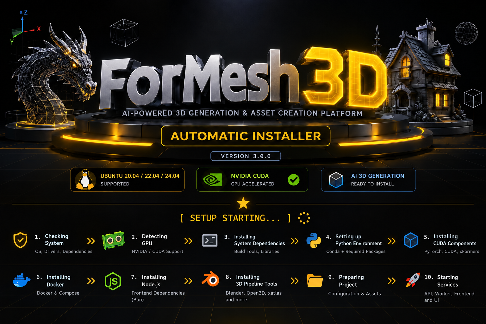
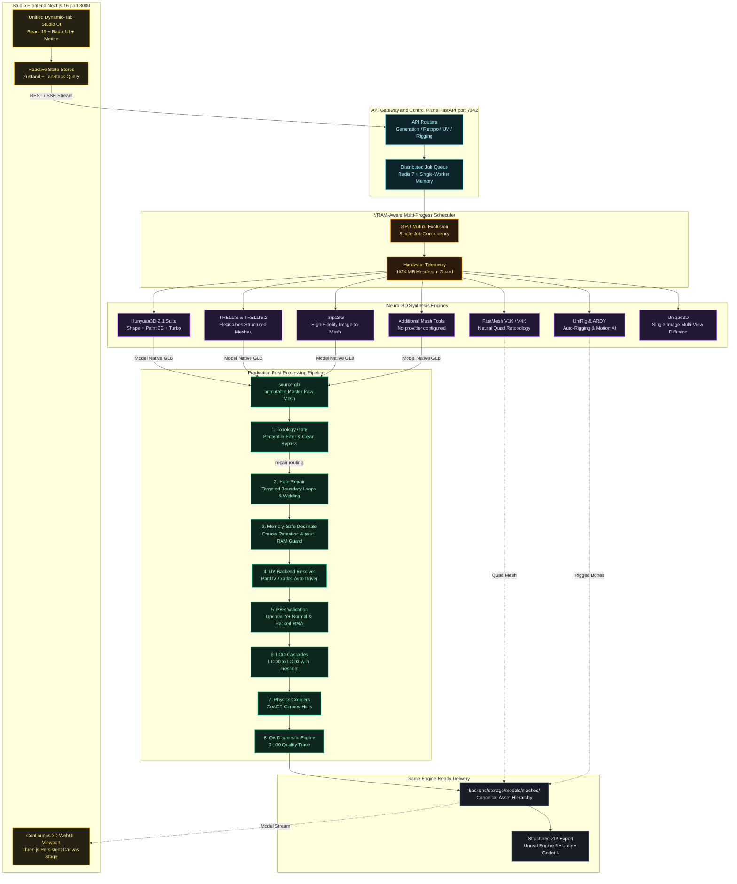

<!-- ===================== HERO BANNER ===================== -->

<p align="center">
  
</p>

<h1 align="center">
    ForMesh3D — Open-Source Self-Hosted Image-to-3D AI Generator
</h1>

<p align="center">
    <strong>Open-Source Generative 3D Mesh Studio & Production Pipeline</strong><br>
    <em>A unified, self-hosted 3D creation suite for neural 3D generation, asset finishing, and engine-ready delivery</em><br>
    Text-to-Motion • Image-to-3D • Quad Retopology • PBR Material Painting • Auto-Rigging • Automated LODs • Game Engine Ready
</p>

<p align="center">
  <a href="https://github.com/Silentzx2/ForMesh3D"></a>
  <a href="https://github.com/Silentzx2/ForMesh3D"></a>
  <a href="https://github.com/Silentzx2/ForMesh3D"></a>
  <a href="https://github.com/Silentzx2/ForMesh3D"></a>
  <a href="https://github.com/Silentzx2/ForMesh3D"></a>
  <a href="LICENSE"></a>
</p>

<p align="center">
  <strong>⚡ Quick Start:</strong> <code>git clone https://github.com/Silentzx2/ForMesh3D.git</code> → <code>bash scripts/setup.sh</code> → <code>bash scripts/start.sh</code> → Open <a href="http://localhost:3000">http://localhost:3000</a>
</p>

<p align="center">
  <a href="https://github.com/Silentzx2/ForMesh3D/releases"></a>
</p>

<p align="center">
  <a href="https://github.com/Silentzx2/ForMesh3D/stargazers"></a>
  <a href="https://github.com/Silentzx2/ForMesh3D/commits/main"></a>
  <a href="https://github.com/Silentzx2/ForMesh3D/issues"></a>
  <a href="docs/GITHUB_SETUP.md"></a>
</p>

## Table of Contents

- [Overview & Product Vision](#-overview--product-vision)
- [Core Capability Map](#-core-capability-map)
- [End-to-End Asset Generation Pipeline](#-end-to-end-asset-generation-pipeline)
- [System Architecture](#-system-architecture)
- [Quick Start](#-quick-start)
- [Contributing](#-contributing)
- [License](#-license)

## Choose Your Contributor Path

| No GPU (CPU only) | GPU (CUDA 12.4) |
|---|---|
| UI/UX, docs, tests, API, post-process | Model adapters (TRELLIS, Hunyuan3D, TripoSG, Unique3D) |
| CPU-only setup mode | Quality pipeline & generation quality gates |
| [Good First Issues](docs/GOOD_FIRST_ISSUES.md) | [Backend Runtime Contract CI](.github/workflows/backend-runtime-ci.yml) |

[View all good first issues →](docs/GOOD_FIRST_ISSUES.md)

---

## 🌟 Overview & Product Vision

> [!NOTE]
> **Phase: BETA** — ForMesh3D has graduated from early development. Core studio, API gateway, and post-processing pipeline are stabilizing; breaking changes may still land before 1.0.

**ForMesh3D** is an open-source, self-hosted generative 3D asset creation and mesh-finishing platform. It bridges modern state-of-the-art open research models into a single, cohesive studio running entirely on your local workstation or private GPU cluster.

ForMesh3D unifies neural 3D generation, asset finishing, validation, and export into one self-hosted workflow for 3D technical artists, game developers, and researchers:
- **100% Private & Self-Hosted**: Run generation locally on NVIDIA GPUs without subscriptions, cloud queues, or uploading proprietary concept art to external servers.
- **Immutable Source Preservation**: Model-native generation is snapshotted at `master/source.glb` before production optimization or decimation.
- **Production Asset Finishing**: Features a complete post-processing pipeline forked and customized from **[3DGenStudio](https://github.com/visualbruno/3DGenStudio)**, delivering watertight repair, conformal UV unwrapping, PBR material baking, quad retopology, multi-tier LOD cascades, and CoACD convex physics collision hulls.

---

> [!WARNING]
> ### ⚖️ Licensing, Commercial & SaaS Advisory (Important)
>
> 1. **Core Repository License**: ForMesh3D's original code (orchestrator, API gateway, scheduler, and Next.js studio UI) is open-source under the **[Apache License 2.0](LICENSE)**.
> 2. **Post-Processing Provenance**: The mesh post-processing engine (`backend/postprocess/`) was forked and customized from **[visualbruno/3DGenStudio](https://github.com/visualbruno/3DGenStudio)** under the **3D Gen Studio Community License**. See **[backend/postprocess/THIRD_PARTY_LICENSE.md](backend/postprocess/THIRD_PARTY_LICENSE.md)**.
> 3. **Commercial Ownership of Outputs**: **You own 100% of the 3D meshes, textures, rigs, and assets generated with ForMesh3D**. You are completely free to use, monetize, sell, or include them in commercial games and software without restrictions.
> 4. **Notice for Commercial & SaaS Implementors**:
>    - The Apache 2.0 license applies **strictly to ForMesh3D's original code**. We do **not** own or re-license the underlying third-party models, research weights, or ported submodules.
>    - The ported `3DGenStudio` post-processing pipeline prohibits hosting the software as a paid public/private commercial SaaS service without explicit written consent from the upstream author (`visualbruno`).
>    - Individual model checkpoints (e.g. Hunyuan3D-2.1, FastMesh, TripoSG) carry their respective upstream research, academic, or non-commercial licenses (see **[backend/thirdparty/LICENSE](backend/thirdparty/LICENSE)** and individual `backend/thirdparty/<model>/LICENSE` files).
>    - **Do NOT blindly deploy or redistribute ForMesh3D as a paid commercial product or SaaS** without auditing and complying with the respective licenses of each integrated model and component!

> [!NOTE]
> ### 🛡️ Repository Rules & Engineering Standards
> All contributions and architectural modifications must comply strictly with **[RULES.md](RULES.md)**:
> - **Ponytail Minimalist Architecture**: YAGNI-first, reuse existing helpers and standard library, shortest correct diffs, zero speculative abstractions.
> - **Documentation Integrity**: Any pipeline or backend modification must be reflected across all `Docs/*.md` guides immediately.
> - **Source Integrity**: Downstream post-processing must operate on derived data and never mutate `master/source.glb`.

---

## 📊 Core Capability Map

| Capability | ForMesh3D Implementation |
|---|---|
| Neural 3D Generation | Image-to-3D adapters with model-specific inference contracts |
| Source Preservation | Immutable master/source.glb checkpoint before production processing |
| Production Optimization | Post-process-only polycount, retopology, UV, LOD, collision, and bake controls |
| PBR Materials | Full-mesh Paint3D/Hunyuan3D texturing; localized mask repaint remains disabled until adapter inference supports it |
| Smart Generation | One-click image-only intents with deterministic model selection and scheduler-backed execution |
| Generation Experiment Presets | Save local profiles, edit schema-driven parameters, test through the existing queue, and import/export JSON |
| QA & Diagnostics | Geometry, UV/material, and production-budget quality tracing |
| Engine Export | GLB/FBX game-ready packages plus LOD and collision assets |

> [!WARNING]
> **Model readiness is not uniform.** A model being registered or enabled in `backend/config/models.yaml` does not guarantee that its checkpoint will load or that inference will produce a valid mesh on every deployment. Some model pipelines are reported to fail during initialization/loading, while others can complete with broken or unusable geometry. Model-specific GPU validation is incomplete; do not treat the catalog as a production-readiness guarantee. See [Docs/MODEL-STATUS.md](Docs/MODEL-STATUS.md) for current limitations and the validation checklist.

## 🔄 End-to-End Asset Generation Pipeline

ForMesh3D enforces an **immutable master preservation architecture**. The raw neural model output is immediately snapshotted at `master/source.glb` before any downstream finishing operations, guaranteeing zero accidental loss of fine surface detail:

```text
   INPUT                     NEURAL GENERATION               CANONICAL CHECKPOINT
┌─────────────────────┐    ┌───────────────────────────┐    ┌──────────────────────────┐
│  • Single Image     │───►│  Neural Model Adapters:   │───►│ master/source.glb        │
│                     │    │  TRELLIS / Hunyuan3D 2.1  │    │ (Immutable Master Mesh)  │
│                     │    │  TripoSG                  │    │ Preserves Raw Topology   │
└─────────────────────┘    └───────────────────────────┘    └────────────┬─────────────┘
                                                                          │
 ┌───────────────────────────────────────────────────────────────────────┘
 │  PRODUCTION POST-PROCESSING & ENGINE FINISHING (Ported & Enhanced from 3DGenStudio)
 ▼
┌─────────────────┐    ┌─────────────────┐    ┌─────────────────┐    ┌─────────────────┐
│ 1. Topology Gate│───►│ 2. Hole Repair  │───►│ 3. Decimation   │───►│ 4. UV Resolver  │
│ 14 Metric Audit │    │ Boundary Loops  │    │ Memory-Safe QEM │    │ PartUV GPU      │
│ Clean Bypass    │    │ Fan Triangulate │    │ Crease Guard    │    │ xatlas Fallback │
└─────────────────┘    └─────────────────┘    └─────────────────┘    └────────┬────────┘
                                                                              │
 ┌────────────────────────────────────────────────────────────────────────────┘
 ▼
┌─────────────────┐    ┌─────────────────┐    ┌────────────────────────────────────────┐
│ 5. PBR & Bake   │───►│ 6. LOD & Physics│───►│ GAME-READY EXPORT PACKAGE              │
│ OpenGL Y+ Normal│    │ LOD0-LOD3 meshopt│   │ • game_ready.glb (Unreal / Unity/Godot)│
│ Packed RMA Check│    │ CoACD Colliders │    │ • lods/ (lod0.glb - lod3.glb)          │
│ [0, 1] UV Bounds│    │ Rapier3D Sim    │    │ • collision.glb & physics.json         │
└─────────────────┘    └─────────────────┘    │ • Structured Engine-Ready ZIP Archive  │
                                              └────────────────────────────────────────┘
```

---

## 🏗️ System Architecture

The following diagram illustrates the multi-tier system architecture connecting the Next.js studio frontend, FastAPI control plane, VRAM scheduler, neural adapters, and post-processing pipeline:



---

## 🤖 Supported Model Catalog

The model registry is dynamically configured via `backend/config/models.yaml` and loaded lazily:

| Model Architecture | Registered Model ID | Category / Task | VRAM Budget | Key Technical Capabilities |
|---|---|---|:---:|---|
| **Hunyuan3D-Shape-v2.1** | `hunyuan3d_shape_v21_image_to_raw_mesh` | Raw Mesh | ~10 GB | 3.3B shape model, official 2.1 pipeline, adapter-owned octree resolution 1300 |
| **Hunyuan3D-Paint-v2.1** | `hunyuan3d_paint_v21_image_mesh_painting` | PBR Texture | ~12 GB configured scheduler reservation (not a measured peak-memory guarantee) | 2B PBR texture checkpoint, internal RealESRGAN, exported 4K/8K atlas validation |
| **Hunyuan3D-DiT-v2-mini-Turbo** | `hunyuan3d_dit_v2_mini_turbo_image_to_raw_mesh` | Raw Mesh | ~6 GB | 0.6B low-VRAM step-distilled shape model with Turbo path |
| **TRELLIS** | `trellis_image_to_3d` / `trellis_image_to_raw_mesh` | Raw Mesh | 11.5 GB | Raw FlexiCubes geometry; optional texture generation is a separate stage |
| **TRELLIS.2** | `trellis2_image_to_3d` / `trellis2_image_to_raw_mesh` | Raw Mesh | 23.5 GB | High-fidelity FlexiCubes geometry; legacy textured IDs resolve to raw geometry |
| **TripoSG** | `triposg_image_to_raw_mesh` | Image/Scribble to 3D | 8 GB | High-fidelity image and scribble guided 3D geometry |
| **Pixal3D** | `pixal3d_image_to_raw_mesh` / `pixal3d_image_to_3d` | Raw Mesh | ~18 GB (~10-12 GB in low-VRAM mode) | Pixel-aligned O-Voxel projection, native PBR, 1536 cascade |
| **TaoFlowForge** | `taoflowforge_image_to_raw_mesh` | Raw Mesh | 20 GB (registered but **disabled**) | Progressive native-mesh generation, direct connectivity |
| **Paint3D** | `paint3d` | PBR Texture | ~12 GB | Centralized texturing stage for 1K/2K atlas targets |
| **FastMesh (1K & 4K)** | `fastmesh_v1k_retopology`<br>`fastmesh_v4k_retopology` | Mesh Retopology | 16–24.5 GB | Fixed-budget neural quad retopology producing clean animation loops |
| **UniRig** | `unirig_auto_rig` | Auto-Rigging | 9 GB | Automated bipedal skeletal armature generation |
| **ARDY** | `ardy_motion_generation` | Motion AI | CPU-only; no GPU VRAM reservation | Interactive autoregressive text-to-motion generation; CPU/RAM-bound |
| **PartUV** | `partuv_uv_unwrapping` | UV Unwrapping | 7 GB | Automated seam placement and UV chart packing |
| **Unique3D** | `unique3d_image_to_raw_mesh` | Raw Mesh | ~10 GB | High-fidelity single-image to 3D with multi-view diffusion and textured reconstruction |

> **Registry source of truth:** the catalog above mirrors `backend/config/models.yaml`. Only entries with `enabled: true` are exposed by `GET /api/v1/system/models`; `taoflowforge_image_to_raw_mesh` is registered but disabled. `backend/config/smart_presets.yaml` holds the intent presets (`mobile`, `game_ready`, `cinematic`, `animation`, `3d_print`; `native` is a backend-only sentinel).

> **FastMesh resource admission:** The 16 GB (V1K) / 24.5 GB (V4K) figures are conservative scheduler reservations, not upstream-published minimum VRAM. Both variants declare the `accelerate_auto_device_map` multi-GPU strategy, so layers can be sharded across selected GPUs, but a single device still has to satisfy the admission budget on its own. Full variant-matched checkpoint files (about 4.38 GB / 4.39 GB on disk) are required, and checkpoint size must not be confused with inference VRAM.

### 📐 Single Source of Truth & Generation Planning
- **Single Source of Truth (`backend/config/quality.yaml`)**: Every tunable threshold, limit, tier, and budget is canonically declared in `quality.yaml` (pipeline tunables) and `models.yaml` (model facts and VRAM reservations). Intent presets live in `backend/config/smart_presets.yaml` and planner routing rules in `backend/config/planner_rules.yaml`. Code reads from these single sources and never defines in-code fallback numeric dicts.
- **Model-Native Source Fidelity & Adapter-Owned Profiles**: Fixed model-specific inference schedules, step counts, guidance scales, octree resolutions, samplers, and decoders are locked directly inside model adapters (`_LOCKED_INFERENCE_PROFILE`). The UI does not expose unbacked or fake inference quality sliders. The multiprocess scheduler enforces source fidelity and strips any legacy inference overrides before dispatching to adapters, while caller-controlled seed and image identity are preserved.
- **Source vs. Production Mesh Distinction**:
  - `master/source.glb` is the immutable raw generative mesh captured at full model-native fidelity and verified with SHA-256 immutability.
  - Production meshes (`game_ready/`, `lods/`, `collision/`) are downstream derived artifacts produced by the post-processing recipe selected by the request intent (`mobile`, `game_ready`, `cinematic`, `animation`, `3d_print`; `native` is a backend-only sentinel).
- **Rule-Based Generation Planning (`backend/config/planner_rules.yaml`)**: Deterministically routes requests by `object_type` (`mechanical`, `organic`, `character`, `general`) and `requested_quality` (`fast`, `balanced`, `high`). Execution behavior is governed by explicit config switches under `apply`:
  - `apply.model_choice`: When `false` (default), preserves legacy smart-preset selection while logging `would_have_chosen`. When `true`, adopts planner model routing.
  - `apply.auto_seeds`: When `false` (default), runs single candidate unless requested by user. When `true`, automatically runs multi-seed candidate scoring.
  - `apply.input_prep`: When `true`, passes plan preprocessing directives into image enhancement pipeline.
- **Verified Parity Scorecard (`parity_scorecard.json`)**: Operates under a strict truth policy where every cell is either measured with explicit source file attribution or `null`. Competitor entries without user-supplied benchmark GLBs are strictly `null`.
- **Reproducible Parity Benchmark (`scripts/run_final_parity_benchmark.py`)**:
  - Offline smoke test: `python scripts/run_final_parity_benchmark.py` evaluates synthetic primitives (`Docs/baseline_vs_now_benchmark.json`).
  - Real GPU benchmark: `python scripts/run_final_parity_benchmark.py --images <dir> --api http://localhost:7842` evaluates generation time, peak VRAM, master immutability, and Hunyuan vs TRELLIS.2 feature retention (`Docs/benchmark_real.json`, `Docs/hunyuan_smoothness_report.md`).
  - Competitor evaluation: `python scripts/run_final_parity_benchmark.py --competitor-dir <dir>` evaluates competitor GLBs under `tripo/`, `meshy/`, `hyper3d/`.

---

## ⚙️ Production Post-Processing Engine

Raw AI generative meshes typically suffer from non-manifold triangles, missing UV layouts, dense topological noise, and absence of physics colliders. ForMesh3D's post-processing engine (ported and enhanced from [3DGenStudio](https://github.com/visualbruno/3DGenStudio)) automates asset finishing:

```text
backend/storage/models/meshes/<asset_name>_<job_id>/
├── master/
│   └── source.glb              # Immutable master raw mesh
├── game_ready/
│   └── <asset_name>_<job_id>.glb # Production engine-ready model
├── lods/
│   ├── lod0.glb                # LOD0 (100% detail)
│   ├── lod1.glb                # LOD1
│   ├── lod2.glb                # LOD2
│   └── lod3.glb                # LOD3 (at most 4 levels; ratios follow the selected LOD preset)
├── collision/
│   └── collision.glb           # Watertight CoACD convex hull
├── textures/                   # PBR texture maps (Albedo, Normal, Roughness, Metallic, AO)
├── previews/                   # Rendered thumbnail images
└── metadata/
    ├── asset.json              # Canonical asset manifest
    ├── quality_report.json     # QA 0-100 score & stage trace
    └── physics.json            # Mass, center of mass, inertia tensor
```

### Core Finishing Highlights:
1. **Topology Gating & Clean Passthrough**: Evaluates 14 geometric and topological metrics (non-manifold edges/vertices, boundary holes, floater ratio, aspect-ratio percentiles). Clean meshes bypass repair entirely; small boundary loops are routed to targeted repair.
2. **Targeted Hole Repair**: Traverses directed boundary loops and triangulates small holes (<= 50 vertices) with fan triangulation without altering or smoothing uncorrupted surfaces.
3. **Memory-Safe Staged Decimation**: Feature-preserving QEM decimation protecting crease edges (>35°); meshes exceeding 2M triangles engage staged 50% chunked decimation with live psutil RAM tracking (80% headroom cap) and aggressive garbage collection.
4. **Centralized UV Backend Resolver**: Single-point resolver automatically routing meshes >= 500k triangles to GPU PartUV (when CUDA and 7GB VRAM are free), falling back to high-throughput CPU/GPU xatlas with 0% overlap and strict [0, 1] bounds.
5. **Tangent Normal Bake & 5-Channel PBR Validation**: Tangent-space normal baking (OpenGL Y+ convention) from high-poly master, validating non-degenerate textures, packed roughness (G) / metallic (B) channels, and atlas space utilization.
6. **CoACD Physics Colliders & WebSim**: Computes approximate convex decomposition for game engine colliders with in-browser Rapier3D physics preview.

---

## 🛠️ Technology Stack

| Component | Technology | Rationale |
|---|---|---|
| **Frontend Framework** | **Next.js 16** (App Router), React 19, TypeScript | Server Components, fast client routing, static optimization |
| **UI Design System** | Tailwind CSS v4, Radix UI, Hugeicons | Studio Gold dark theme (`hsl(48, 100%, 50%)`), accessible, responsive |
| **State & Query** | Zustand, TanStack Query | Reactive real-time stores and optimistic server-state sync |
| **3D Rendering** | Three.js, React Three Fiber | Real-time PBR shaders, wireframe inspection, matcaps |
| **Physics Preview** | `@dimforge/rapier3d-compat` (WebAssembly) | Fast browser physics simulation without external dependencies |
| **Backend API** | **FastAPI**, Python 3.10, Pydantic V2 | Async high-throughput REST, SSE event streaming |
| **GPU Scheduling** | Multiprocess VRAM Scheduler, Redis 7 Queue | Mutual exclusion, 1GB headroom buffer, memory safety |
| **Geometry Core** | PyMeshLab, Trimesh, CoACD, meshoptimizer | Watertight repair, quad retopo, texture decimation |
| **Package Managers** | Bun (Frontend), Conda (Python 3.10 `3daigc-api`) | Ultra-fast JS bundling and deterministic CUDA C++ bindings |

---

## 📦 Installation & Quick Start

### Prerequisites
- **OS**: Linux (Ubuntu 20.04, 22.04, or 24.04 recommended) or Windows WSL2.
- **GPU**: NVIDIA GPU with CUDA 12.4+ (minimum 8GB VRAM for basic models, 16GB–24GB+ recommended).
- **Node Environment**: [Bun](https://bun.sh/) installed.
- **Python**: Python 3.10 via Conda (`conda create -n 3daigc-api python=3.10`).


The shared Python runtime is version-pinned for supported model adapters: Transformers 4.44.2, Diffusers 0.30.3, and PyTorch 2.6.0 with CUDA 12.4 (see `backend/requirements.txt`). Use `bash scripts/setup.sh` rather than installing model dependencies individually.

### 1. Clone & Frontend Setup

```bash
git clone https://github.com/Silentzx2/ForMesh3D.git
cd ForMesh3D

# Install frontend dependencies with Bun
bun install
```

### 2. Backend Environment & Setup

```bash
# Automated setup prepares the environment, builds C++/CUDA kernels,
# installs backend dependencies, and initializes the thirdparty submodule
bash scripts/setup.sh
```

### 3. Model Weights & Checkpoints

Download pre-trained weights for the models you wish to use:

```bash
# Download all core model checkpoints
bash backend/scripts/download_models.sh
```

### 4. Running the Studio

```bash
# Launch both backend (Port 7842) and Next.js frontend (Port 3000)
bash scripts/start.sh
```

Open **`http://localhost:3000`** in your browser.

Services:
- Frontend Studio: `http://localhost:3000`
- Backend API: `http://localhost:7842`
- Interactive Swagger Docs: `http://localhost:7842/docs`
- Health Endpoint: `http://localhost:7842/api/v1/system/health`

### Docker Compose (NVIDIA GPU)

From the repository root, build and start the backend stack with:

```bash
docker compose -f docker-compose.yml up --build -d
```

Compose builds from the repository root. The image keeps backend code under `/app/backend`, adds it to `PYTHONPATH`, and launches the scheduler from that path. Put model weights in `backend/pretrained/`; generated assets are persisted in `backend/storage/`, shared by the API and scheduler.

The single-container RunPod image uses the same repository-root build context: `docker build -f Dockerfile.runpod -t formash3d-runpod .`. Its supervisor runs the API and scheduler from `/app/backend` and keeps Redis on localhost port 6380.

---

## 🎮 Studio Workspace Modules

The ForMesh3D workspace provides a comprehensive suite of creative 3D tools:

- **Generate Studio (`/workspace`)**: Image-to-3D generation with reference image intake, model selector with real-time VRAM estimator & hardware readiness, unified Target Polycount & Output Presets (`mobile`, `game_ready`, `cinematic`, `animation`, `3d_print`, `native`), and genuine production post-processing options (candidates 1–4, quad/tri topology, UV unwrapping, normal baking, LODs, repair, physics colliders). Model inference schedules are locked inside model adapters to guarantee maximum source fidelity without fake UI sliders.
- **Texture Studio (`/workspace/texture`)**: Multi-view PBR texture painting and PBR map inspection/export (Albedo, Normal, Roughness, Metallic, AO). Paint3D handles 1K/2K, while Hunyuan3D-Paint runs its internal RealESRGAN enhancement for 4K/8K; this is automatic, not a separate UI setting.
- **Retopology & Remesh (`/workspace/remesh`)**: FastMesh quad-dominant retopology with V1K and V4K target presets.
- **UV Unwrapping (`/workspace/uv`)**: Automated conformal seam placement and atlas chart packing.
- **Mesh Segmentation (`/workspace/segment`)**: Semantic part decomposition interface; no model adapter is currently configured.
- **Mesh Editing (`/workspace/edit`)**: Workspace/API scaffolding remains, but no mesh-editing model adapter is currently configured.
- **Animation & Motion (`/animation`)**: UniRig bipedal armature generation and ARDY motion synthesis.
- **Jobs & Run Inspector (`/workspace/jobs`)**: Real-time progress tracking, step telemetry, and VRAM monitoring.
- **Admin & Model Registry (`/admin?tab=models`)**: Live GPU health, temperature, and adapter configuration.
- **Database Administration (`/admin?tab=database`)**: Cross-store statistics (SQLite/Redis/queue/file-metadata/disk), read-only Redis key inspector, paginated jobs table with per-row cancel/delete and multi-select bulk delete, plus typed-confirmation clear actions for jobs and file metadata.

---

## 🔌 API Endpoints Reference

The FastAPI backend exposes comprehensive REST and SSE streaming endpoints:

| Endpoint | Method | Description |
|---|:---:|---|
| `/api/v1/system/info` | `GET` | System health, GPU specs, VRAM utilization, active worker mode |
| `/api/v1/system/health` | `GET` | Lightweight liveness check |
| `/api/v1/system/models` | `GET` | List registered models, readiness, capabilities, and VRAM requirements |
| `/api/v1/mesh-generation/image-to-raw-mesh` | `POST` | Generate high-fidelity raw geometry from single reference image |
| `/api/v1/mesh-generation/image-to-textured-mesh` | `POST` | Backward-compatible endpoint; ordinary generation is raw-first with optional centralized texturing |
| `/api/v1/mesh-generation/image-mesh-painting` | `POST` | Paint PBR textures onto existing 3D geometry |
| `/api/v1/mesh-generation/text-mesh-painting` | `POST` | Paint PBR textures onto existing 3D geometry from a text prompt |
| `/api/v1/smart-generation/generation` | `POST` | Intent-driven generation with deterministic model selection |
| `/api/v1/mesh-retopology/retopologize-mesh` | `POST` | Run FastMesh V1K/V4K quad retopology on mesh |
| `/api/v1/mesh-uv-unwrapping/unwrap-mesh` | `POST` | Generate conformal UV atlas charts |
| `/api/v1/mesh-segmentation/segment-mesh` | `POST` | Segment mesh into semantic parts |
| `/api/v1/mesh-editing/text-mesh-editing` | `POST` | Edit existing mesh using localized prompt deformation |
| `/api/v1/auto-rigging/generate-rig` | `POST` | Generate bipedal skeleton armature |
| `/api/v1/motion-generation/generate-motion` | `POST` | Synthesize motion sequence into playable JSON |
| `/api/v1/system/jobs/{job_id}` | `GET` | Durable job status and production progress polling |
| `/api/v1/system/jobs/{job_id}/postprocess/retry` | `POST` | Retry production processing from immutable master |
| `/api/v1/mesh-tools/*` | `POST` | In-process Auto UV, Retopo, Repair, Optimize, LOD, Collision, Bake, Convert and Segment tools |

---

## 🛠️ Verification & Test Suite

ForMesh3D maintains rigorous unit, integration, and regression test suites:

```bash
# Backend CPU contract tests (includes the geometry dependencies used by the pipeline).
# This is exactly what the Backend Runtime Contract CI workflow runs.
PYTHONPATH=backend python -m pytest -q backend/tests \
  backend/thirdparty/tests/test_runtime_path_utils.py

# Verify clean compilation across all Python modules
python3 -m compileall -q backend/

# Frontend unit tests (node:test files)
bun test

# Frontend type and lint checks
npx tsc --noEmit
bun run lint

# Verify shell script syntax
bash -n manager.sh backend/scripts/*.sh scripts/*.sh
```

**Verification status**: The backend CPU contract suite, `python3 -m compileall -q backend/`, `bun test` and `npx tsc --noEmit` all pass without model weights or a GPU (verified green on `dev` at 2026-10-23: 40 passed / 6 skipped backend, 54 passed / 0 failed Bun, zero TS errors). GPU/model inference and Blender-dependent validation still require the supported runtime environment.

---

## 🔍 Frequently Asked Questions (FAQ)

<details>
<summary><strong>How does ForMesh3D protect source quality?</strong></summary>

Source generation uses model-specific inference schedules and source-density settings. The scheduler strips production-only face, decimation, remesh, LOD, physics, and paint orchestration controls before adapter inference. The resulting master/source.glb is immutable; downstream production budgets operate on derived artifacts only.
</details>

<details>
<summary><strong>Can I use ForMesh3D commercially or deploy it as a paid SaaS service?</strong></summary>

**For Outputs**: Yes! You own 100% of all 3D meshes, textures, rigs, and assets generated with ForMesh3D. You may use them in commercial video games, 3D printing, VFX, or digital storefronts.

**For Code & Hosting**: While ForMesh3D's original orchestrator is open-source under Apache 2.0, the codebase incorporates ported engines (such as the `3DGenStudio` post-processing pipeline under the 3D Gen Studio Community License) and external neural model weights that carry non-commercial or academic research restrictions. **You may NOT sell the unmodified software or host it as a paid commercial SaaS service without explicit author permission.** Please review **[backend/thirdparty/LICENSE](backend/thirdparty/LICENSE)** and **[backend/postprocess/THIRD_PARTY_LICENSE.md](backend/postprocess/THIRD_PARTY_LICENSE.md)** for details.
</details>

<details>
<summary><strong>Can I generate clean quad-topology meshes for game animation?</strong></summary>

Yes. ForMesh3D natively integrates **FastMesh** (V1K for rapid prop prototyping and V4K for hero characters) alongside an adaptive **AutoRetopo** pipeline. Unlike raw generative outputs that yield messy triangle soups, ForMesh3D outputs clean quad-dominant edge loops with preserved feature creases, ready for skeletal auto-rigging and subdivision.
</details>

<details>
<summary><strong>How does ForMesh3D handle PBR texturing and baking?</strong></summary>

ForMesh3D features **Hunyuan3D-Paint-v2.1**, a 2B parameter diffusion checkpoint that projects multi-view high-resolution textures onto 3D geometry with automated **Real-ESRGAN x4+** super-resolution. The engine bakes complete PBR material channels (Albedo, Tangent Normal, Roughness, Metallic, and Ambient Occlusion) onto clean conformal UV layouts.
</details>

<details>
<summary><strong>Can ForMesh3D run 100% offline without internet?</strong></summary>

Yes. Once your model checkpoints are downloaded via `bash backend/scripts/download_models.sh`, ForMesh3D operates **completely offline**. No telemetry, prompts, reference images, or generated models are ever transmitted to any external server, ensuring complete data privacy and NDA compliance for commercial game studios.
</details>

<details>
<summary><strong>What GPU hardware is required to run ForMesh3D?</strong></summary>

ForMesh3D runs on modern NVIDIA GPUs supporting CUDA 12.4+. VRAM figures are the scheduler reservations declared in `backend/config/models.yaml`:
- **Lightweight Models (6 GB–10 GB VRAM)**: TripoSG (~8 GB), Hunyuan3D-DiT-v2-mini-Turbo (~6 GB), Unique3D (~10 GB), UniRig (~9 GB), PartUV (~7 GB).
- **Standard Models (11.5 GB–12 GB VRAM)**: TRELLIS (~11.5 GB), Hunyuan3D-Paint v2.1 (~12 GB configured reservation), Paint3D (~12 GB).
- **Heavy & High-Poly Models (16 GB–24 GB+ VRAM)**: FastMesh V1K (~16 GB) and V4K (~24.5 GB) reserve conservatively per GPU and declare the `accelerate_auto_device_map` multi-GPU strategy, so the planner can consider aggregate VRAM when the adapter supports it; Pixal3D (~18 GB), TRELLIS.2 (~23.5 GB, runs on RTX 3090, 4090, A10, A100).
</details>

<details>
<summary><strong>What file formats can ForMesh3D export for game engines?</strong></summary>

ForMesh3D exports standard **GLB / glTF 2.0**, **OBJ**, **STL**, and **FBX** (via isolated Blender automation). Downloaded ZIP archives are structured specifically for **Unreal Engine 5**, **Unity**, and **Godot 4**, containing game-ready meshes, LOD cascades (`lod0.glb`–`lod3.glb`), convex collision hulls (`collision.glb`), and portable physics metadata (`physics.json`).
</details>

---

## 🏷️ Recommended GitHub Repository Topics

```text
3d, 3d-generation, 3d-mesh-generation, tripo-ai, image-to-3d, mesh-generation, ai-3d, generative-ai, generative-3d, neural-3d, self-hosted, self-hosted-ai, gpu-accelerated, pbr-textures, retopology, quad-mesh, fastmesh, trellis, hunyuan3d, unreal-engine, unity, godot, game-ready, physics-colliders, open-source-3d
```

---

## Centralized Runtime Logging

All project-managed runtime output is consolidated in `logs/master.log`: Python/API logging, scheduler and worker events, jobs, Next.js server/build output, startup scripts, and Redis when ForMesh3D manages or can reconfigure the local Redis instance. The file is append-only while the app runs and does not rotate into numbered sibling logs.

Use `./manager.sh logs` or `tail -f logs/master.log`. The Admin Logs tab and `/api/v1/system/logs/stream` read this same file. The tab opens on configured recent lines and follows new writes via SSE, similar to `tail -f`; reconnects resume by file identity and byte offset. Docker and Docker Compose persist the file through the repository-root `logs/` mount. A separately managed remote Redis service keeps its own logs on its host.
The stream preserves newline- and carriage-return-delimited progress output, partial lines, and Unicode without parsing records. The Next.js proxy disables buffering and propagates cancellation; the browser batches DOM appends and bounds displayed history. `master.log` remains non-rotating until a multi-process-safe rotation strategy is introduced.

---

## 📚 Documentation Index

| Documentation Guide | Description |
|---|---|
| 🏛️ **[System Architecture](Docs/ARCHITECTURE.md)** | Deep architectural layers, gateway design, and scheduler contracts |
| 📋 **[Product Requirements (PRD)](Docs/PRD.md)** | Core features, target users, and product roadmaps |
| 🎨 **[Design System](Docs/DESIGN.md)** | Studio Gold color tokens, UI component specifications, and layouts |
| 🛡️ **[Agent & Engineering Rules](RULES.md)** | Authoritative coding standards, minimalist practices, and change policies |
| 📝 **[Project Decisions (ADRs)](Docs/DECISIONS.md)** | Architecture Decision Records (up to ADR-087) |
| 🧪 **[Experimental Model Settings](Docs/EXPERIMENTAL-MODEL-SETTINGS.md)** | Dated upstream/community evidence, active max-detail profiles, compatibility limits and user-confirmation policy |
| 🧠 **[Project Memory & Status](Docs/MEMORY.md)** | Active state, hardware prerequisites, and verified milestones |
| 📜 **[Change Log](Docs/CHANGELOG.md)** | Chronological history of releases, fixes, and optimizations |
| 📋 **[Task Tracker](Docs/TASKS.md)** | Future tasks and follow-ups; new tasks will be added here |
| ⚡ **[Physics Runtime Specification](Docs/SYSTEM-BLUEPRINT.md#physics-path)** | Rigid-body simulation, mass properties, and Rapier3D integration |
| 🔌 **[API Documentation](Docs/api-documentation.md)** | Complete endpoint schemas, request payloads, and status codes |
| ⚖️ **[Third-Party Model Licenses](backend/thirdparty/LICENSE)** | Upstream terms and attributions for all integrated model weights |
| 🔒 **[Security Policy](Docs/SECURITY.md)** | Vulnerability reporting and isolated environment safety guidelines |

---

## 📄 License & Attribution

- **ForMesh3D Core**: Licensed under the **[Apache License 2.0](LICENSE)**.
- **Post-Processing Pipeline**: Ported and adapted from **[visualbruno/3DGenStudio](https://github.com/visualbruno/3DGenStudio)** under the **3D Gen Studio Community License**. See **[backend/postprocess/THIRD_PARTY_LICENSE.md](backend/postprocess/THIRD_PARTY_LICENSE.md)**.
- **Backend API Gateway Base**: Forked and modernized from **[FishWoWater/3DAIGC-API](https://github.com/FishWoWater/3DAIGC-API)**.
- **Neural Model Checkpoints**: Individual neural model architectures are subject to their respective original authors' licenses (Hunyuan3D, TRELLIS, TripoSG, FastMesh, etc.). See **[backend/thirdparty/LICENSE](backend/thirdparty/LICENSE)** and individual `backend/thirdparty/<model>/LICENSE` files for full attributions and terms.

---

## Recent Fixes (2026-10-05)

- Fixed Minified React error #130 on settings page by adding error handling for missing workspace context.
- Made "smash mash gen" feature visible in UI by adding fallback to hardcoded smart presets when API fails.

### Runtime note
Mesh tools are part of the main FastAPI runtime at `/api/v1/mesh-tools/*`. The default startup no longer launches a separate port 8200 mesh-tools service. Job progress is read from durable job state; mesh-tool operations may stream operation-level SSE progress.

## Phase 1 Production Automation

ForMesh3D's normal Image → 3D workflow now includes optional production automation without a second pipeline:

- Generation Preview with reusable preprocessing artifacts, adaptive low-resolution enhancement, and provenance. Foreground masks are validated and preserved through upscaling; failed previews cannot enter inference, and suspicious previews require explicit review.
- Smart Intent presets for Game Ready, Cinematic, Animation, 3D Print, and Mobile with deterministic backend model selection.
- Printability QA with optional auto-repair inside the existing post-processing path.
- Auto-Rig through the existing UniRig adapter after final production processing, with explicit success/degraded state.

These capabilities reuse the existing scheduler, image editor, post-processing, history, and artifact-delivery infrastructure.

## Generation Experiments & Reusable Presets

Inference schedules are adapter-owned and are not editable from the Generate UI. Production choices such as output intent, topology, repair, baking and LODs are separate from model inference. See [Docs/EXPERIMENTAL-MODEL-SETTINGS.md](Docs/EXPERIMENTAL-MODEL-SETTINGS.md) for the profile change-control policy and [Docs/GENERATION-UI-CONTRACT.md](Docs/GENERATION-UI-CONTRACT.md) for the current request boundary. The active UI contract is also summarized in [Docs/GENERATION-CONTROL-AUDIT.md](Docs/GENERATION-CONTROL-AUDIT.md).

## High-Fidelity Generation Architecture

ForMesh3D now treats the generated master mesh as the immutable high-fidelity asset and produces optimized/game-ready derivatives from it. Model selection remains additive and capability-aware, so existing models are retained rather than replaced. The scheduler caps tracked VRAM estimates with live device-free memory; supported adapters use actual Accelerate layer maps or component placement when a single GPU cannot meet the reservation.

FastMesh V1K/V4K can shard layers across selected GPUs. Hunyuan3D-Paint uses row-chunk raster interpolation/extraction and can place renderer/super-resolution and multiview diffusion components on separate GPUs. Incomplete placement fails explicitly. Paint3D, UniRig, PartUV, and ARDY are not treated as sharded merely because several GPUs exist; their current adapters remain single-device unless a verified placement implementation is added. Rigged assets regenerate their thumbnail and the viewport resolves canonical GLB/FBX artifact URLs.

Quality diagnostics can compare derivatives to the master and can use reference-mesh metrics when ground truth is available. Final GPU/OOM validation remains hardware-specific; CPU CI covers source and scheduler contracts, not actual model inference.

## High-Fidelity Runtime Hardening — 2026-10-08

ForMesh3D now uses a normalized model capability contract for deterministic routing, model-aware preprocessing and resource admission. ARDY motion inference is explicitly CPU-only; its local LLM2Vec text encoder is also forced to CPU, so this feature does not reserve or use GPU VRAM. The scheduler can consider aggregate VRAM only for adapters that explicitly declare a supported multi-GPU strategy. CPU worker/thread policy is auto-scaled from available logical cores with environment overrides.

Production results keep the immutable source master separate from optimized derivatives and now include final QA/LOD/fidelity diagnostics. A lightweight offline A/B benchmark is available for controlled same-input comparisons; without a real reference mesh, generated-vs-generated geometry metrics remain diagnostic.
